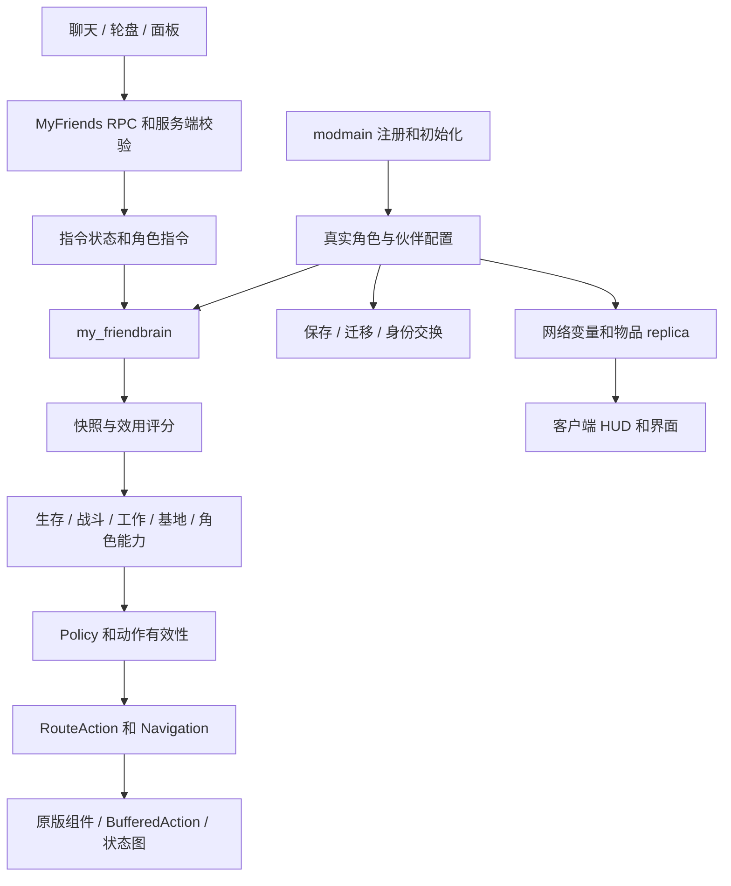

# 一路同行：架构与系统开发文档

本文面向维护模组、扩展角色和排查问题的开发者，介绍当前工作目录中的实现。它是代码阅读地图和规则说明，不代替实际代码；具体阈值、优先级与配方应以对应模块的常量和判断为准。

快速维护约束见 [AGENTS.md](AGENTS.md)，使用说明见 [README.md](README.md)，翻译流程见 [CONTRIBUTING.md](CONTRIBUTING.md) 和 [语言目录说明](scripts/languages/README.md)。

## 目录

1. [伙伴实体与运行边界](#1-伙伴实体与运行边界)
2. [架构与初始化](#2-架构与初始化)
3. [伙伴模式、家园和活动范围](#3-伙伴模式家园和活动范围)
4. [好感度、领队与权限](#4-好感度领队与权限)
5. [AI 评分、动作与中断](#5-ai-评分动作与中断)
6. [聊天指令、轮盘与工作任务](#6-聊天指令轮盘与工作任务)
7. [移动、寻路与平台](#7-移动寻路与平台)
8. [食物、容器进食与烹饪](#8-食物容器进食与烹饪)
9. [战斗、躲避与装备](#9-战斗躲避与装备)
10. [独立基地、农业与物资](#10-独立基地农业与物资)
11. [生存、社交与附属生物](#11-生存社交与附属生物)
12. [角色专属能力](#12-角色专属能力)
13. [死亡、复活与救援](#13-死亡复活与救援)
14. [存档、跨分片、换角色与附身](#14-存档跨分片换角色与附身)
15. [网络同步与界面](#15-网络同步与界面)
16. [语言、对白与声音](#16-语言对白与声音)
17. [模块索引](#17-模块索引)
18. [扩展步骤、排错与验证](#18-扩展步骤排错与验证)

## 1. 伙伴实体与运行边界

### 1.1 为什么运行角色与存档 prefab 不同

伙伴运行时是实际角色实体，例如 `wendy`、`wortox`、`wathgrithr`，保留原版角色组件、装备动作、状态图、饮食能力和专属物品接口。模组为它安装伙伴 AI，而不是另造一个只有角色外观的普通随从。

保存世界时，`modmain.lua` 的保存包装会把伙伴的记录名称映射为 `my_friend_<character>`。恢复时，[包装 prefab](scripts/prefabs/my_friend_characters.lua) 创建对应的真实角色，再安装伙伴配置并恢复状态。这样，移除模组后不会把世界中的伙伴记录误恢复成没有控制者的普通玩家。

`my_friend_wendy` 是旧存档使用过的名称，必须兼容保留。新增角色支持、改存档字段或调整保存包装时，都要同时检查 `my_friend_characters.lua` 和包装 prefab，不能只改生成逻辑。

### 1.2 伙伴身份与数量

- 默认角色是温蒂，由 `my_friend_characters.DEFAULT` 定义。
- 角色目录综合 `DST_CHARACTERLIST` 与 `MODCHARACTERLIST`，排除只能通过无缝转换到达的特殊形态。支持真实角色并不意味着每个模组角色都经过兼容验证。
- 伙伴增加 `my_friend`、`companion` 等标签，并标记 `_my_friend_is_companion`。普通玩家、附身中的真实玩家和临时停放的角色体不能混作伙伴。
- 伙伴从 `AllPlayers` 中移出，也不显示普通玩家跟踪标记；仍保留角色实体所需的原版基础组件。
- 当前分片用 `TheWorld._my_friend` 引用活动伙伴。地上首次创建、分片存在性检查、迁移记录和附身会话共同维持一个逻辑伙伴，不能把分片暂时没有实体视作需要重新生成。
- 首次生成位置优先选绚丽之门等入口附近。`FindFriend` 会寻找已有伙伴并处理重复实体；它不是每帧运行的物资扫描。

### 1.3 保留原版能力的含义

健康、饥饿、理智、潮湿、装备、伤害等主要仍由角色组件处理。模组针对部分能力补充初始化和行为调度，例如旺达年龄状态、温蒂的阿比盖尔、沃拓克斯灵魂、WX-78 电路。

当前配置为伙伴单独增加查理黑暗伤害免疫，但 AI 仍会寻找照明并遵守持灯工作规则。免疫黑暗伤害不等于免疫战斗、温度、饥饿或其他危险。

## 2. 架构与初始化

### 2.1 总体依赖关系



`modmain.lua` 是注册和接线层：资源、动作、状态图处理器、组件包装、RPC、玩家/世界/角色初始化及保存钩子均由它连接。具体规则优先放在职责明确的 `scripts/my_friend_*.lua` 中。

### 2.2 初始化顺序与幂等性

大致流程是：加载配置和语言 → 注册资产与角色包装 → 在角色两端创建一致的网络结构 → 主模拟端创建或恢复伙伴 → `ConfigureFriend` 安装组件、AI、事件和保存逻辑 → 客户端按 replica 更新显示。

`ConfigureFriend` 设置伙伴标识、移除玩家身份、添加 `follower`/好感度等组件，启用平台跳跃，配置角色能力、生存限制、装备和同步，然后安装 `FollowBrain`。各模块通常用 `_my_friend_*_configured` 标记避免重复安装。

同一实体可能由生成、恢复、迁移、附身恢复等路径进入配置，因此初始化不能重复叠加监听器、包装方法或周期任务。新能力应复用统一配置入口。

### 2.3 服务端和客户端

AI 决策、组件改动、库存转移、配方消耗和存档都由主模拟端负责。客户端负责读取网络变量、原版 replica，展示界面并请求 RPC。

伙伴使用真实玩家角色，因此一些原版延迟初始化和客户端监听器会误以为它始终拥有玩家库存或控制者。`my_friend_client_init.lua` 为听觉等生命周期提供清理与有效性保护；不要用“给所有回调加一个 nil 判断”替代追踪监听器归属。

## 3. 伙伴模式、家园和活动范围

“有没有领队”“有没有手动家园”“基地是否建成”“有没有任务”“是否为鬼魂”是不同维度，并非一个统一枚举。修改某个状态时要检查它们的组合。

| 情况 | 主要规则 | 入口 |
| --- | --- | --- |
| 跟随 | 以领队为常规活动参照，协战、补给、工作指令与生存共同调度 | `Policy.GetLeader`、跟随行为 |
| 独立建家 | 没有领队、没有禁止建家的家园状态、基地未完成时推进建设 | `BaseAI.EnsureBase/GetAction` |
| 已完成的自动基地 | 基地生活、存储、农业和有限外出，不再重复完整建家流程 | `BaseAI.IsComplete` |
| 手动新基地 `base` | 以玩家发令时的当前位置为中心、半径 32，视作完成基地，不重新规划自动建造 | `Home.Set/Apply` |
| 原地待命 `hold` | 固定中心活动，保留生存、救援等行为；自动暂留可保存原家园记忆 | `Home.Hold/Resume` |
| 晚加入 `roam` | 初次来到显示天数大于 200 的世界时不建家；允许必要外出找食物 | `Home.IsLateJoin` |
| 探索/钓鱼/领养 | 有限期的远行指令，搜索中心和活动范围处理与普通跟随不同 | `Policy.IsRoaming` |
| 领队死亡 | 保留领队引用，在死亡附近守候，不追随四处移动的鬼魂 | `Policy.UpdateVigil` |

常规跟随活动半径为 20，部分直接跟随/战斗检查使用 7，普通有效工作命令可把活动半径扩展到 32。设置基地不自动停止跟随；停止跟随后，手动基地的闲逛和常规路线边界均为半径 32，距中心超过 30 时触发返回判断；“原地待命”仍保留原有 40 单位路线边界。这些数字用途不同，不能互相代换。

`set_base` 直接保存玩家发令位置，不再选择冰箱、盐盒、锅或科技站作为新中心。`Home.Facilities` 在该中心 32 单位内发现并缓存设施，复用 `Discovery` 的事件失效机制；设置基地时做一次发现，后续移除、燃烧或新建设施使记录失效，不建立周期基地扫描。设施记录不改变归属和容器权限，锅、科技、冷藏与箱子的原有使用校验保留。设施实体引用属于临时缓存，存档仍保存中心坐标；读档按当前分片重建。已存档的旧中心保持原坐标，重新发出设置基地指令时应用新选点规则。

救援、记忆书架访问、战斗武器恢复、传送塔、搬运背包和死亡物资取回等动作带有专门路线标记，由 `Policy.GuardAction` 与 `Navigation.InTravelRange` 分别解释；它们不是通用“无限距离授权”。

晚加入还具有独立的拾取许可：未取得许可时，自主活动主要允许食物、草和树枝；`Home.UpdateAsk` 在合适时机询问附近玩家。明确任务与自主拾取的限制要分别检查。

## 4. 好感度、领队与权限

### 4.1 每位玩家独立记分

`components/my_friend_affinity.lua` 以 `userid` 保存好感度，默认 20，范围为 -50～100。当前源码有一个 `FIXED_USERID` 特例，`Get` 对它固定返回 100；排查“某玩家永远满好感”时必须检查这里，不能先假设是网络延迟。

| 行为 | 当前门槛或规则 |
| --- | --- |
| 喂食权限 | 好感度至少 0，另检查角色可食性和危险食物许可 |
| 拿取物资 | 好感度至少 20，仍受对应 RPC 的距离/状态校验 |
| 请求跟随 | 至少 25，并兼容浮点数临界误差 |
| 劳动指令 | `CanCommandWork` 要求严格大于 50 |
| 接受危险食物 | 至少 90 |
| 跟随优先层级 | 至少 90 为高优先级请求，其余合格请求为普通层级 |
| 改名 | 一次共享免费机会；用过后至少 80 |
| 附身/交换实体 | 专属校验通过且好感度至少 25；还需通过界面 RPC 校验 |
| 换角色 | 共享免费机会与后续领队/100 好感规则由 `Farewell.CanRequest` 判断 |

面板、换装、拿取和角色选择可能有独立校验，不应拿“能跟随”推导“所有管理操作都能做”。例如皮肤操作还检查好感度、角色形态与拥有信息。

### 4.2 多人跟随仲裁

`RequestFollow` 把最新请求移到队首。`UpdateLeader` 先选高优先级层级，再在同层级中选最新有效请求，而不是简单挑好感度数值最大的人。

因此 A/B 好感度为 30/50、伙伴跟随 A 时，B 发出有效跟随请求可以接替 A；如果当前有效请求中有人达到 90，则普通层级的新请求不能抢过高优先级。没有领队时会清除旧请求，防止旧的高好感记录持续锁住独立伙伴。

待命、停止跟随以及恢复家园会调整请求表和 `staying`。修改时同时检查聊天和轮盘，避免一条入口清理了旧请求，另一条仍保留。

### 4.3 好感变化与劳动扣费

喂食收益按实际健康、饥饿、理智变化计算；丢进库存的礼物、装备礼物、陪伴时间也有独立结算和冷却。食物礼物有 240 秒窗口，最多按前三件有效高价值物品结算；装备礼物有 480 秒窗口和加分上限。

在伙伴 8 格内累计陪伴 60 秒可增加 0.2 好感。玩家攻击伙伴会扣好感，原版 `Follower` 因受击自动解除跟随的路径还需由模组恢复仲裁。

工作命令通过 `Commands.Commit` 在实际开始劳动时校验并扣费，当前首次收费为 0.01。不要把收费挪到客户端按钮或每个连续挥砍动作上。

## 5. AI 评分、动作与中断

### 5.1 从快照到原版动作

`brains/my_friendbrain.lua` 注册行为候选，并构建包含领队、威胁、黑暗、温度、饥饿、修理、死亡和库存压力的快照。`behaviours/my_friend_utility.lua` 计算候选评分、排序，并让可执行的高分行为运行。

评分高只是候选资格；动作 getter 返回 nil、路线无效、对象失效或组件限制仍可能让候选失败，调度器会继续尝试其他行为。阅读代码时要沿着“评分 → getter → 动作有效性 → 状态图实际执行 → 成功/失败回调”追踪。

`Action(...)` 通常用 `RouteAction` 包装 `BufferedAction`；战斗、跟随、钓鱼等待等连续行为使用自己的行为节点。生存系统和角色能力也遵循这个入口，不应另起周期任务绕开调度持续抢动作。

### 5.2 代表性评分

下表是定位冲突时常用的基线，不是保证执行顺序；实际条件和作用域包装可能把评分降为零。

| 行为 | 代表评分 |
| --- | --- |
| 鬼魂复活/返回 | 150 或以上，具体由鬼魂指令决定 |
| 告别换角色 | 145 |
| 主动救援玩家 | 144 |
| 找回战斗装备；黑暗照明 | 140 |
| 受伤后退/等待 | 135/134 |
| 短时等玩家 | 133，仅安全条件成立时 |
| 角色专属命令 | 132 |
| 协战；直接战斗；逃离 | 128 / 125 / 124 |
| 紧急进食 | 122；其他进食评分随饥饿变化 |
| 追赶领队 | 110，包含距离和重新汇合条件 |
| 普通工作命令 | 通常 104；搬重物等有例外 |
| 独立基地 | 未完成通常 78，完成后通常 45 |
| 后期最低草/树枝补给 | 12 |
| 跟随闲置、守候、独立闲逛 | 通常 10 |

正在运行的行为并不会被高一两分的候选反复抢占：调度器有被动行为例外和超过当前行为 10 分的紧急抢占条件。新增行为需要同时考虑这一差值、状态图忙碌保护和作用域限制。

### 5.3 检查频率

- 普通决策约每 0.4 秒；忙碌期间约 0.15 秒。
- 全局快照缓存约 0.6 秒，连续工作也有独立的生存复查周期。
- 战斗通常每 0.1 秒，匹配攻击窗口、敌人带有攻击标签或伙伴正在普通攻击前摇时可每帧检查；危险躲避可中断普通攻击。
- 帧级战斗检查不等于帧级完整评分：战斗行为重排约每 0.1 秒，装备评估缓存 0.25 秒。
- `_my_friend_replan_requested` 用于指令变化、装备掉落等即时重新规划；实体归属、存活和关键状态仍需当场验证。

设施发现共用 `my_friend_discovery.lua`：按 32 格区域记录变化，查询结果（包括空结果）不靠短周期过期重扫；实体创建/移除、燃烧/熄灭、容器内容/开关、植物再生和晾晒完成才使附近相关类别失效。移动搜索有 4 格发现余量，移动超过余量才重新发现，实际动作仍按原范围检查。只保存资源坐标/数量记忆，不保存发现缓存、实体引用或变化计数；读档重建缓存。监听挂在被观察实体自身，无周期扫描任务；生成后的坐标只在一次延迟回调中核实。新增组件包装须保留原方法和完整返回值，并防止重复安装。

### 5.4 中断、失败与卡住

`Policy.IsBusy` 保护吃饭、复活、工作前摇等原版动作。不能为了“尽快执行新指令”在这些阶段随意 `Stop` 或强切 `idle`。

`RouteAction` 处理路线取消、局部接近重试和路径失败；`my_friend_progress.lua` 检测长时间没有移动或有效进展的行为，并通过已有失败回调释放锁。库存、容器、工作、搬运、钓鱼等模块应提供可重复调用的取消路径。

## 6. 聊天指令、轮盘与工作任务

### 6.1 一条消息如何执行

```text
客户端输入/聊天回显
  → my_friend_chat.Forward
  → MyFriends.ChatCommand RPC
  → 服务端 my_friend_chat.Dispatch
  → 定位活动伙伴或附身对应的 AI 身体
  → Commands.Dispatch：称呼、关键词、权限、角色分派
  → _my_friend_command
  → AI command 候选 / 专属候选
  → 动作 getter → Commit → RouteAction → 原版动作
```

客户端输入与聊天回显可能重复转发；服务器也可能同时收到原版聊天回调与 RPC，因此聊天模块在两个边界都处理跨来源去重。不能简单删除其中一条路径来修复重复执行。

### 6.2 解析和权限

消息包含伙伴当前名字和关键词即可被识别，名字可在开头、中间或末尾，也支持 `@`、角色 prefab、部分角色别名。中文主要按子串匹配，英文公共关键词有词边界判断，匹配时优先较长关键词。历史角色别名可在改名后继续使用，并非只接受新名字。

大部分工作需当前领队授权；跟随请求走自己的好感度仲裁。读书与薇格弗德 `lightning_spear` 是无需跟随的角色请求，传送塔、双尾心等另有专属路径。解析成功、权限允许、动作能执行是三个不同阶段。

轮盘通过稳定的 command ID 查找关键词，再调用同一分派逻辑，不能为轮盘另写一套执行规则。角色专属词库也进入轮盘目录；不同角色不会因目录中存在按钮就获得该角色能力。

部分中文聊天指令还经过约 3% 的台词拒绝分支；轮盘和奔雷矛专属指令有例外。遇到偶发一次不执行时，应检查 `MaybeRefuseChinese`，不要直接判断是丢包。

### 6.3 指令状态

`_my_friend_command` 常见字段包括 `id`、`player`、`started`、`deadline`、`special`、`recipe`，具体任务追加目标、阶段、批次数和等待标记。普通特殊任务常用 180 秒期限，钓鱼、探索等有自己的生命周期，不能把这个值视作所有任务的总时限。

`Commands.Get` 会校验玩家在线、命令期限及适用的领队关系。`Clear` 除清空字段外，还会关闭读书/容器流程、取消搬运/钓鱼、释放任务临时状态。新增任务不能只赋 nil 而漏掉自己的清理。

### 6.4 常见指令分组

| 分组 | 代表 ID 与执行模块 |
| --- | --- |
| 模式 | `follow`、`stop_follow`、`hold_position`、`wait_for_me`、`set_base` |
| 采集与挖掘 | `chop`、`mine`、`harvest`、`grass`、`dig_grass`、`dig_sapling`、`dig_stump` |
| 农业 | `seeds`、`hoe`、`water`，涉及整地、土壤和工具接线 |
| 特殊采收 | `rockfruit`、`bullkelp`、`monkeytail`、`banana`、`dry_meat` |
| 探索与生活 | `explore`、`fish`、`sit`、`ride`、领养宠物及其停止命令 |
| 库存 | `backpack`、`backpack_drop`、`tidy`、`equipment`、`carry_statue` |
| 角色与互动 | `food`、`ask_activity`、`touch_tower`、改名、告别换角色、角色专属指令 |

具体本地关键词以 `scripts/languages/<code>/command_words.lua` 及 `characters/*_command_words.lua` 为准。传送塔指令允许访问已激活的塔，但仍需检查目标有效性、寻路和传送交互状态。

## 7. 移动、寻路与平台

`Policy` 决定动作是否属于允许活动；`Navigation` 解决如何走；`RouteAction` 管理某一次动作的路径和生命周期；`Platforms` 与 `Wormhole` 处理船和传送连接。这四层不能互相替代。

`my_friend_navigation.lua` 提供地面/海洋/洞口检查、碰撞检查、接近点、不可达缓存、搜索预算及转向。基础搜索超时为 12 秒；局部重试、连续停滞和业务动作还各有期限。特殊业务的完整期限应从动作创建时开始计时，不能在每次重规划时无限重置。

`my_friend_route_action.lua` 在原版 `DoAction` 上补充路线搜索、步进、恢复移动、失败标记与清理。它也处理某些原版 idle 转换清掉移动动作的情况，避免重复提交已完成的动作。

跨船移动由 `my_friend_platforms.lua`、角色 `embarker` 和原版可行走平台协作；不能只用平面坐标推断可以跨水走直线。长期跟随、骑乘跟随和基地工作可能用不同的接近策略。

洞口检查使用向量对象并复用临时向量；不要给要求 `pt:Get()` 的原版接口直接传普通 `{x,z}` 表。

## 8. 食物、容器进食与烹饪

### 8.1 三类限制分别维护

| 限制 | 当前物品或条件 | 实现 |
| --- | --- | --- |
| 通用禁食 | 格罗姆黏液、普通曼德拉草、蜂王浆等既有禁用项；生高鸟蛋禁止直接吃 | `FoodAI` 的禁食表及 eater 包装 |
| 仅禁止 AI 选吃 | `deerclops_eyeball`、`minotaurhorn`；玩家直接喂食仍按原角色规则 | 主动进食禁用表 |
| 禁止入锅/配方限制 | 普通曼德拉、蜂王浆等保护食材；新鲜肉干与大肉组合限制 | `my_friend_food_rules.lua` |

原版角色可食性始终有效，例如薇格弗德只吃肉。食物能用于配方、能被原版 eater 接受、值得伙伴主动吃，是三个不同问题。不能把“眼球不主动吃”扩成所有玩家喂食、入锅和其他用途一律禁止。

### 8.2 主动进食评分

`my_friend_food_ai.lua` 根据角色吸收率、食物实际效果、当前三维缺口、浪费量、负面作用和新鲜度评分。常规健康、饥饿、理智需求的参考阈值分别为 90%、65%、60%，紧急阈值为 15%；具体执行还取决于优先级与状态。

普通治疗资格由 `my_friend_health.CanReceiveHealing` 共用判断：必须有 `health`，且没有 `oldager`、`health_as_oldage`、`cannotheal`、`_no_healing` 或 `health.canheal == false`。这覆盖旺达及使用原版年龄/不可治疗标识的模组角色，不根据 prefab、生命上限或任意伤害重定向函数猜测含义。沃拓克斯选治疗目标和 `FoodAI.CanHealWithFood` 复用该判断；沃姆伍德仍单独排除食物回血。丢魂和伙伴喂食回血还要求原版 `health:IsHurt()`，避免生命惩罚已满时仍因百分比偏低反复治疗。时间值角色不因显示值偏低而触发伙伴喂食回血，但仍可按饥饿需求接受食物。完全自定义、未提供这些标识的模组角色需要额外兼容，不能只凭数值判断为时间值。

食物至少要有有意义的恢复量，避免为了极小收益频繁吃冰、灯泡等。选食还会排除种子、锁定物品、宠物任务材料和需要归还的食物。补给量统计与实际选食共用禁用规则，避免把不能吃的物品误算成储粮。

眼球和犀牛角在饥饿、回血、低理智、吃饭指令和容器取食中都不得被 AI 选中。动作执行时再检查禁用和归属，防止缓存候选绕过规则。

### 8.3 食物存储与容器吃饭

`my_friend_food_storage.lua` 统一引用随身食物，并特殊识别自己携带的熊皮袋。普通库存、装备背包、熊皮袋和外部箱子不是同一种容器。

`my_friend_container_ai.lua` 负责寻找可用容器、打开或翻找、取食、份额记录和归还。`_my_friend_meal`、`_my_friend_container_action` 等字段表示一个跨动作的进食流程，不能在两个动作之间把容器锁当作遗留错误强行释放。

容器中的选择经过 `Evaluate/CommandScore`；已取出的份额和最终 `EAT` 动作也要校验禁用状态。中断后应执行归还或取消流程，不能一概把临时取出的物品视作伙伴永久财产。

### 8.4 烹饪范围和配方

当前只有“无领队、未禁止建家、基地尚未完成”的独立建家状态允许烹饪。跟随、手动基地、原地生活或自动基地建成后，不因附近有锅就自行继续做菜。角色料理指令进入具体执行时也要尊重适用的烹饪约束。

`my_friend_cooking_ai.lua` 负责烤制流程；`my_friend_recipe_planner.lua` 负责食材和配方估值；`my_friend_recipe_cooking.lua` 把计划推进为放料、烹饪、收取等阶段；锅的库存动作和兼容处理在 cookpot 相关模块中。

- `meat_dried` 在新鲜度不低于 50% 时保留；低于 50% 可入锅。
- 三份及以上大肉/烤大肉不能全部按受保护的新鲜大肉使用；过期风险较高的大肉可解除对应份额限制。
- 限制既用于计划阶段，也包装原版 `COOK` 在实际执行前复查，不能只改评分器。
- 薇格弗德允许料理时优先肉丸，降低炖肉汤的选择倾向；日常优先吃肉干。

## 9. 战斗、躲避与装备

### 9.1 找敌人和决定是否迎战

`my_friend_behavior_ai.lua` 管理威胁搜索、玩家攻击记录、协战目标、武器/护甲评分及胜算判断；`my_friend_combat_rules.lua` 管理共享的可攻击边界；`behaviours/my_friend_combat.lua` 执行接近、攻击、躲避和角色特殊战斗动作。

伙伴对已有仇恨关系迎战，并不无差别攻击附近中立生物或玩家。显示天数小于 500 时，扩大对伙伴和附近玩家已有仇恨生物的迎战范围，放宽通常的类型、低血量和胜算限制；第 500 天起恢复原有判断。猎犬与暗影威胁还有专门的优先迎战处理。

亮茄本体 `lunarthrall_plant` 只有处于 `tired` 虚弱阶段才允许攻击，避免反伤；这不禁止攻击藤蔓。共享攻击边界需要同时影响目标选择和实际动作，不能由某个专属角色绕过。

玩家攻击记录、同队关系、活动边界和目标有效性会影响协战。领队每次攻击都会刷新该目标的协战标记；最后一次攻击后保留 16 秒，由 `ASSIST_ATTACK_WINDOW` 统一控制攻击记录有效期、过期记录清理和协战候选期限，并非两次协战之间的冷却。排查“AI 有威胁却不攻击”时，还要检查武器恢复、紧急修理、受伤后退和状态图忙碌是否优先。

`FindThreat` 提供迎战/协战候选，不能直接作为逃跑依据。`FindEscapeThreat` 与它复用一次查询和缓存，只返回以伙伴为仇恨目标或近期实际伤害过伙伴的生物；两类目标独立排名，避免玩家的协战目标遮住伙伴自身的攻击者，并在使用缓存时重验个人威胁关系。逃跑评分、持续条件和 `RunAway` 取目标均走该入口。仅仇恨玩家的生物仍按现有规则决定是否迎战/协战；未通过战斗判断时不设置受威胁状态，不触发逃跑，也不因此取消钓鱼、容器操作或短时等候。通过战斗判断后仍可正常打断普通行为参战。

### 9.2 躲避流程

`my_friend_dodge_profiles.lua` 保存敌人 prefab、攻击动画、危险帧和移动参数；`my_friend_dodge.lua` 根据当前帧、距离、移速和地形计算躲避点。帧数据包括普通生物和巨兽，未收录或改版后不匹配的攻击保留通用躲避回退。

危险躲避先于伙伴普通攻击的 `abouttoattack`/`attack` 保护判断：有可用躲避点时，即使命中帧尚未到达，也清除待执行的普通 `ATTACK`，通过原版移动事件退出攻击，不强制切换 idle。没有实际危险时保持普通攻击；进食、救援和施法等 busy 动作仍受保护。恐怖尖喙等使用通用回退的敌人进入攻击时，同样可打断伙伴的反击承诺，不能等整个伙伴攻击状态结束才考虑躲避。

攻击窗口可按 30 Hz 观察，但避免把昂贵工作一起提高到这个频率：

- 局部障碍物查询使用半径 8 的缓存，通常 250 毫秒刷新，明显位移或上下文变化时失效。
- 同一次计算的多个方向备选共用障碍列表；地面与船边界仍逐步验证。
- 部分巨兽的特效查询也缓存 250 毫秒，不在多个帧参数回调里重复扫描。
- 相同躲避目标不重新提交原版寻路，变化目标的提交至少间隔 150 毫秒；中断新一次普通攻击时可立即提交移动。
- `CanContinueCombat` 缓存装备决策，丢武器、目标失效和关键身份变化仍即时检查。

这些都是局部检测，不是每帧全世界扫描。扩展帧表后要检查回调是否暗中引入新的高频实体查询。

环境撤离由实际扣血事件触发，优先级独立于普通受击后退。`healthdelta` 中带有有效 `afflicter` 的伤害不能一概忽略：启用中的 `aura` 范围伤害按组件半径处理；无生命组件的环境实体伤害和无来源的地面伤害使用接触位置。普通生物攻击、物品/自身代价、附身于伙伴的减益、饥饿、寒冷、年龄和酸雨等不因此成为地面危险区。局部热源只在热伤害时查找，火源只在火伤害时查找，同类查找间隔至少 1 秒；未找到局部热源时仍走温度生存逻辑。

身处已记录危险区时，撤离/无路等待评分为 170/169，压过战斗、协战、治疗和换装；普通受击后退仍为 135/134。受伤事件请求重新决策，战斗快速路径和排队攻击也检查当前位置安全。普通攻击通过原版动作取消和移动退出，进食、工作、救援和施法等 busy 状态仍先完成，不能强制切换状态图。

未知危险区按首次接触点记录半径 6，后续受伤刷新 8 秒期限但不拖动撤离起点；已确认的活动范围伤害源保留到停用/移除，火源保留到熄灭/移除。撤离目标在危险边界外额外留 1 格，失败或仍在危险区内的提前到达不能当作撤离成功，应清除旧目标、尝试其他方向并维持撤离。离开后不立即遗忘，战斗接近、帧表躲避和冲刺不主动穿过已记录区域；能从安全位置攻击时仍可反击。这里只复查记录和线段几何，不增加周期实体扫描；临时记录不写入存档。

### 9.3 战斗武器掉落恢复

装备/卸装/掉落事件记录实际物品，保存在 `_my_friend_combat_recovery_item` 等字段中。优先恢复附近 8 格内的那件物品，不按同名 prefab 扫描替代品，备用斧头或徒手状态也不能覆盖原武器记录。

恢复评分 140，用于压过正在运行的协战；一次拾取连同寻路最多 10 秒，失败后 5 秒重试，被其他行为中断后至少等 1 秒。归属变化、物品失效、平台不同或空间不足会阻止恢复。

原版 `PICKUP` 在手空等情况下可能自动装备。成功回调必须先检查手槽，不能再对同一物品调用 `Equip`。原版 `Equip` 先移除原归属，随后遇到旧装备与新装备相等时可能不重新赋槽，造成物品在 LIMBO 中“消失”。伙伴的库存包装也为相同装备提供幂等保护。

### 9.4 常规装备仲裁

`my_friend_equipment.lua` 统一考虑保温/降温、防雨和移速，避免多个系统反复互相换装。常规换装有 10 秒冷却和明显收益要求，战斗时让位给战斗装备系统；玩家主动卸装、照明、工具工作和搬重物也会锁住相应槽位。

防雨按整套装备及角色自身防雨累加到 100%，评分只计候选槽位对剩余缺口的贡献，当前装备与库存候选使用相同规则。优先考虑能单件补足保护的槽位；已经穿有单件全防雨装备时，先处理其余槽的冗余雨具，再评估该槽，避免同时释放而留下多件部分防雨装备。达到上限后不为额外防雨加分，纯冗余雨具遵守原有空闲释放/冷却和玩家卸装规则；仍承担保暖、隔热、移速或其他受保护用途的装备不因防雨冗余被强制卸下。战斗护甲继续优先于环境收益。

战斗选装按组件能力处理多功能装备，不按物品名称或防雨、隔热、照明用途排除护甲。所有非手持槽先比较护甲对当前攻击者和武器的有效减伤率；减伤相同时，复用常规装备评分比较当前温度、防雨需求和战斗移速收益，再比较剩余护甲耐久，完全相同则保留当前装备。温度、防雨等附加用途不能覆盖更高减伤，也不能让普通衣物优先于可用护甲；损坏、耐久耗尽、角色受限、物品锁定或不归伙伴所有的护甲不参与选择。照明燃料耗尽本身不使仍有防御能力的护甲失效。

启迪皇冠 `alterguardianhat` 保留日常偏好，但战斗中只有头槽没有可用护甲时才作为回退；其他槽没有可用护甲时保留原衣物。日常不会因白天或已有外部光源收起皇冠，保温、防雨的实际收益仍可覆盖该偏好。照明维护和照明动作入口在有威胁、战斗目标或短时战斗手槽锁时均让位，防止灯帽/手持灯在两次战斗评估之间抢回槽位；战斗锁解除后恢复常规照明和日常换装。战斗选装共用一次随身库存快照，不增加世界扫描。

修理扫描与负载评估有独立缓存；`my_friend_basic_equipment.lua` 与 `my_friend_equipment_reserves.lua` 分别处理基础装备准备和保留。不要为了一把武器可用，就把正在照明或承担温度保护的手持物无条件换掉。

## 10. 独立基地、农业与物资

### 10.1 建家阶段

`my_friend_base_ai.lua` 是当前最大的业务调度模块，内部仍有选址、建造、资源需求、工作动作、库存压力和存档。新增功能应先找已经拆出的模块，避免继续把所有逻辑塞进去。

`GetConstructionPhase` 按现状计算主要阶段：

```text
选址 → 科学机器 → 背包 → 箱子 → 移植草/树枝 → 石头火坑 → 完成
```

阶段检查不是无条件线性执行：已存在设施、材料、背包、食物、生存危险和地形会影响下一步。当前目标包括 4 个基地箱子、草和树枝各 30 株移植目标。手动新基地会直接标为完成，不能套用上述自动规划。

选址和远程找资源会使用地形、节点、危险和不可达缓存；无合适地点时等待再试，不应每帧重新全图选址。

### 10.2 资源来源与记忆

`my_friend_crafting_materials.lua` 可以为普通制作规划地面/容器等外部来源；`my_friend_crafting_tech.lua` 负责科技站接近和激活。明确要求“只用随身材料”的角色指令不能复用外部取材计划。

`my_friend_resource_memory.lua` 记录观察过的资源区域，当前网格为 16，最多保留 64 格、有效期约 960 秒，按坐标、数量和剩余记忆年龄保存。远程找资源先解析记忆区域，再在必要时做一次全实体回退。空结果不再每 8 秒重扫；需求类别、库存、搜索位置（移动 8 格）、基地/家园/领队、工具可用性或季节变化，以及对应资源生成/再生、失败冷却到期才开始新一轮发现。危险生物离开时仅重验已发现资源候选，最多每 2 秒复查，不为此重新遍历全世界。

所属背包通过归属/读档登记进入分片局部弱引用索引，旧对象只做一次全实体兼容引导，找不到后不再每 2 秒重复扫描；重新归属、清除、移除等变化直接更新或淘汰记录。基地建筑查询复用同一份区域发现，不再为科技、箱子和火坑各扫一次。自动收晾肉架与顺手整理复用相关设施发现，空闲无变化时不重复搜索；库存、容器或晾晒状态变化会唤醒，整理也保留礼物保护期限、失败冷却和第 151 天规则变化后的重试。

`my_friend_resource_safety.lua` 在采集动作和受伤之间建立关联，临时阻止反复去危险资源点；默认重试延迟为 60 秒。死亡物资取回的安全判断由独立模块处理。

### 10.3 第 151 天后的库存策略

世界 `cycles` 从 0 开始。`Reserves.IsLateWorld` 在 `cycles + 1 > 150` 时成立，即显示第 151 天起。

此时停止通常的草、树枝、石头、金子等材料囤积和通用补库存，只通过低评分 12 的 `late_minimum` 尽量补足 10 草、10 树枝。整理和存储使用同一最低保留规则，避免一边存走、一边又捡回来。

具体任务的配方材料、角色资源、照明和生存需求仍由各自模块处理；“停止通用囤积”不能解释为“正在建造的东西也不许收集材料”。

### 10.4 农业、林业和工作掉落物

`my_friend_garden.lua` 处理花园植物和肥料供给，`my_friend_farm_tiles.lua` 处理农田布局与地块；`my_friend_fertilizer_search.lua` 管理顺路或定向找肥料。

基地种植区的设施发现和统计按植物新增、移除、采集、施肥、再生等变化失效，不再每 3 秒重扫全区；已记住植物仍在执行动作前检查成熟、枯萎和可施肥状态。没有原版通知的再生/旧式晾晒完成通过保留原函数的幂等包装发出失效通知。

`my_friend_forestry.lua` 管理独立林区、成熟树批次、树桩和补种，当前树木目标为 20、批次为 5。布局和状态可保存，不能每次闲逛都重建林区。

`my_friend_chop_loot.lua` 与 `BaseAI` 工作收尾跟踪本次劳动掉落物。工作连续挥砍、最终一击、采集等待窗口和背包压力必须协同，避免树砍完却没有收拾掉落物，或把已经完成的旧动作再次排入。

## 11. 生存、社交与附属生物

### 11.1 照明和温度

`my_friend_light_ai.lua` 决定是否黑暗、可用灯具、光源、燃料和临时照明；`my_friend_survival_ai.lua` 决定温度避难、保温/降温装备和必要物品。手持照明与工具、战斗武器有真实冲突，需要通过装备锁和动作资格处理。

温度判断具有开始/恢复的不同阈值，装备也使用滞回，避免在临界值每帧穿脱。`Equipment.UpdateLoadout` 统一仲裁常规装备，不应重新增加独立的防雨、保温、加速换装循环。

### 11.2 社交与物品互动

`my_friend_social_ai.lua` 包括与不熟悉玩家保持距离、提醒领队三维状态等；`my_friend_core_ai.lua` 包括问候、连续顺路收集和堆叠维护；`my_friend_gifts.lua`、`my_friend_item_reactions.lua`、`my_friend_feeding.lua` 连接玩家给予、喂食和物品反应。

`my_friend_feed_player.lua` 是伙伴喂玩家的独立行为，不应与玩家喂伙伴混淆。问候只在合适的闲置阶段暂停，不能因工作中的角色瞬间出现 idle 标签就中断任务。

### 11.3 背包、重物与库存整理

普通物品栏、装备背包、熊皮袋、外部容器和手上活动物品分别有归属规则。`my_friend_inventory.lua` 提供操作基础；`my_friend_equip_slots.lua` 统一兼容装备槽；`my_friend_backpacks.lua` 处理背包所有权、取回和制作。

`my_friend_carry_backpack.lua` 与 `my_friend_command_carry.lua` 管理搬重物前后暂放/取回背包以及多动作取消。玩家明确拿走装备与意外掉落必须区分。

`my_friend_tidy.lua`、`my_friend_storage.lua` 和容器兼容模块处理分类、取材和整理。打开箱子、临时借用物品、堆叠拆分、同类合并及归还义务不能仅凭 prefab 相同就合并为一个状态。

### 11.4 皮弗娄牛和宠物

`my_friend_beefalo.lua` 处理饥饿、服从与供给；`my_friend_riding.lua` 处理骑乘请求、上下牛、追赶和受击时的骑乘策略；`my_friend_exploration_riding.lua` 将骑乘适配到远行。绑定牛的存档与库存迁移另见第 14 节。

`my_friend_pets.lua` 管理领养任务及其材料，`my_friend_pet_care.lua` 在空闲合适时机喂自己的宠物。`my_friend_offscreen.lua` 每 2 秒检查伙伴所属附属生物，过远时作有限返回保护，避免其永久留在卸载区域；不能拿这个模块实现每帧任意实体传送。

## 12. 角色专属能力

### 12.1 温蒂和阿比盖尔

`my_friend_wendy.lua` 管理阿比盖尔主动/防守模式，请求后有 120 秒手动行为保护；随后可根据战斗状态自动调整。

`my_friend_abigail.lua` 以温蒂的 `ghostlybond` 为归属入口，管理召唤、收回、皮肤、重复实体清理和身体状态保存。阿比盖尔的等级、最大生命和当前生命必须随正确身体转移；原版刚生成时的默认等级不能覆盖已保存的高等级生命。

只有温蒂进入该流程，其他角色不应注册阿比盖尔周期任务或清理。换皮授权也有独立好感条件。

### 12.2 沃拓克斯

`my_friend_wortox.lua` 处理灵魂、玩家治疗、双尾心和伙伴制心：

- 以主物品栏中的灵魂为统计对象，目标 18 个。
- 超过 18 的部分尝试放入随身 `wortox_souljar`；罐满后停止，不附带额外处理。
- 少于 18 时从罐子取回，但不能把灵魂塞进背包或因溢出丢失物品。
- 主物品栏灵魂多于 10 且饥饿低于 65% 时，优先用灵魂进食。
- 只有沃拓克斯伙伴初始化玩家血量监听和每 30 秒的兜底检查；治疗调度均在专属脚本中。玩家真实血量发生变化时，先检查是否位于伙伴周围 10 单位内，再读取治疗资格与血量。低于 80% 加入候选，达到 80% 停止；远处或血量未变的通知不触发治疗。
- 兜底只查询伙伴当前位置周围 10 单位的玩家，处理进范围前已受伤、没有新血量通知的情况。仅初始化订阅时遍历一次 `AllPlayers`；之后通过加入/离开和实体移除事件维护监听。动作评分/生成只复查已触发候选与当前目标，不反复遍历全服玩家血量。候选、实体引用、监听和任务不写入存档，读档重建；伙伴移除时取消任务和外部监听。
- 保留领队优先、其次选择候选中最低血量玩家、走近约 4 单位后在自己脚下丢单颗魂、等待原版治疗延迟再继续的流程。目标离开 10 单位、死亡、不可见或不再接受普通治疗时中止。战斗、生存、忙碌、指令和库存操作限制继续生效；附身停放/退场期间不治疗，暂停的检查不查询玩家。已选丢魂动作在自己的 busy 动画中仍可执行，不能在 validfn 中重复使用选动作时的 busy 门槛。
- 原版灵魂吸取与实际范围治疗结算保持原有机制，与伙伴发现治疗目标的调度分开；制心与救援共用相关校验。
- 双尾心关联角色和显示名需要在附身、退场、恢复期间重新校验；网络字符串不能写 nil。

### 12.3 旺达

`my_friend_wanda.lua` 恢复原版年龄状态，调度回血表、复活表、警钟补燃料和绝望石相关行为。年龄不是普通健康值，不能直接用其他角色的回血与伤害估值套用。

治疗参考年龄阈值为 73，65 之后还有带冷却的可选治疗判断；具体行动仍需检查表、冷却和随身归属。复活玩家交给统一救援候选，不需要先跟随。

### 12.4 薇格弗德

`my_friend_wathgrithr.lua` 包含战斗和奔雷矛交互：

1. 装备普通或充能奔雷矛时，实际普通攻击事件累计四次后使用一次闪电冲刺。
2. 耐久低于 10% 进入仅冲刺模式；超过 20% 才恢复普通攻击循环，避免临界状态来回变化。
3. 使用原版冲刺武器回调和 `combat_lunge_start`，保留冷却与修复机制；等待冷却时不偷偷回退普通攻击。
4. 限制的是当前攻击目标：如果目标具有会被电击点燃的状态图标记、能燃烧且无永久免疫，就不对它冲刺。附近树苗、作物或一般植物标签不能阻止冲刺。
5. 每五个游戏日向当前领队询问奔雷矛或材料；询问后 30 秒内识别拒绝关键词并回复。台词通过语言目录提供多个变体。

“名字＋奔雷矛”是角色专属指令，聊天和轮盘共用 ID `wathgrithr_lightning_spear`，执行类型为 `lightning_spear`，无需跟随：

```text
检查随身制作材料
  → 足够：只制作一柄；不足：跳过制作
  → 再找随身/手持未充能奔雷矛和一份约束静电
  → 优先手持武器，安全卸装到空位
  → 用原版 upgradeable 消耗一份静电并替换成充能矛
  → 必要时重新装备，结束命令
```

制作使用原版 builder 消耗，但同步调用期间排除已打开的外部容器，避免原版取材优先消耗箱子。升级保留皮肤、耐久和冷却，空位不足时停止提示；不重复批量制作、不取箱子、不自动采材料，也不永久修改技能树标签。

### 12.5 维克巴顿

`my_friend_books.lua` 负责读书、找书、存书；`my_friend_bookstation.lua` 负责书架制作/放置准备；`my_friend_wickerbottom.lua` 专门保存基地书架记忆。

设置新基地时复用中心 32 单位内的设施发现结果记录有效书架，保存坐标，避免重复扫描。读书和放书优先用记录，不因为当前距离远就直接失败；必要时先走到记录位置，再在约 3 单位内核实对应实体。失败的坐标访问在本条读书指令中不再重试，随后允许寻找其他书架。

没有书架记录，或已有书架中没有所需的可用书时，每条读书指令最多补扫一次基地。伙伴在基地外（包括尚未设置基地），或基地记录/补扫仍不能提供可用书时，再以伙伴当前位置为中心补扫一次半径 20 的书架。附近书架必须进入实际选书、开柜和读书流程，不能只记录而在基地范围过滤中丢弃；只剩最后一次耐久的保护、容器限制和被其他玩家占用的限制保留。两处搜索均无可用书时沿原入口回复并结束指令，不因为后续 AI tick 或移动继续扫描。

附近发现且位于基地 32 单位内的书架纳入基地坐标记忆；基地外书架只放在本条读书指令的临时记录中，不写入存档、不供日常自动存书使用。`Guard` 与 `InTravelRange` 共用动作标记，书架访问允许沿动作起点到目标之间、两侧最多 8 单位的有限路线通行，避免从基地外返回书架时第一步即被基地圆圈拒绝；这不扩大常规基地范围。没有周期性全基地刷新；书架被移除、烧毁或原坐标无法解析时清理记录。新基地替换旧记录，跨分片保存各自位置，只允许维克巴顿进入该行为。

### 12.6 沃利、沃姆伍德、WX-78 与其他角色

- 沃利的便携设备、料理与调味由 `special_commands`、`special_actions`、`device_deploy` 和食谱模块组合实现，没有要求每个角色都有同名专属模块。
- 沃姆伍德不能按通用食物回血处理，`my_friend_wormwood.lua` 在受伤时检查随身治疗物品并生成 `HEAL`；一般检查间隔为 3 秒，避免地面/箱子扫描。
- `my_friend_wx78.lua` 保存恢复电路、充能和技能解锁插槽；恢复插槽前需要先恢复技能。不要通过反复弹出电路制造副本或扣除重复费用。
- `my_friend_skills.lua` 桥接技能树保存和 NPC 初始化，与玩家登录握手区分；附身返回真实玩家时允许等待握手后恢复。
- 没有专属 AI 的角色仍受通用系统和原版角色组件约束，不能因此宣称所有能力已完整自动化。

## 13. 死亡、复活与救援

### 13.1 伙伴自己死亡

`my_friend_revive_ai.lua` 管理伙伴死亡、复活准备、复活后物资恢复和送回基地。`components/my_friend_death_drop.lua`、`components/my_friend_remains.lua` 跟踪掉落或遗留物；`my_friend_ghost_commands.lua` 管理鬼魂寻找可用复活点、玩家指令和复活后返回。

死亡恢复使用自己的范围、安全和优先级标记，不能与战斗中掉落武器取回共用一个实体字段。复活后优先找回实际死亡物资，真正饥饿等紧急情况仍可抢占。

### 13.2 伙伴主动复活玩家

`my_friend_rescue.lua` 统一调度附近 20 格内可复活玩家，评分为 144：

- 优先尝试可用旺达复活表。
- 其次使用告密的心；其他条件下可以放下供玩家作祟的复活物品。
- 沃拓克斯具备条件时可制心后继续救援。

跟随、原地待命、基地闲逛和独立活动都可以触发，不要求玩家是领队。仍会检查施救者忙碌、威胁、物品归属和玩家是否已复活，并有目标重试冷却。

动作携带 `_my_friend_rescue_target`，路线可以在受控范围内离开普通基地/跟随边界。不能只提高评分，却让 `Policy` 或 `Navigation` 把动作再次拒绝。

## 14. 存档、跨分片、换角色与附身

### 14.1 保存内容分工

原版组件负责角色三维、物品等基础保存；`ConfigureFriend` 包装的 `OnSave/OnLoad` 汇总伙伴标志、名字、皮肤、基地、家园、资源记忆、探索、角色能力、冷却等状态。好感度等真正的组件还有自己的保存方法。

`_my_friend_*` 命名不代表字段自动持久化。新增字段必须明确属于哪一类：

| 状态 | 保存方式 |
| --- | --- |
| 跨重进需要的业务状态 | 写入对应模块的 Save/Load 或组件 OnSave/OnLoad |
| 绝对时间冷却 | 优先保存剩余时长，恢复后换算，避免跨会话 GetTime 差异 |
| 地图位置/书架/基地 | 保存坐标和适用分片，不保存运行时实体指针 |
| 路线搜索、动作、临时锁、躲避帧 | 不持久化；离开/恢复时清理或重新规划 |
| 与身体绑定的能力 | 随对应身体保存，如阿比盖尔、电路、技能和双尾心关联 |

旧存档可能缺少新字段；必须提供默认值，字段改名需要迁移或兼容读取。

### 14.2 地上/洞穴迁移

`components/my_friend_traveller.lua` 把跟随者状态携带在玩家迁移数据中；`my_friend_migration.lua` 处理附加、暂留和分片局部记忆选择；`my_friend_shard_home.lua` 处理返家、跨分片数据分块、确认和存在性探测。

`LOCAL_FIELDS` 是基地/家园等分片相关字段的集中清单，增加坐标状态时必须检查这里。迁移前先清动作、关闭容器并解除源端实体；目的端按记录重建。跨分片暂时不存在实体时，要考虑 traveller 中的记录、待确认数据和附身会话，防止补生成第二个伙伴。

### 14.3 物品和绑定牛

`my_friend_inventory_transfer.lua` 集中处理库存 Capture、SaveAndClear、Load。牛铃的保存记录可能包含绑定的皮弗娄牛；若只删除牛铃或源身体而保留源牛，目的端会再生成一头。

因此清理顺序要处理关联动物和牛铃回调，再删除旧物品；恢复使用原版回调建立绑定。不能在两个身体/分片都直接加载同一份物品记录而未清除源实例。

### 14.4 换伙伴角色与交换玩家身体不同

普通换角色走 `my_friend_farewell.lua` 和 `my_friend_switch.lua`。旧伙伴先告别、离开玩家视野，再完成交接；玩家可以决定留下或带走物品。当前这是新角色到来的流程，不等于继承原伙伴全部好感度和基地状态；共享免费换角使用标记需按代码保留。

附身/交换实体则走 `my_friend_possess.lua`：真实玩家借助原版 seamless swap 控制伙伴身体，旧玩家身体被重建为 AI 伙伴。会话记录绑定 `userid`，并有进入、退出和重载等阶段，而不是简单交换两个实体变量。

### 14.5 快速换回与自动保存边界

`CanPossess` 会拒绝加载中、已有会话、退场中或停放身体等状态。`Rebind` 在玩家新实体出现后恢复会话，退出完成前不能重新把新玩家标成伙伴。

客户端旧组件的延迟任务可能晚于旧实体销毁；需要重新检查实体、库存 replica 和组件归属，并移除旧监听器。自动保存期间还要避免同时存在两份可保存身体或重复装载同一背包。

排查这类崩溃要联合阅读 `my_friend_possess.lua`、`my_friend_client_init.lua`、角色专属保存模块和原版回调栈；服务端仍运行不代表服务端状态切换就没有触发客户端失效路径。

## 15. 网络同步与界面

### 15.1 面板数据

`modmain.lua` 创建伙伴身份、三维/潮湿、外观及玩家好感等网络字段，面板从这些字段与 `replica.inventory/container` 获取显示。三维面板以约 0.5 秒任务检查，但内容不变时不重新写 net string。

伙伴没有拥有库存的普通客户端，`my_friend_replication.lua` 因此发布库存相关 classified 数据，让其他客户端可以读取；它不赋予直接改库存的权力。同步周期约 1.5 秒，物品集合签名与事件监听用于避免无变化重发。

### 15.2 界面模块

`widgets/my_friend_panel.lua` 展示三维、物品、装备、背包和管理操作；`my_friend_command_wheel.lua` 处理轮盘、目录和分页；`my_friend_hud_buttons.lua` 处理 HUD 入口；`screens/my_friend_character_screen.lua` 和 `my_friend_skin_screen.lua` 处理选择界面。

背包槽应通过 `my_friend_equip_slots.lua` 解析，不能假设所有模组只使用原版 BODY 槽。大背包滚动要复用可见控件，不要为每个远端槽永久创建高成本 UI。

### 15.3 RPC 校验

`MyFriends` 命名空间下包含聊天/轮盘、面板开关、物品点击/快速转移、装备、改名、换角、皮肤和实体交换等 RPC。跨分片还有 `HomeChunk/HomeAck/PresenceProbe/Presence`。

普通管理入口 `CanManage` 默认检查约 10 格距离、活动伙伴身份及领队关系；某些公共或改名操作有明确例外。最终仍由对应行为检查好感度、物品归属、角色和忙碌状态。

所有参数均来自客户端，需要服务端检查类型、索引、实体有效性及授权。客户端按钮置灰、客户端拥有皮肤报告和面板文本都不能代替这些检查。

## 16. 语言、对白与声音

### 16.1 语言文件分工

`my_friend_language.lua` 加载语言文件，`my_friend_strings.lua` 提供当前语言和文本接口。当前目录有 `zh`、`zh_tw`、`en`、`ru` 与 `_template`。

| 文件 | 用途 |
| --- | --- |
| `command_words.lua` | 通用 ID、关键词和轮盘标签 |
| `characters/<character>_command_words.lua` | 角色命令和书籍别名等角色词汇 |
| `dialogue_lines.lua` | 共享台词 |
| `characters/<character>.lua` | 角色台词和语音映射 |

缺失语言资源有中文回退；角色台词查询还可回退到温蒂默认台词。翻译保留 ID、键和 `{1}` 占位符，每个文件只放对应语言。

### 16.2 对白传输

`my_friend_dialogue.lua` 决定何时说、对谁说、台词冷却和队列；`my_friend_speech.lua` 注册字符串表，将台词 key、索引和参数通过原版 talker chatter 传到客户端解析；`my_friend_voice.lua` 负责声音。

普通对白是附近聊天/气泡路径，入场、告别等部分消息可用世界公告。语音独立挂载在伙伴声音发射器上，公告文字是全服可见不意味着应该全服播放无衰减声音。

### 16.3 自定义语音编号

中文和繁体中文可用自定义语音，其他语言沿用原角色声音。`voice_order` 项使用 `{"key", line_index, fn_number}` 明确绑定事件，不能因整理台词顺序重排旧音频编号。

每银行 70 个事件，路径 `fsN/fsN/fnK` 的 `K` 跨银行连续，例如第二银行从 `fn71` 开始。新增银行需要对应 `.fev/.fsb` 和 `modmain.lua` 资产注册，不能只有映射没有资源。

### 16.4 FMOD 距离问题

代码通过伙伴自身 `SoundEmitter` 播放自定义事件，音量乘数不负责把二维事件变成三维事件。3D 模式、衰减类型和距离曲线属于导出的 FMOD 事件配置。

反距离衰减的 `3D Max Distance` 通常是停止进一步衰减的距离，不是声音硬截止距离；超过它仍可能保持可听音量。要在远处静音，可配置合适的线性衰减或归零的距离音量曲线，并在所有银行统一配置、重新导出实际加载的资源后完整重启客户端验证。

此规则解释声音参数，不表示仓库会自动改写二进制银行。维护 Lua 时不得无关修改用户制作的 `.fev/.fsb`。

## 17. 模块索引

下表补充正文中的入口。文件位于 `scripts/`；同组多个文件代表分工协作，不意味着某一个文件包含整组全部逻辑。

### 17.1 运行、AI 与兼容

| 模块 | 职责 |
| --- | --- |
| `my_friend_characters.lua`、`prefabs/my_friend_characters.lua` | 角色集合、默认角色、包装命名与重建 |
| `brains/my_friendbrain.lua` | 行为注册、评分作用域、快照、跟随/闲逛组装 |
| `behaviours/my_friend_utility.lua` | 选择、中断、连续工作和频率控制 |
| `behaviours/my_friend_route_action.lua` | 单次业务动作的路线与执行生命周期 |
| `behaviours/my_friend_combat.lua` | 战斗行为循环 |
| `my_friend_policy.lua` | 玩家/领队身份、活动范围、动作守卫与忙碌判定 |
| `my_friend_navigation.lua`、`my_friend_platforms.lua`、`my_friend_wormhole.lua` | 路线、船与平台、传送连接 |
| `my_friend_progress.lua` | 进展记录、停滞恢复与释放动作锁 |
| `my_friend_client_init.lua` | 客户端组件延迟回调和身体切换清理 |
| `my_friend_work_states.lua` | 原版工作状态的伙伴适配 |
| `my_friend_shadow_compat.lua` | 暗影相关实体的伙伴兼容登记 |
| `my_friend_offscreen.lua` | 伙伴所属生物离屏与返回保护 |
| `utils.lua` | 现有公共辅助代码；新增工具前先确认调用者和运行环境 |

### 17.2 指令与交互

| 模块 | 职责 |
| --- | --- |
| `my_friend_chat.lua`、`my_friend_commands.lua` | 聊天转发去重、寻址、权限和统一分派 |
| `my_friend_special_commands.lua`、`my_friend_special_actions.lua` | 角色命令解析、特殊制作/读书/料理动作 |
| `my_friend_command_work.lua`、`my_friend_command_gather.lua`、`my_friend_command_dig.lua` | 劳动执行、采集和挖掘任务 |
| `my_friend_command_hoe.lua` | 锄地/整地指令 |
| `my_friend_command_special_gather.lua` | 石果、海带、晾晒等特殊采收处理 |
| `my_friend_command_carry.lua`、`my_friend_carry_backpack.lua` | 重物搬运与暂放背包恢复 |
| `my_friend_command_butterfly.lua`、`my_friend_butterfly.lua` | 捕蝶指令与生存捕蝶 |
| `my_friend_command_tower.lua` | 传送塔目标、接近和交互 |
| `my_friend_character_actions.lua` | 角色专属原版物品动作接线 |
| `my_friend_exploration.lua`、`my_friend_exploration_riding.lua` | 远行探索和骑乘适配 |
| `my_friend_fishing.lua`、`behaviours/my_friend_fishing.lua` | 钓鱼任务和等待行为 |
| `my_friend_sitting.lua`、`my_friend_emotes.lua` | 坐椅和表情互动 |
| `my_friend_feeding.lua`、`my_friend_gifts.lua`、`my_friend_item_reactions.lua` | 玩家喂食、礼物与物品反应 |
| `my_friend_feed_player.lua`、`my_friend_social_ai.lua`、`my_friend_core_ai.lua` | 伙伴喂玩家、社交提醒与基础维护 |
| `my_friend_names.lua` | 名字相关资源与辅助 |

### 17.3 食物、库存、生产

| 模块 | 职责 |
| --- | --- |
| `my_friend_food_ai.lua`、`my_friend_food_rules.lua` | 选食与食物禁用、烹饪许可和实际入锅约束 |
| `my_friend_food_storage.lua`、`my_friend_container_ai.lua` | 随身食物引用、容器进食与归还 |
| `my_friend_recipe_planner.lua`、`my_friend_recipe_cooking.lua` | 食谱估值和料理阶段推进 |
| `my_friend_cooking_ai.lua`、`my_friend_cookpot.lua` | 烤制与锅交互 |
| `my_friend_cookpot_cleanup.lua`、`my_friend_beefalo_cooking.lua` | 锅清理及皮弗娄牛相关供给料理 |
| `my_friend_device_deploy.lua`、`my_friend_crafting_tech.lua`、`my_friend_crafting_materials.lua` | 便携设备部署、科技与取材 |
| `my_friend_inventory.lua`、`my_friend_equip_slots.lua`、`my_friend_backpacks.lua` | 物品操作、装备槽与背包所有权 |
| `my_friend_discovery.lua` | 按区域与事件失效的设施发现、空结果缓存、资源变化与库存版本 |
| `my_friend_container_compat.lua` | 容器接口兼容 |
| `my_friend_storage.lua`、`my_friend_tidy.lua` | 基地存取、整理与分类 |
| `my_friend_equipment.lua`、`my_friend_basic_equipment.lua`、`my_friend_equipment_reserves.lua` | 换装、修理、武器恢复和装备准备 |
| `my_friend_base_ai.lua`、`my_friend_home.lua` | 自动基地规划和手动家园模式 |
| `my_friend_garden.lua`、`my_friend_farm_tiles.lua`、`my_friend_fertilizer_search.lua` | 花园、农田和肥料 |
| `my_friend_forestry.lua`、`my_friend_chop_loot.lua` | 林区与伐木收尾 |
| `my_friend_resource_memory.lua`、`my_friend_world_resources.lua` | 局部资源记忆和世界搜索方向 |
| `my_friend_resource_reserves.lua`、`my_friend_resource_safety.lua` | 物资配额和危险采集点冷却 |

### 17.4 角色、保存、显示

| 模块 | 职责 |
| --- | --- |
| `my_friend_wendy.lua`、`my_friend_abigail.lua` | 温蒂和阿比盖尔 |
| `my_friend_wortox.lua`、`my_friend_wanda.lua` | 灵魂/双尾心和年龄/钟表 |
| `my_friend_wathgrithr.lua` | 奔雷矛、冲刺和武器请求 |
| `my_friend_wickerbottom.lua`、`my_friend_books.lua`、`my_friend_bookstation.lua` | 书架记忆、读书存书和书架制作 |
| `my_friend_wormwood.lua`、`my_friend_wx78.lua`、`my_friend_skills.lua` | 植物人治疗、电路和技能树 |
| `my_friend_beefalo.lua`、`my_friend_riding.lua`、`my_friend_pets.lua`、`my_friend_pet_care.lua` | 牛、骑乘、领养和宠物照顾 |
| `my_friend_combat_rules.lua`、`my_friend_dodge.lua`、`my_friend_dodge_profiles.lua` | 攻击限制与躲避参数/决策 |
| `my_friend_revive_ai.lua`、`my_friend_ghost_help.lua`、`my_friend_ghost_commands.lua` | 伙伴死亡、鬼魂帮助和复活路线 |
| `behaviours/my_friend_ghost_follow.lua`、`my_friend_recovery_safety.lua` | 鬼魂跟随与死亡物资取回安全 |
| `my_friend_rescue.lua` | 活伙伴主动救援玩家 |
| `my_friend_switch.lua`、`my_friend_farewell.lua`、`my_friend_possess.lua` | 换角色、告别和玩家身体交换 |
| `my_friend_inventory_transfer.lua`、`my_friend_migration.lua`、`my_friend_shard_home.lua` | 安全库存转移、玩家迁移及跨分片返家 |
| `components/my_friend_affinity.lua`、`components/my_friend_traveller.lua` | 持久好感度和迁移携带记录 |
| `components/my_friend_death_drop.lua`、`components/my_friend_remains.lua` | 死亡物资和遗留物身份 |
| `my_friend_replication.lua`、`my_friend_skins.lua` | 物品/外观同步与皮肤辅助 |
| `my_friend_language.lua`、`my_friend_strings.lua`、`my_friend_speech.lua` | 语言装载、字符串和对白协议 |
| `my_friend_dialogue.lua`、`my_friend_voice.lua` | 台词调度与声音 |
| `widgets/my_friend_*.lua`、`screens/my_friend_*.lua` | 客户端伙伴界面 |

## 18. 扩展步骤、排错与验证

### 18.1 新增一个 AI 行为

1. 找到规则所属模块，读现有调用方，确定服务端边界和角色限制。
2. 实现资格判断/评分与动作 getter；写清无目标时返回 nil 的条件。
3. 动作创建和真正执行时分别检查实体、组件、归属、距离、模式和授权。
4. 选择 `Action/RouteAction` 或持续行为节点，检查评分是否足以抢占既有行为。
5. 明确 busy 保护、超时起点、失败重试、取消、锁释放及任务被替换时的行为。
6. 只保存必要业务状态；更新分片局部字段、角色交换和旧档默认值。
7. 对复杂回归增加能模拟实际生命周期的测试，再做相关游戏验证。

### 18.2 新增聊天或角色指令

为支持语言添加稳定 ID、关键词和 label → 解析/分派 → 权限例外（如确有需要） → AI 评分作用域 → 动作与取消 → 轮盘目录 → 本地化反馈。无跟随指令要同时通过 `Commands.Get`、分派、`BaseAI.GetCommandAction` 和 brain 评分，不能只改解析入口。

不要凭新建语言关键词文件就认为行为已实现。需要新角色专属目录时，还要检查服务端/轮盘启动回退目录和台词注册目录。

### 18.3 常用排错路径

| 现象 | 优先追踪 |
| --- | --- |
| 同房间部分玩家不能下指令 | 原始称呼 → 去重 → RPC 玩家身份 → 好感度 → 有效领队请求/90 层级 → 命令期限 |
| 执行一半停住 | getter 是否继续有动作 → busy → 容器/工作锁 → 路线失败 → 冷却 → 进展恢复 |
| 捡回装备后消失 | PICKUP 是否自动装备 → 是否重复 Equip → 物品 owner/手槽/LIMBO → 背包/归还容器 |
| 对普通生物不躲 | 动画和帧匹配 → 敌人攻击标签 → 躲避是否先于普通攻击返回 → busy 保护/原版移动 → 实际调度频率 → 地形 |
| 工作后卡顿 | 实体查询调用次数 → 重复 GoToPoint/FindPath → 重装监听器 → 排序频率 → 无变化网络写入 |
| 快速交换或自动保存客户端崩溃 | 客户端栈 → 旧组件监听器 → 会话阶段 → replica/库存恢复 → 身体专属关联 |
| 远处听见语音 | 实际 FEV 是否为 3D → 衰减类型/曲线 → 加载的银行版本 → 伙伴发射器挂载 |
| 远距离读书无动作 | 是否维克巴顿 → 书架记录 → 分片/基地坐标 → 访问路线 → 失效记录清理 |
| 角色/牛/背包重复或丢失 | 保存包装 → 源端清除 → 关联实体回调 → 目的端只恢复一次 |

### 18.4 自动检查

在模组根目录运行 Lua 5.1 的 `lua` 和 `luac`；可执行文件不在 PATH 时使用实际路径。语法检查不要生成 `luac.out`。

```powershell
$files = @(rg --files -g '*.lua')
foreach ($file in $files) {
    & luac -p $file
    if ($LASTEXITCODE -ne 0) { throw "Lua 语法检查失败：$file" }
}

$tests = @(rg --files tests -g '*_test.lua' | Sort-Object)
foreach ($test in $tests) {
    & lua $test
    if ($LASTEXITCODE -ne 0) { throw "回归测试失败：$test" }
}

git diff --check
```

普通 `git diff --check` 不包含未追踪的新文件；准备提交后还要检查 `git diff --cached --check`。不要跳过检查失败继续提交；只清理本次改动引入的格式问题。

### 18.5 回归测试地图

下表文件均位于 `tests/`，每个文件使用独立 Lua 进程运行。

| 测试 | 验证重点 |
| --- | --- |
| `affinity_follow_test.lua` | 25 门槛、30/50 接替、90 优先级和独立状态清理 |
| `chat_address_test.lua`、`chat_command_test.lua` | 称呼位置、聊天转发、附身目标及去重、设置基地使用玩家原位置及领队门槛 |
| `tower_command_test.lua` | 已激活传送塔仍可作为指令目标 |
| `food_policy_test.lua` | 建家烹饪、禁食、眼球/犀牛角、鲜度、肉干和角色饮食 |
| `combat_policy_test.lua` | 迎战、猎犬/暗影、亮茄保护、第 499/500 天边界、个人威胁与协战候选分离、逃跑入口及未参战时保留原行为 |
| `dodge_test.lua` | 帧窗口、方向、地形/船边界、缓存和未知攻击回退 |
| `combat_dodge_integration_test.lua` | 普通生物/快速暗影攻击、命中前打断、busy 保护、调度和寻路频率 |
| `hazard_retreat_test.lua` | 范围伤害来源/半径、局部热源、稳定接触点、撤离失败重试与安全余量、危险记忆、战斗/协战抢占、busy 保护及无周期扫描 |
| `combat_equipment_recovery_test.lua` | 装备掉落、自动装备幂等、空间/归属、总期限与重试 |
| `equipment_priority_test.lua` | 皇冠日常偏好/战斗回退、多功能护甲排序、整套防雨上限与冗余释放、归属与可用性、照明入口战斗锁及解除 |
| `discovery_trigger_test.lua` | 空结果无定时重扫、区域变化与移动触发、背包归属索引、资源记忆/危险与失败重试、再生/晾晒回调、整理唤醒及读档清缓存、32 单位基地设施记录与事件失效 |
| `late_world_reserves_test.lua` | 第 150/151 天、停止囤积与最低草/树枝 |
| `wathgrithr_test.lua`、`wathgrithr_command_test.lua` | 冲刺目标/耐久、武器询问、聊天/轮盘和单次制作充能 |
| `wortox_souls_test.lua`、`wortox_heart_owner_test.lua`、`wortox_swap_test.lua` | 灵魂罐、物品栏、双尾心归属和交换期间保护 |
| `wortox_healing_test.lua` | 10 单位血量事件、30 秒局部兜底、无空闲全服血量轮询、原版丢魂流程、busy 执行校验、年龄/不可治疗识别与饥饿喂食、玩家进出和监听/任务清理 |
| `bookstation_memory_test.lua` | 基地/附近书架发现、空书架记录后的补查、无基地与基地外读书、20 单位边界、失败坐标访问与有限路线、临时记录不落盘、容器权限和角色限制 |
| `rescue_modes_test.lua` | 各状态下通用/角色复活玩家与路线例外 |
| `possession_rebind_test.lua`、`abigail_body_test.lua` | 进入/退出身份恢复与阿比盖尔随身体状态 |
| `inventory_transfer_test.lua`、`carry_backpack_test.lua` | 牛铃关联实体、背包搬运与物品转移 |
| `panel_badges_test.lua`、`panel_scroll_test.lua` | 面板状态、兼容徽章、槽位滚动与控件复用 |

这些测试使用部分 DST 桩接口，不能证明真实状态图、网络时序、音频衰减或跨分片完全正确。代码类修复通过对应测试后，按影响范围在测试世界验证远程客户端、专服、保存重进、地洞迁移、死亡复活和快速身体交换；不能拿真实玩家存档直接做破坏性验证。

### 18.6 文档与提交

`AGENTS.md` 保持简短，记录工作原则和入口；具体系统规则更新本文，使用方式更新 README，翻译规范更新贡献文档。规则变更要同时检查实现、调用处和测试，避免只改文档。

开始前记录 Git 状态，保留用户已有修改。新功能按仓库约定从 `develop` 开始，需要新分支时默认 `codex/<主题>`；已有指定分支/工作目录按用户要求继续。不得擅自调整版本号、作者、发布设置或声音二进制。提交、推送和发布依当前授权范围执行。

提交与合并标题优先中文，技术名称、分支名和稳定标识保留原文。GitHub 合并 PR 时检查自动填写的英文合并标题，可在确认合并前改为中文；已经公开的历史提交保留原记录。`main` 发布后及时同步回 `develop`，保持下一轮开发包含已发布修复；已合并功能分支不再承载新主题的开发。
