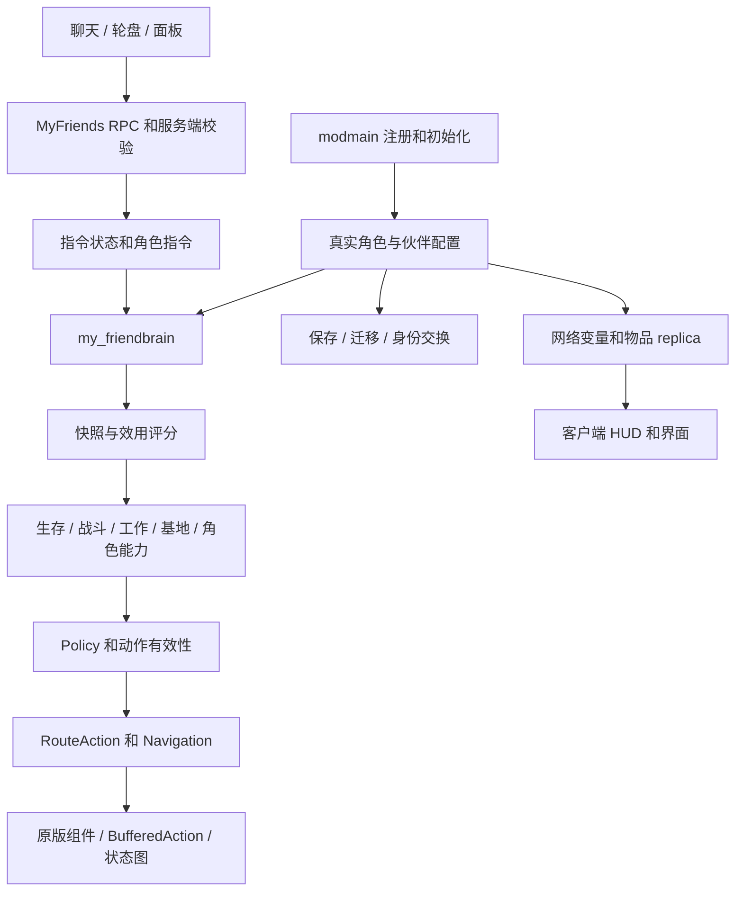

# 一路同行：架构与系统开发文档

本文面向维护模组、扩展角色和排查问题的开发者，介绍当前工作目录中的实现。它是代码阅读地图和规则说明，不代替实际代码；具体阈值、优先级与配方应以对应模块的常量和判断为准。

快速维护约束见 [AGENTS.md](AGENTS.md)，使用说明见 [README.md](README.md)，翻译流程见 [CONTRIBUTING.md](CONTRIBUTING.md) 和 [语言目录说明](scripts/languages/README.md)。

## 目录

1. [伙伴实体与运行边界](#1-伙伴实体与运行边界)
2. [架构与初始化](#2-架构与初始化)
3. [伙伴模式、家园和活动范围](#3-伙伴模式家园和活动范围)
4. [好感度、领队与权限](#4-好感度领队与权限)
5. [AI 评分、动作与中断](#5-ai-评分动作与中断)
6. [聊天指令、轮盘与工作任务](#6-聊天指令轮盘与工作任务)
7. [移动、寻路与平台](#7-移动寻路与平台)
8. [食物、容器进食与烹饪](#8-食物容器进食与烹饪)
9. [战斗、躲避与装备](#9-战斗躲避与装备)
10. [独立基地、农业与物资](#10-独立基地农业与物资)
11. [生存、社交与附属生物](#11-生存社交与附属生物)
12. [角色专属能力](#12-角色专属能力)
13. [死亡、复活与救援](#13-死亡复活与救援)
14. [存档、跨分片、换角色与附身](#14-存档跨分片换角色与附身)
15. [网络同步与界面](#15-网络同步与界面)
16. [语言、对白与声音](#16-语言对白与声音)
17. [模块索引](#17-模块索引)
18. [扩展步骤、排错与验证](#18-扩展步骤排错与验证)

## 1. 伙伴实体与运行边界

### 1.1 为什么运行角色与存档 prefab 不同

伙伴运行时是实际角色实体，例如 `wendy`、`wortox`、`wathgrithr`，保留原版角色组件、装备动作、状态图、饮食能力和专属物品接口。模组为它安装伙伴 AI，而不是另造一个只有角色外观的普通随从。

保存世界时，`modmain.lua` 的保存包装会把伙伴的记录名称映射为 `my_friend_<character>`。恢复时，[包装 prefab](scripts/prefabs/my_friend_characters.lua) 创建对应的真实角色，再安装伙伴配置并恢复状态。这样，移除模组后不会把世界中的伙伴记录误恢复成没有控制者的普通玩家。

`my_friend_wendy` 是旧存档使用过的名称，必须兼容保留。新增角色支持、改存档字段或调整保存包装时，都要同时检查 `my_friend_characters.lua` 和包装 prefab，不能只改生成逻辑。

### 1.2 伙伴身份与数量

- 默认角色是温蒂，由 `my_friend_characters.DEFAULT` 定义。
- 角色目录综合 `DST_CHARACTERLIST` 与 `MODCHARACTERLIST`，排除只能通过无缝转换到达的特殊形态。支持真实角色并不意味着每个模组角色都经过兼容验证。
- 伙伴增加 `my_friend`、`companion` 等标签，并标记 `_my_friend_is_companion`。普通玩家、附身中的真实玩家和临时停放的角色体不能混作伙伴。
- 伙伴从 `AllPlayers` 中移出，也不显示普通玩家跟踪标记；仍保留角色实体所需的原版基础组件。
- 当前分片用 `TheWorld._my_friend` 引用活动伙伴。地上首次创建、分片存在性检查、迁移记录和附身会话共同维持一个逻辑伙伴，不能把分片暂时没有实体视作需要重新生成。
- 首次生成位置优先选绚丽之门等入口附近。`FindFriend` 会寻找已有伙伴并处理重复实体；它不是每帧运行的物资扫描。

### 1.3 保留原版能力的含义

健康、饥饿、理智、潮湿、装备、伤害等主要仍由角色组件处理。模组针对部分能力补充初始化和行为调度，例如旺达年龄状态、温蒂的阿比盖尔、沃拓克斯灵魂、WX-78 电路。

当前配置为伙伴单独增加查理黑暗伤害免疫，但 AI 仍会寻找照明并遵守持灯工作规则。免疫黑暗伤害不等于免疫战斗、温度、饥饿或其他危险。

## 2. 架构与初始化

### 2.1 总体依赖关系



`modmain.lua` 是注册和接线层：资源、动作、状态图处理器、组件包装、RPC、玩家/世界/角色初始化及保存钩子均由它连接。具体规则优先放在职责明确的 `scripts/my_friend_*.lua` 中。

### 2.2 初始化顺序与幂等性

大致流程是：加载配置和语言 → 注册资产与角色包装 → 在角色两端创建一致的网络结构 → 主模拟端创建或恢复伙伴 → `ConfigureFriend` 安装组件、AI、事件和保存逻辑 → 客户端按 replica 更新显示。

`ConfigureFriend` 设置伙伴标识、移除玩家身份、添加 `follower`/好感度等组件，启用平台跳跃，配置角色能力、生存限制、装备和同步，然后安装 `FollowBrain`。各模块通常用 `_my_friend_*_configured` 标记避免重复安装。

同一实体可能由生成、恢复、迁移、附身恢复等路径进入配置，因此初始化不能重复叠加监听器、包装方法或周期任务。新能力应复用统一配置入口。

### 2.3 服务端和客户端

AI 决策、组件改动、库存转移、配方消耗和存档都由主模拟端负责。客户端负责读取网络变量、原版 replica，展示界面并请求 RPC。

伙伴使用真实玩家角色，因此一些原版延迟初始化和客户端监听器会误以为它始终拥有玩家库存或控制者。`my_friend_client_init.lua` 为听觉等生命周期提供清理与有效性保护；不要用“给所有回调加一个 nil 判断”替代追踪监听器归属。

## 3. 伙伴模式、家园和活动范围

“有没有领队”“有没有手动家园”“基地是否建成”“有没有任务”“是否为鬼魂”是不同维度，并非一个统一枚举。修改某个状态时要检查它们的组合。

| 情况 | 主要规则 | 入口 |
| --- | --- | --- |
| 跟随 | 以领队为常规活动参照，协战、补给、工作指令与生存共同调度 | `Policy.GetLeader`、跟随行为 |
| 独立建家 | 没有领队、没有禁止建家的家园状态、基地未完成时推进建设 | `BaseAI.EnsureBase/GetAction` |
| 已完成的自动基地 | 基地生活、存储、农业和有限外出，不再重复完整建家流程 | `BaseAI.IsComplete` |
| 手动新基地 `base` | 以玩家发令时的当前位置为中心、半径 32，视作完成基地，不重新规划自动建造 | `Home.Set/Apply` |
| 原地待命 `hold` | 固定中心活动，保留生存、救援等行为；自动暂留可保存原家园记忆 | `Home.Hold/Resume` |
| 晚加入 `roam` | 初次来到显示天数大于 200 的世界时不建家；允许必要外出找食物 | `Home.IsLateJoin` |
| 探索/钓鱼/领养 | 有限期的远行指令，搜索中心和活动范围处理与普通跟随不同 | `Policy.IsRoaming` |
| 领队死亡 | 保留领队引用，在死亡附近守候，不追随四处移动的鬼魂 | `Policy.UpdateVigil` |

常规跟随活动半径为 20，部分直接跟随/战斗检查使用 7，普通有效工作命令可把活动半径扩展到 32。设置基地不自动停止跟随；停止跟随后，手动基地的闲逛和常规路线边界均为半径 32，距中心超过 30 时触发返回判断；“原地待命”仍保留原有 40 单位路线边界。这些数字用途不同，不能互相代换。

普通跟随的持续战斗另有领队距离上限：伙伴离领队超过 32 单位时停止迎战/协战，改为普通追赶。该上限不被自卫、猎犬/暗影优先级或早期主动迎战绕过；探索、钓鱼等显式漫游指令沿用独立活动规则。它与伙伴到敌人的 32 单位追敌范围是两个判断。

`set_base` 直接保存玩家发令位置，不再选择冰箱、盐盒、锅或科技站作为新中心。`Home.Facilities` 在该中心 32 单位内发现并缓存设施，复用 `Discovery` 的事件失效机制；设置基地时做一次发现，后续移除、燃烧或新建设施使记录失效，不建立周期基地扫描。设施记录不改变归属和容器权限，锅、科技、冷藏与箱子的原有使用校验保留。设施实体引用属于临时缓存，存档仍保存中心坐标；读档按当前分片重建。已存档的旧中心保持原坐标，重新发出设置基地指令时应用新选点规则。

救援、记忆书架访问、战斗武器恢复、传送塔、搬运背包和死亡物资取回等动作带有专门路线标记，由 `Policy.GuardAction` 与 `Navigation.InTravelRange` 分别解释；它们不是通用“无限距离授权”。

晚加入还具有独立的拾取许可：未取得许可时，自主活动主要允许食物、草和树枝；`Home.UpdateAsk` 在合适时机询问附近玩家。明确任务与自主拾取的限制要分别检查。

## 4. 好感度、领队与权限

### 4.1 每位玩家独立记分

`components/my_friend_affinity.lua` 以 `userid` 保存好感度，默认 20，范围为 -50～100。当前源码有一个 `FIXED_USERID` 特例，`Get` 对它固定返回 100；排查“某玩家永远满好感”时必须检查这里，不能先假设是网络延迟。

| 行为 | 当前门槛或规则 |
| --- | --- |
| 喂食权限 | 好感度至少 0，另检查角色可食性和危险食物许可 |
| 拿取物资 | 好感度至少 20，仍受对应 RPC 的距离/状态校验 |
| 请求跟随 | 至少 25，并兼容浮点数临界误差 |
| 劳动指令 | `CanCommandWork` 要求严格大于 50 |
| 接受危险食物 | 至少 90 |
| 跟随优先层级 | 至少 90 为高优先级请求，其余合格请求为普通层级 |
| 改名 | 一次共享免费机会；用过后至少 80 |
| 附身/交换实体 | 专属校验通过且好感度至少 25；还需通过界面 RPC 校验 |
| 换角色 | 共享免费机会与后续领队/100 好感规则由 `Farewell.CanRequest` 判断 |

面板、换装、拿取和角色选择可能有独立校验，不应拿“能跟随”推导“所有管理操作都能做”。例如皮肤操作还检查好感度、角色形态与拥有信息。

### 4.2 多人跟随仲裁

`RequestFollow` 把最新请求移到队首。`UpdateLeader` 先选高优先级层级，再在同层级中选最新有效请求，而不是简单挑好感度数值最大的人。

因此 A/B 好感度为 30/50、伙伴跟随 A 时，B 发出有效跟随请求可以接替 A；如果当前有效请求中有人达到 90，则普通层级的新请求不能抢过高优先级。没有领队时会清除旧请求，防止旧的高好感记录持续锁住独立伙伴。

待命、停止跟随以及恢复家园会调整请求表和 `staying`。修改时同时检查聊天和轮盘，避免一条入口清理了旧请求，另一条仍保留。

### 4.3 好感变化与劳动扣费

喂食收益按实际健康、饥饿、理智变化计算；丢进库存的礼物、装备礼物、陪伴时间也有独立结算和冷却。食物礼物有 240 秒窗口，最多按前三件有效高价值物品结算；装备礼物有 480 秒窗口和加分上限。

在伙伴 8 格内累计陪伴 60 秒可增加 0.2 好感。玩家攻击伙伴会扣好感，原版 `Follower` 因受击自动解除跟随的路径还需由模组恢复仲裁。

工作命令通过 `Commands.Commit` 在实际开始劳动时校验并扣费，当前首次收费为 0.01。不要把收费挪到客户端按钮或每个连续挥砍动作上。

## 5. AI 评分、动作与中断

### 5.1 从快照到原版动作

`brains/my_friendbrain.lua` 注册行为候选，并构建包含领队、威胁、黑暗、温度、饥饿、修理、死亡和库存压力的快照。`behaviours/my_friend_utility.lua` 计算候选评分、排序，并让可执行的高分行为运行。

评分高只是候选资格；动作 getter 返回 nil、路线无效、对象失效或组件限制仍可能让候选失败，调度器会继续尝试其他行为。阅读代码时要沿着“评分 → getter → 动作有效性 → 状态图实际执行 → 成功/失败回调”追踪。

`Action(...)` 通常用 `RouteAction` 包装 `BufferedAction`；战斗、跟随、钓鱼等待等连续行为使用自己的行为节点。生存系统和角色能力也遵循这个入口，不应另起周期任务绕开调度持续抢动作。

### 5.2 代表性评分

下表是定位冲突时常用的基线，不是保证执行顺序；实际条件和作用域包装可能把评分降为零。

| 行为 | 代表评分 |
| --- | --- |
| 鬼魂复活/返回 | 150 或以上，具体由鬼魂指令决定 |
| 告别换角色 | 145 |
| 主动救援玩家 | 144 |
| 找回战斗装备；黑暗照明 | 140 |
| 受伤后退/等待 | 135/134 |
| 短时等玩家 | 133，仅安全条件成立时 |
| 角色专属命令 | 132 |
| 协战；直接战斗；逃离 | 128 / 125 / 124 |
| 紧急进食 | 122；其他进食评分随饥饿变化 |
| 追赶领队 | 110，包含距离和重新汇合条件 |
| 普通工作命令 | 通常 104；搬重物等有例外 |
| 独立基地 | 未完成通常 78，完成后通常 45 |
| 基础装备、基地雨伞与针线包制作 | 73，仅空闲安全且无明确任务时 |
| 后期最低草/树枝补给 | 12 |
| 跟随对局玩家并陪坐 | 13，被动行为，较高评分可抢占 |
| 跟随闲置、守候、独立闲逛 | 通常 10 |

正在运行的行为并不会被高一两分的候选反复抢占：调度器有被动行为例外和超过当前行为 10 分的紧急抢占条件。新增行为需要同时考虑这一差值、状态图忙碌保护和作用域限制。

### 5.3 检查频率

- 普通决策约每 0.4 秒；忙碌期间约 0.15 秒。
- 全局快照缓存约 0.6 秒，连续工作也有独立的生存复查周期。
- 战斗通常每 0.1 秒，匹配攻击窗口、敌人带有攻击标签或伙伴正在普通攻击前摇时可每帧检查；危险躲避可中断普通攻击。
- 帧级战斗检查不等于帧级完整评分：战斗行为重排约每 0.1 秒，装备评估缓存 0.25 秒。
- `_my_friend_replan_requested` 用于指令变化、装备掉落等即时重新规划；实体归属、存活和关键状态仍需当场验证。

设施发现共用 `my_friend_discovery.lua`：按 32 格区域记录变化，查询结果（包括空结果）不靠短周期过期重扫；实体创建/移除、燃烧/熄灭、容器内容/开关、植物再生和晾晒完成才使附近相关类别失效。移动搜索有 4 格发现余量，移动超过余量才重新发现，实际动作仍按原范围检查。只保存资源坐标/数量记忆，不保存发现缓存、实体引用或变化计数；读档重建缓存。

发现通知在主模拟端 `AddSimPostInit` 安装一次：包装共享的 `EntityScript.PushEvent_Internal`，仅处理相关事件，保留原事件派发、状态图/脑事件和全部返回值；再生、旧作物成熟和传统晾晒等无事件路径包装共享组件类方法，不给全世界实体逐个增加监听、包装闭包或周期任务。原版 `dryer` 在完成时调用 `Resume`，通过该共享方法通知发现系统，原 prefab 的晾晒完成回调保持原样。安装应幂等，其他模组已有的方法包装必须继续执行。

生成通知只更新计数；存在查询后，将同一帧生成实体的最终位置核实合并为一个世界零延迟任务，队列使用弱键，不保留实体。只有真正返回过查询结果的实体才有弱键位置/类别/资源元数据，值不反向引用实体；移动、移除或组件类别消失时同时使旧位置/旧类别失效。区域计数目录最多 4096 项，清理时增加 generation，避免旧空结果误命中新目录的相同计数。局部缓存只保留 GUID 数组，使用时从 `Ents` 解析，不因闲置缓存留住已移除实体的 Lua 对象。

`my_friend_world_resources.lua` 保留原搜索范围、评分公式、完整候选排序、危险复查、失败期限和最多 16 组需求查询。候选改为 GUID 数组，评分使用调用内临时数字表，不为每个候选分配长期记录，也不按前若干个候选截断搜索；最优安全目标可能在排序末尾。家园、基地和领队上下文为弱值引用，并分别记录原来是否为空，避免旧对象回收后误把 nil 当作同一上下文。资源变化仍通过版本触发发现，负结果不恢复为定时全世界扫描。

### 5.4 中断、失败与卡住

`Policy.IsBusy` 保护吃饭、复活、工作前摇等原版动作。不能为了“尽快执行新指令”在这些阶段随意 `Stop` 或强切 `idle`。

`RouteAction` 处理路线取消、局部接近重试和路径失败；`my_friend_progress.lua` 检测长时间没有移动或有效进展的行为，并通过已有失败回调释放锁。库存、容器、工作、搬运、钓鱼等模块应提供可重复调用的取消路径。

## 6. 聊天指令、轮盘与工作任务

### 6.1 一条消息如何执行

```text
客户端输入/聊天回显
  → my_friend_chat.Forward
  → MyFriends.ChatCommand RPC
  → 服务端 my_friend_chat.Dispatch
  → 定位活动伙伴或附身对应的 AI 身体
  → Commands.Dispatch：称呼、关键词、权限、角色分派
  → _my_friend_command
  → AI command 候选 / 专属候选
  → 动作 getter → Commit → RouteAction → 原版动作
```

客户端输入与聊天回显可能重复转发；服务器也可能同时收到原版聊天回调与 RPC，因此聊天模块在两个边界都处理跨来源去重。不能简单删除其中一条路径来修复重复执行。

### 6.2 解析和权限

消息包含伙伴当前名字和关键词即可被识别，名字可在开头、中间或末尾，也支持 `@`、角色 prefab、部分角色别名。中文主要按子串匹配，英文公共关键词有词边界判断，匹配时优先较长关键词。历史角色别名可在改名后继续使用，并非只接受新名字。

大部分工作需当前领队授权；跟随请求走自己的好感度仲裁。读书与薇格弗德 `lightning_spear` 是无需跟随的角色请求，传送塔、双尾心等另有专属路径。解析成功、权限允许、动作能执行是三个不同阶段。

轮盘通过稳定的 command ID 查找关键词，再调用同一分派逻辑，不能为轮盘另写一套执行规则。普通问答回复不属于指令：糖豆、石果、拾取许可/鬼魂取物同意的回复词放在各语言 `dialogue_lines.lua` 的 `M.chat_replies`，由 `my_friend_chat_replies.lua` 整句匹配并忽略首尾空白/常用标点，不写入 `command_words.lua`，不进入轮盘。服务端只在对应问题有效且发送者符合原权限时接受，可直接回复“敲吧／不敲”“吃吧／不要”“可以”，不要求伙伴名字；旧的带称呼回复继续兼容。轮盘动作不经过问答处理，避免“跟随”等明确动作被待回答问题截走。角色专属词库也进入轮盘目录；不同角色不会因目录中存在按钮就获得该角色能力。

部分中文聊天指令还经过约 3% 的台词拒绝分支；轮盘和奔雷矛专属指令有例外。遇到偶发一次不执行时，应检查 `MaybeRefuseChinese`，不要直接判断是丢包。

### 6.3 指令状态

`_my_friend_command` 常见字段包括 `id`、`player`、`started`、`deadline`、`special`、`recipe`，具体任务追加目标、阶段、批次数和等待标记。普通特殊任务常用 180 秒期限，钓鱼、探索等有自己的生命周期，不能把这个值视作所有任务的总时限。

`Commands.Get` 会校验玩家在线、命令期限及适用的领队关系。`Clear` 除清空字段外，还会关闭读书/容器流程、取消搬运/钓鱼、释放任务临时状态。新增任务不能只赋 nil 而漏掉自己的清理。

### 6.4 常见指令分组

| 分组 | 代表 ID 与执行模块 |
| --- | --- |
| 模式 | `follow`、`stop_follow`、`hold_position`、`wait_for_me`、`set_base` |
| 采集与挖掘 | `chop`、`mine`、`harvest`、`grass`、`dig_grass`、`dig_sapling`、`dig_stump` |
| 农业 | `seeds`、`hoe`、`water`，涉及整地、土壤和工具接线 |
| 种树 | `plant_trees`，`my_friend_command_plant.lua` 复用林区选点，仅消耗随身树种 |
| 特殊采收 | `rockfruit`、`bullkelp`、`monkeytail`、`banana`、`dry_meat` |
| 探索与生活 | `explore`、`fish`、`sit`、`ride`、领养宠物及其停止命令 |
| 库存 | `backpack`、`backpack_drop`、`tidy`、`equipment`、`carry_statue` |
| 角色与互动 | `food`、`ask_activity`、`touch_tower`、改名、告别换角色、角色专属指令 |

具体本地关键词以 `scripts/languages/<code>/command_words.lua` 及 `characters/*_command_words.lua` 为准。传送塔指令允许访问已激活的塔，但仍需检查目标有效性、寻路和传送交互状态。

`plant_trees` 的中文关键词为“种树／种下去／种吧”，聊天和轮盘共用入口，沿用当前领队及工作好感度大于 50 的权限，首个 `DEPLOY` 沿用一次劳动扣分。发令时保存伙伴当前位置为固定中心，后续不跟随玩家位置移动；300 秒内使用随身、背包或活动物品中的松果、桦栗果、多枝树种子，在横纵各延伸 10 单位的方形区域内种植（20×20）。采用建家林区的 `Forestry.SPACING`（当前 8/3 单位），每边按 `floor(2 * half_size / spacing) + 1` 计算数量，将完整网格居中布置；不做圆形裁剪，不沿用建家中央通道，也不设置固定棵数上限。当前空地生成 8×8 共 64 个位置，50 个可用树种应全部种下，树种足够则填满全部网格。显式任务不初始化或改变基地林区，不清场、砍树、取箱子、拾取地面树种或收集材料。用完候选位置、缺少可用树种或无可用位置即回复并清除任务；动作失败的位置本轮跳过，中断取消则保留重试机会。网格点仅生成一次并在本条指令内复用，选动作时按方形外接圆再加 2 单位间隔余量核实树木和幼苗，避免漏掉四角；空任务不扫描，不新增周期任务。部署点继续经原版 `CanDeploy`、地形/洞口、危险记忆和归属校验；原点标记允许受控绕行，不让领队移动改变部署边界。临时布局、失败点和计数只在指令内保存。

## 7. 移动、寻路与平台

`Policy` 决定动作是否属于允许活动；`Navigation` 解决如何走；`RouteAction` 管理某一次动作的路径和生命周期；`Platforms` 与 `Wormhole` 处理船和传送连接。这四层不能互相替代。

`my_friend_navigation.lua` 提供地面/海洋/洞口检查、碰撞检查、接近点、不可达缓存、搜索预算及转向。基础搜索超时为 12 秒；局部重试、连续停滞和业务动作还各有期限。特殊业务的完整期限应从动作创建时开始计时，不能在每次重规划时无限重置。

`my_friend_route_action.lua` 在原版 `DoAction` 上补充路线搜索、步进、恢复移动、失败标记与清理。它也处理某些原版 idle 转换清掉移动动作的情况，避免重复提交已完成的动作。

跨船移动由 `my_friend_platforms.lua`、角色 `embarker` 和原版可行走平台协作；不能只用平面坐标推断可以跨水走直线。长期跟随、骑乘跟随和基地工作可能用不同的接近策略。

上下船沿用原版鱼人 `mermbrain` → `Follow` → `locomotor`/`embarker` 的职责分工：跟随行为向领队当前位置移动，原版移动组件临近边缘时按当前平台、方向、跳跃距离和障碍选择可达跳船点。伙伴的普通跟随和骑牛跟随共用这个原则；平台不同时即使已进入普通停止距离，也继续接近。同船保持原有跟随距离，不要求贴近领队。伙伴是真实玩家角色，仍使用自己的原版状态图和玩家跳船规则，不修改 `isplayer` 来伪装鱼人。

`Platforms` 负责当前平台比较、一次性船面移动、路线失效处理和限频移动重试，不记录或回放领队的历史上下船点，不挂领队 `onhop` 监听，也不启动独立的半秒平台观察任务。只有 AI 评估跟随或实际执行跟随时才比较双方当前平台；领队离船后，尚未上船的伙伴重新按当前状态跟随，不补走旧上船流程。双方都在陆地时继续使用现有地面寻路，不把领队曾坐过的船当作必须经过的路线。

伙伴实际进入新平台后，普通/骑牛跟随先执行一次向领队方向、最多 4 单位的船面移动；方向和目标在上船后固定，以平台局部坐标保存，随船移动，不随领队下船而被改写。目标受船面半径和碰撞半径余量限制；原版边缘落点允许先向内进入余量范围。未完成移动按追赶优先级调度，达到目标、6 秒超时、领队切换、离开平台或平台移除后释放，再恢复普通上下船跟随。busy、跳跃动画和 `embarker` 的原版跳跃先完成；仅在上船时做最多 16 个局部几何点检查，不新建扫描、监听器或周期任务，临时状态不写入存档。

跨平台和同船跑动的目的地在持续 1.5 秒没有实际进展时允许重试，进展按船的局部坐标判断，避免船本身移动掩盖卡住；失败目的地在运行中的跟随节点里按半秒间隔检查，不逐帧提交，不另建任务。伙伴或领队的平台改变、领队切换时，清除转向、卡住、局部/长途路线与旧移动记录，重新读取领队当前位置。接受聊天/轮盘跟随指令也请求一次路线重置，由普通或骑牛跟随节点在 busy/原版跳船结束后消费；保留落地恢复，不打断忙碌动画，不强制原版组件跳到历史坐标。

地面判断采用原版 `Map:IsVisualGroundAtPoint`，允许岸边和斜角码头的可行走外沿；局部跟随仍逐段验证地形、洞口和实体碰撞，不能把真实海水间隙或船面当作陆地。船上不使用陆地侧移脱困搜索。

模型移动与普通近身动作经 `my_friend_body_travel.lua` 共用表面判断。水面目标先找动作范围内的可站立点，船面按本船边界和实体碰撞检查短段，跨船岸交给原版跳跃。候选点按任务保存，目标移位、平台变化或无进展时才重算。跳跃结束后按脚下表面通过原版接口校正本次跨越的平台归属。到位后交还原 BufferedAction，原生远程动作仍自行判断距离。观察提供实时距离与表面，可按句柄重查；接近与重试不新增周期任务或存档字段。

洞口检查使用向量对象并复用临时向量；不要给要求 `pt:Get()` 的原版接口直接传普通 `{x,z}` 表。

## 8. 食物、容器进食与烹饪

### 8.1 三类限制分别维护

| 限制 | 当前物品或条件 | 实现 |
| --- | --- | --- |
| 通用禁食 | 格罗姆黏液、普通曼德拉草、蜂王浆等既有禁用项；生高鸟蛋禁止直接吃 | `FoodAI` 的禁食表及 eater 包装 |
| 仅禁止 AI 选吃 | `deerclops_eyeball`、`minotaurhorn`；玩家直接喂食仍按原角色规则 | 主动进食禁用表 |
| 禁止入锅/配方限制 | 普通曼德拉、蜂王浆、蜜脾 `honeycomb` 等保护食材；新鲜肉干与大肉组合限制 | `my_friend_food_rules.lua` |

原版角色可食性始终有效，例如薇格弗德只吃肉。食物能用于配方、能被原版 eater 接受、值得伙伴主动吃，是三个不同问题。不能把“眼球不主动吃”扩成所有玩家喂食、入锅和其他用途一律禁止。

### 8.2 主动进食评分

`my_friend_food_ai.lua` 根据角色吸收率、食物实际效果、当前三维缺口、浪费量、负面作用和新鲜度评分。常规健康、饥饿、理智需求的参考阈值分别为 90%、65%、60%，紧急阈值为 15%；具体执行还取决于优先级与状态。

普通治疗资格由 `my_friend_health.CanReceiveHealing` 共用判断：必须有 `health`，且没有 `oldager`、`health_as_oldage`、`cannotheal`、`_no_healing` 或 `health.canheal == false`。这覆盖旺达及使用原版年龄/不可治疗标识的模组角色，不根据 prefab、生命上限或任意伤害重定向函数猜测含义。沃拓克斯选治疗目标和 `FoodAI.CanHealWithFood` 复用该判断；沃姆伍德仍单独排除食物回血。丢魂和伙伴喂食回血还要求原版 `health:IsHurt()`，避免生命惩罚已满时仍因百分比偏低反复治疗。时间值角色不因显示值偏低而触发伙伴喂食回血，但仍可按饥饿需求接受食物。完全自定义、未提供这些标识的模组角色需要额外兼容，不能只凭数值判断为时间值。

食物至少要有有意义的恢复量，避免为了极小收益频繁吃冰、灯泡等。选食还会排除种子、锁定物品、宠物任务材料和需要归还的食物。补给量统计与实际选食共用禁用规则，避免把不能吃的物品误算成储粮。

生大肉等“加饱食度、仅扣理智”的可烤食物不再被硬性排除；仍按三维实际收益评分，低饱食度及饥饿为零时可进食，角色饮食、禁食和致死伤害保护不变。加生命扣理智的食物继续按原回血优先级选择。仅扣血或红色新鲜度的原料可在非紧急状态优先留给烤制，低饱食度/低生命时保留原有直接进食与紧急选食规则。

眼球和犀牛角在饥饿、回血、低理智、吃饭指令和容器取食中都不得被 AI 选中。动作执行时再检查禁用和归属，防止缓存候选绕过规则。

自主进食安全判断使用当前真实生命值与原版 eater 的预计食物扣血，包含新鲜度、吸收率、食物记忆、整堆进食和角色自定义效果；不能使用旧快照或不能食疗角色的评分用满血值。生命不高于35%，或食用后生命不高于上限10%（至少1点）时拒绝扣血食物，选食、吃饭指令与真正吃下前复用同一判断。不能靠食物回血的角色只忽略正向回血，不抹掉负向扣血。随身动作、容器直接进食和取出后的首口份额均在动作校验时复核；伙伴配置还幂等包装 `eater:Eat`，在真正吃下前再次拒绝危险食物，不消耗食物。该限制只作用于仍带伙伴标签的自身进食，玩家主动喂食仍走独立饮食与权限流程，换回玩家身体后不施加伙伴限制。

紧急选食同样要求食物能恢复当前需要的三维；低血本身不能让只有热量的食物获得回血资格。单独为了回血进食至少需预计恢复1点，避免黄色生肉等不足1点收益反复触发。黄色生肉的原版普通收益可能是小数回血，红色则为0，不能把所有黄色食物一概当作0。模型观察提供原版阶段的freshness与当前伙伴的预计food收益，扫描预算裁剪保留这两类字段，提示词禁止未知新鲜度默认报新鲜。

### 8.3 食物存储与容器吃饭

`my_friend_food_storage.lua` 统一引用随身食物，并特殊识别自己携带的熊皮袋。普通库存、装备背包、熊皮袋和外部箱子不是同一种容器。

`my_friend_container_ai.lua` 负责寻找可用容器、打开或翻找、取食、份额记录和归还。`_my_friend_meal`、`_my_friend_container_action` 等字段表示一个跨动作的进食流程，不能在两个动作之间把容器锁当作遗留错误强行释放。

容器中的选择经过 `Evaluate/CommandScore`；已取出的份额和最终 `EAT` 动作也要校验禁用状态。中断后应执行归还或取消流程，不能一概把临时取出的物品视作伙伴永久财产。

### 8.4 烹饪范围和配方

木炭 `charcoal` 和灰烬 `ash` 在原版带有供熔岩虫宠物使用的 `edible`/`FOODTYPE.BURNT` 属性，但伙伴按材料处理：不进入自主进食评分、客户端 `FEEDPLAYER` 选项或服务端喂食流程。`ItemReactions.IsRealFoodType` 排除 `BURNT`，赠送入包不触发食物台词或食物礼物好感，玩家取走也不触发取走食物台词；正常转交、库存和材料用途不受影响。旧存档中尚未结算的木炭/灰烬食物礼物记录在恢复和结算时过滤。其他可食物品的玩家主动喂食仍遵循原版角色饮食规则，角色及熔岩虫自身的原版饮食定义不改动。

烤制与锅料理不再共用“仅独立建家”的模式限制；存活伙伴在跟随、手动基地和自动基地建成后也能烹饪。`FoodRules.NeedsRoasting` 只用于单件烤食：实际食用会扣生命值，或新鲜度严格低于 `TUNING.PERISH_STALE`（原版 20%）时才触发；仅扣理智不构成烤制理由。烤制选取、动作有效性及实际原版 `COOK` 执行复用该条件，保留锁定、归属、宠物/归还预留与角色可食性校验。原版烤制后新鲜度为 `(1 + 原新鲜度) / 2`，红色原料通常回到 50%～60%。

锅料理按原食材收益和补给需求规划，不套用单件原料的扣血/20% 条件；可继续从权限允许且范围内、同平台的冰箱、盐盒和箱子取料，再入锅、烹饪与收菜。战斗、忙碌、极低饱食度/生命、跟随刚发令暂缓收集、容器权限和有害配方保护等原约束仍生效；不因解除模式限制而扩大取料范围或添加全局扫描。

当前自主锅料理要求饱食度至少 25%、生命值高于 35%，明确烹饪指令只豁免饱食度门槛，不豁免生命门槛。紧急进食不为锅料理预留食材：低血低饱食度时，即使随身有一份怪物肉与三份能合成肉丸的填充物，也不会先开锅等待肉丸，而是直接选择不会致死的可食食材；没有安全食物时不以致死食物兜底。这是现有烹饪调度策略，与进食致死校验分开维护。

料理评分会读取当前三维缺口：生命低于 35% 或三维同时偏低时，生命恢复权重最高；理智低于 60% 且生命安全时，优先有理智恢复的料理；饱食度低于 65% 时，优先高饱食料理；三维都充足时，按可用食材选择饱食收益较高的料理。配方收益按当前可用缺口截取，避免为了高饱食料理浪费回血或理智属性；仍保留薇格弗德肉丸偏好。自动组合最多检查 2048 组，不增加周期扫描。

糖豆 `jellybean`（不要与太妃糖 `taffy` 混淆）属于自主进食禁用项，不进入普通食物评分。伙伴生命低于 20%、库存内没有足够可恢复生命的食物时，才触发一次附近 20 单位内的糖豆查找，来源包括身上、允许访问的箱子/冰箱/盐盒和地面；查找结果缓存 4 分钟，期间不会重复扫描。找到糖豆后向当前领队询问，回答仅接受当前语言 `chat_replies.sugar` 中的完整同意或拒绝回复；同意后只执行一次糖豆进食，拒绝、超时、物品失效或动作失败都清理本次请求。扫描冷却仅在领队在线且 20 单位内允许查找时消耗，缺少领队不提前冷却；扫描和询问只在现有进食决策中触发，不新建周期任务。询问采用现有 `RandomReply` 的三条台词；同意后有 30 秒执行期限，动作复核本次授权、领队、物品归属/锁定/保留和原版饮食资格；拆堆/合并后只在取物成功时重新确认随身糖豆。回血食物存量按堆叠数量计入，糖豆本身不计作免询问的普通回血食物；玩家明确喂食继续走独立的原版饮食及喂食规则。

石果问答由 `my_friend_command_special_gather.AnswerRockFruit` 处理：30 秒内仅原发令且仍为领队的玩家可回答，保留原任务对象；同意切换到先丢整堆再敲，拒绝切到储存，并请求重新决策。直接敲地面石果与同意后敲随身石果均经 `BaseAI.GetCommandWorkAction → CreateGatherAction` 建立 MINE 目标锁，复用普通挖矿的工作进度、45 秒停滞期限、末击掉落清理和 `SGwilson mine → Utility.RepeatWork → GetRepeatWorkAction` 连续挥镐。仅在实际进度/移动时刷新停滞期限，不每轮重置；正常换镐成功同步返回工具，不能误以为任务没有动作而结束。每次续接仍检查威胁、黑暗、温度、饥饿、伤害、领队及指令状态，不强停 busy，不额外创建逐帧找石果或周期扫描。

`my_friend_cooking_ai.lua` 负责烤制流程；`my_friend_recipe_planner.lua` 负责食材和配方估值；`my_friend_recipe_cooking.lua` 把计划推进为放料、烹饪、收取等阶段；锅的库存动作和兼容处理在 cookpot 相关模块中。

火坑/吸热火坑燃料统一按 `log`、`charcoal`、`twigs`、`cutgrass` 顺序选择；基地火坑、温度生存火坑和烹饪锅缺燃料时复用这组优先级，并仍通过原版 `CanAcceptFuelItem` 校验。

- `meat_dried` 在新鲜度不低于 50% 时保留；低于 50% 可入锅。
- 三份及以上大肉/烤大肉不能全部按受保护的新鲜大肉使用；前两份新鲜大肉可以进入配方，第三份必须是新鲜度严格低于 20% 的过期大肉，过期份额从限制中扣除。
- 蜜脾 `honeycomb` 通过统一 `PROTECTED`/`CanUseIngredient` 检查从随身物品、冰箱、盐盒、箱子和实际锅内物品全部排除；玩家原版手动烹饪不受伙伴规则包装影响。
- 限制既用于计划阶段，也包装原版 `COOK` 在实际执行前复查，不能只改评分器。
- 薇格弗德允许料理时优先肉丸，降低炖肉汤的选择倾向；日常优先吃肉干。

## 9. 战斗、躲避与装备

### 9.1 找敌人和决定是否迎战

`my_friend_behavior_ai.lua` 管理威胁搜索、玩家攻击记录、协战目标、武器/护甲评分及胜算判断；`my_friend_combat_rules.lua` 管理共享的可攻击边界；`behaviours/my_friend_combat.lua` 执行接近、攻击、躲避和角色特殊战斗动作。

伙伴对已有仇恨关系迎战，并不无差别攻击附近中立生物或玩家。显示天数小于 500 时，扩大对伙伴和附近玩家已有仇恨生物的迎战范围，放宽通常的类型、低血量和胜算限制；第 500 天起恢复原有判断。猎犬与暗影威胁还有专门的优先迎战处理。

亮茄本体 `lunarthrall_plant` 只有处于 `tired` 虚弱阶段才允许攻击，避免反伤；这不禁止攻击藤蔓。共享攻击边界需要同时影响目标选择和实际动作，不能由某个专属角色绕过。

玩家攻击记录、同队关系、活动边界和目标有效性会影响协战。领队每次攻击都会刷新该目标的协战标记；最后一次攻击后保留 16 秒，由 `ASSIST_ATTACK_WINDOW` 统一控制攻击记录有效期、过期记录清理和协战候选期限，并非两次协战之间的冷却。排查“AI 有威胁却不攻击”时，还要检查武器恢复、紧急修理、受伤后退和状态图忙碌是否优先。

多人协战只读取当前领队的攻击行为、攻击记录和受仇恨关系；没有领队时，不因任意玩家受仇恨或攻击生物而参战。早期主动迎战与猎犬/暗影优先级也遵守这个边界，伙伴自身受仇恨或近期受伤仍按原自卫规则处理。威胁缓存使用时重验敌对关系和领队身份，正在执行的战斗及反击评估也校验待执行攻击缓存的领队、期限和实际攻击动作，避免切换领队、停止跟随或生物转移仇恨后继续旧协战。

`FindThreat` 提供迎战/协战候选，不能直接作为逃跑依据。`FindEscapeThreat` 与它复用一次查询和缓存，通常只返回以伙伴为仇恨目标或近期实际伤害过伙伴的生物；两类目标独立排名，避免玩家的协战目标遮住伙伴自身的攻击者，并在使用缓存时重验个人威胁关系。逃跑评分、持续条件和 `RunAway` 取目标均走该入口。仅仇恨玩家的生物仍按现有规则决定是否迎战/协战；未通过战斗判断时不设置受威胁状态，不触发逃跑，也不因此取消钓鱼、容器操作或短时等候。已经进入战斗/协战后因装备不足触发下述低血撤退时，另以原目标 GUID 维持退出距离；这是正在退出的战斗，不把其他玩家的任意交战当作逃跑理由。

`ShouldRetreatUnequipped` 在生命比例严格低于 80%、随身没有可用防御装备、所有可用手部装备对当前目标的攻击力均严格低于 25 时拒绝战斗。恰好 80% 或攻击力恰好 25 不触发本条限制；护甲、武器包括穿戴、物品栏、背包和活动物品，仍需有效、归伙伴所有、未锁定、满足角色限制且耐久可用，火把不计武器。护甲沿用当前目标下的有效减伤判断，坏掉或耗尽的护甲不算保护。本条在早期主动迎战、猎犬/暗影优先级和领队协战之前生效，统一覆盖 `CanCounterAttack/CanContinueCombat`、普通攻击/冲刺的有效性和原版 `combat:CanTarget`；不限制普通玩家身体。真实自身威胁交由现有逃跑行为；已在协战中的原目标保留到脱离 28 单位、恢复血量/装备、切换领队或跟随脱战边界失效。撤退记忆仅含目标/领队 GUID，不写存档、不新增实体搜索或任务；装备检查按已有库存版本号失效，至多缓存 0.25 秒，已选装备移除、损坏和归属变化即时复核。只取消待执行的普通攻击，不强停进食、施法、救援等 busy 动作。

`my_friend_combat_rules.lua` 统一执行跟随脱战边界。普通跟随离领队超过 `FOLLOW_COMBAT_RANGE = 32` 时，战斗/逃跑候选让位于追赶；已经缓存的战斗许可、已排队的普通攻击、薇格弗德冲刺及原版 `combat:CanTarget` 都重验领队距离。旧普通受击后退计时在快照中清除，远处新受击不反复刷新该计时，避免“停战后仍原地等受击后退”卡住；火焰、温度或地面危险区撤离继续保持优先级。返回距离内后按原胜算、角色和仇恨规则评估。

聊天/轮盘 `follow` 经好感度仲裁且实际取得领队身份后，调用 `DisengageForFollow`：记录当前战斗、协战、排队攻击及当前战斗节点中的目标 GUID，清除旧战斗目标、协战/威胁/装备决策缓存和战斗手槽锁，取消普通 `ATTACK` 并请求重新决策及唤醒。`FOLLOW_DISENGAGE_TIME = 5` 秒内不与这些目标交战，也不因这些目标再次触发普通受击后退或逃跑选择；`IsThreat` 的真实敌对关系仍保留供安全判断使用，新出现的其他威胁仍按原规则处理。期限独立于追赶是否提前到达，重复跟随刷新已有目标的五秒期限；到期清除相关决策缓存并重新评估，不强制重新交战，领队变更或解除跟随时记录失效。拒绝或未取得领队的请求不改变战斗状态。进食、施法、救援等 busy 动作不强停，已选普通攻击通过原版取消和随后移动退出。暂停记录仅含 GUID、领队 GUID 和期限，不保存实体引用，不写入存档，不新增实体搜索、监听器或周期任务。

### 9.2 躲避流程

`my_friend_dodge_profiles.lua` 保存敌人 prefab、攻击动画、危险帧和移动参数；`my_friend_dodge.lua` 根据当前帧、距离、移速和地形计算躲避点。帧数据包括普通生物和巨兽，未收录或改版后不匹配的攻击保留通用躲避回退。

危险躲避先于伙伴普通攻击的 `abouttoattack`/`attack` 保护判断：有可用躲避点时，即使命中帧尚未到达，也清除待执行的普通 `ATTACK`，通过原版移动事件退出攻击，不强制切换 idle。没有实际危险时保持普通攻击；进食、救援和施法等 busy 动作仍受保护。恐怖尖喙等使用通用回退的敌人进入攻击时，同样可打断伙伴的反击承诺，不能等整个伙伴攻击状态结束才考虑躲避。

攻击窗口可按 30 Hz 观察，但避免把昂贵工作一起提高到这个频率：

- 局部障碍物查询使用半径 8 的缓存，通常 250 毫秒刷新，明显位移或上下文变化时失效。
- 同一次计算的多个方向备选共用障碍列表；地面与船边界仍逐步验证。
- 部分巨兽的特效查询也缓存 250 毫秒，不在多个帧参数回调里重复扫描；结果使用弱值数组，按保存的数量遍历以容忍回收后的空洞，避免 Lua 5.1 弱键缓存的值又强引用查询对象。战斗重置清空这些查询。
- 相同躲避目标不重新提交原版寻路，变化目标的提交至少间隔 150 毫秒；中断新一次普通攻击时可立即提交移动。
- `CanContinueCombat` 缓存装备决策，丢武器、目标失效和关键身份变化仍即时检查。

这些都是局部检测，不是每帧全世界扫描。扩展帧表后要检查回调是否暗中引入新的高频实体查询。

环境撤离由实际扣血事件触发，优先级独立于普通受击后退。活动aura、实际危险火源/温度源、角色身上lunarfissureburning的正在接触原版裂隙地面状态属于明确的范围危险依据，首次受伤即可撤离。其余来源必须是同一静止实体在0.1～3秒内、伙伴接触点相距不超过2单位再次造成伤害，才建立半径6的临时接触区；来源漂移不能超过0.5单位。单条运行时采样仅存GUID和标量，不新增扫描、任务或监听，不进入存档。区域原点固定，不随逃离路线铺出危险带；来源移除/明显移动或8秒内未续证即清除。没有来源、仅有cause/overtime或单次扣血不足以证明危险地面；不把落石、爆炸、制作生命代价、食物、瞬时陷阱、投射物、附身减益和个人持续灼烧记成危险区。个人持续伤害仍由原生角色与生存系统处理。

普通受击后退也核对来源：仅存活且具有combat组件的攻击者可触发，物品、投射物、自身和附身效果排除；持续范围伤害走上述区域判断。modmain按当前原版damageresolved的实际伤害量判定受伤，并兼容旧包装给出的有符号数值，不能误用负数门槛漏掉普通攻击。采摘接触伤害继续复用原动作/接触记录过滤。局部热源只在热伤害时查找，火源只在火伤害时查找，同类查找间隔至少1秒；未找到局部热源仍走温度生存逻辑，单凭伙伴自身正在燃烧不建立地面危险区。活动aura关闭、温度覆盖恢复安全或离开原版裂隙地面时，沿原验证入口释放相应危险记录。

普通 `heater` 来源按受伤方向筛选：寒冷扣血只归因于继续降温的吸热源，不把旁边正在补偿冰眼外圈降温的火坑记为寒冷危险区；过热扣血只归因于继续升温的放热源，不把降温设备当作热危险。火伤害继续按原燃烧范围独立识别。

寒冷/过热扣血先在 64 单位内按通用 `temperatureoverrider` 组件发现覆盖当前位置的活动温度源，沿用原版最近覆盖源优先规则，再判断温度是否低于 0 或高于伙伴过热阈值；不能穿过更近的安全覆盖源选择远处危险源。激活的冰眼 `deerclopseyeball_sentryward` 具有两层效果：`temperatureoverrider` 的 35 单位范围改变环境温度，可由加热抵消；`DEERCLOPSEYEBALL_SENTRYWARD_GROUND_ICE_RADIUS`（原版 3.5 单位）冰圈直接压低实体体温。冰眼仅把内圈记作持续危险区，发现、初次撤离和后续路径避让共用该半径，撤离目标额外留 1 单位；外圈不因一次内圈受伤而永久封锁，体温过低仍由普通保暖/取暖逻辑处理。其他温度源保持原组件半径规则。只在对应扣血事件中查找，每类至少间隔 1 秒；之后仅复核已记录源的活动半径、温度和有效性，关闭/移除或恢复安全温度即清除，不增加全局索引、逐源监听或周期发现。没有可确认局部温度源的季节性寒冷仍走原有保暖/取暖逻辑。

`my_friend_contextual_events.lua` 负责回档、季节、降雨和再次跟随台词。世界天数保存到独立 session/shard 持久化键，记录当前值与上次保存值，不写世界快照，因此回档不会清除比较基准；天数变化只计算一次，只有负差值 `0 > current - previous >= -2` 使用近回档台词，`-2 > current - previous >= -5` 使用远回档台词，正常前进天数不触发回档台词。回档检测会独立保存回档前领队 userid 和回档台词 key，不依赖回档后仍保留 follower 关系；同一玩家重新成功跟随时比较 userid，匹配后等待 5 秒确认并只播放一次。玩家成功取消跟随时按 userid 保存当天，之后同一玩家再次成功跟随且间隔至少 2 天时只触发一次 `follow_reunion` 随机台词，再次跟随会更新基准；记录随世界 session/shard 一起持久化。春夏秋冬只在季节字段变化时触发一次，且不要求当前处于跟随状态；雨雪台词由原版 `WatchWorldState("israining")` / `WatchWorldState("issnowing")` 状态变化回调触发，使用回调值，不依赖周期任务。当前领队在 20 单位内时，每场降雨开始播放一次 `rain_request`，每场降雪开始播放一次现有 `season_winter` 台词；不检查雨具、不设天气台词冷却，持续雨雪不重播。停止事件重置对应的伙伴运行时状态，下一场可再次触发；配置伙伴时若已在下雨/雪，按当前一场处理一次，重复配置不重播。雨雪分开记录，雪天不当作下雨，也不参与防雨装备判断；不保存天气台词运行时标记。

身处已记录危险区时，撤离/无路等待评分为 170/169，压过战斗、协战、治疗和换装；普通受击后退仍为 135/134。受伤事件请求重新决策，战斗快速路径和排队攻击也检查当前位置安全。普通攻击通过原版动作取消和移动退出，进食、工作、救援和施法等 busy 状态仍先完成，不能强制切换状态图。

未知危险区按首次接触点记录半径 6，后续受伤刷新 8 秒期限但不拖动撤离起点；已确认的活动范围伤害/温度源保留到停用、移除或变安全，火源保留到熄灭/移除。撤离目标在危险边界外额外留 1 格，失败或仍在危险区内的提前到达不能当作撤离成功，应清除旧目标、尝试其他方向并维持撤离。离开后不立即遗忘，战斗接近、帧表躲避和冲刺不主动穿过已记录区域；能从安全位置攻击时仍可反击。这里只复查记录和线段几何，不增加周期实体扫描；临时记录不写入存档。

### 9.3 战斗武器掉落恢复

装备/卸装/掉落事件记录实际物品，保存在 `_my_friend_combat_recovery_item` 等字段中。优先恢复附近 8 格内的那件物品，不按同名 prefab 扫描替代品，备用斧头或徒手状态也不能覆盖原武器记录。

恢复评分 140，用于压过正在运行的协战；一次拾取连同寻路最多 10 秒，失败后 5 秒重试，被其他行为中断后至少等 1 秒。归属变化、物品失效、平台不同或空间不足会阻止恢复。

原版 `PICKUP` 在手空等情况下可能自动装备。成功回调必须先检查手槽，不能再对同一物品调用 `Equip`。原版 `Equip` 先移除原归属，随后遇到旧装备与新装备相等时可能不重新赋槽，造成物品在 LIMBO 中“消失”。伙伴的库存包装也为相同装备提供幂等保护。

### 9.4 常规装备仲裁

`my_friend_equipment.lua` 统一考虑保温/降温、防雨和移速，避免多个系统反复互相换装。常规换装有 10 秒冷却和明显收益要求，战斗时让位给战斗装备系统；玩家主动卸装、照明、工具工作和搬重物也会锁住相应槽位。

防雨按整套装备及角色自身防雨累加到 100%，评分只计候选槽位对剩余缺口的贡献，当前装备与库存候选使用相同规则。优先考虑能单件补足保护的槽位；已经穿有单件全防雨装备时，先处理其余槽的冗余雨具，再评估该槽，避免同时释放而留下多件部分防雨装备。达到上限后不为额外防雨加分，纯冗余雨具遵守原有空闲释放/冷却和玩家卸装规则；仍承担保暖、隔热、移速或其他受保护用途的装备不因防雨冗余被强制卸下。战斗护甲继续优先于环境收益。

战斗护甲选择不依赖手持武器：空手、低伤害工具、保留照明或取回掉落武器的提前返回分支也调用同一护甲选择入口；正常高伤害武器路径保留先换武器再选护甲的顺序，既不降低参战/撤退门槛，也不让掉落背包中的待换武器失去归属。没有新扫描任务，未变化的装备不重复 Equip。

战斗选装按组件能力处理多功能装备，不按物品名称或防雨、隔热、照明用途排除护甲。所有非手持槽先比较护甲对当前攻击者和武器的有效减伤率；减伤相同时，复用常规装备评分比较当前温度、防雨需求和战斗移速收益，再比较剩余护甲耐久，完全相同则保留当前装备。温度、防雨等附加用途不能覆盖更高减伤，也不能让普通衣物优先于可用护甲；损坏、耐久耗尽、角色受限、物品锁定或不归伙伴所有的护甲不参与选择。照明燃料耗尽本身不使仍有防御能力的护甲失效。

火把 `torch` 即使带有原版 `weapon` 组件，也不进入伙伴战斗武器候选；伙伴手持火把时，战斗目标资格和反击判定都会拒绝它作为武器，并尝试先卸回库存。基础武器准备也不把火把当作长矛替代品，避免照明物品被战斗动作消耗。

启迪皇冠 `alterguardianhat` 保留日常偏好，但战斗中只有头槽没有可用护甲时才作为回退；其他槽没有可用护甲时保留原衣物。日常不会因白天或已有外部光源收起皇冠，保温、防雨的实际收益仍可覆盖该偏好。照明维护和照明动作入口在有威胁、战斗目标或短时战斗手槽锁时均让位，防止灯帽/手持灯在两次战斗评估之间抢回槽位；战斗锁解除后恢复常规照明和日常换装。战斗选装共用一次随身库存快照，不增加世界扫描。

修理扫描与负载评估有独立缓存。`GetRepairStatus` 首次检查后复用已有库存版本号，物品进出、装备/卸装、堆叠和耐久变化才使结果失效；无变化不再每 2 秒遍历随身物品，有变化时仍最多每 2 秒评估一次。复用共享 `percentusedchange` 通知和库存事件，不新增逐物品监听、周期任务或世界搜索；动作派发时再次检查物品和材料归属、锁定及可用性，成功/失败清除状态缓存，失败保留短重试间隔。

缝补和锻造维护统一以 `finiteuses`、`fueled`、可损耗 `armor` 的剩余比例不高于 15% 或 `broken` 标记为入口，再以原版组件判断可执行性。`needssewing` 加 `fueled` 使用随身 `sewing` 道具；眼球伞与暖石沿此路径。锻造装备以 `forgerepairable.repairmaterial` 匹配随身 `forgerepair`，不列举材料或物品名称，因此暗影伞、虚空护甲及兼容模组材料均可按实际组件修理。没有对应修理能力的普通护甲不会凭空获得修复途径，耗尽的修理包不参与选择。

通用噩梦燃料装备维护同属 `my_friend_equipment.lua`：有 `equippable`、接受 `NIGHTMARE` 的 `fueled` 且随身有可接受的 `nightmarefuel` 时，低于 10% 才开始 `ADDFUEL`，以一个运行时 GUID 维持本轮补充，直到超过 90%；正好 10% 不开始，正好 90% 继续。骨甲由此获得通用维护，不依赖伙伴角色；警钟等 `pocketwatch` 继续由旺达专属脚本负责。已穿戴装备补充期间按紧急维护处理，环境撤离仍优先。缺料时不发动作、不搜索地面/箱子，已开始的补充可在新燃料进入库存后恢复；物品离身、失效或充足后清除 GUID。耗材移动和耐久变化全部经原版动作及组件，存档和换体继续保存物品自身状态，运行时查询与补充 GUID 不写入存档。

`my_friend_basic_equipment.lua` 与 `my_friend_equipment_reserves.lua` 分别处理基础装备准备和保留。不要为了一把武器可用，就把正在照明或承担温度保护的手持物无条件换掉。

## 10. 独立基地、农业与物资

### 10.1 建家阶段

`my_friend_base_ai.lua` 是当前最大的业务调度模块，内部仍有选址、建造、资源需求、工作动作、库存压力和存档。新增功能应先找已经拆出的模块，避免继续把所有逻辑塞进去。

`GetConstructionPhase` 按现状计算主要阶段：

```text
选址 → 科学机器 → 背包 → 箱子 → 移植草/树枝 → 石头火坑 → 完成
```

阶段检查不是无条件线性执行：已存在设施、材料、背包、食物、生存危险和地形会影响下一步。当前目标包括 4 个基地箱子、草和树枝各 30 株移植目标。手动新基地会直接标为完成，不能套用上述自动规划。

选址和远程找资源会使用地形、节点、危险和不可达缓存；无合适地点时等待再试，不应每帧重新全图选址。

### 10.2 资源来源与记忆

`my_friend_crafting_materials.lua` 可以为普通制作规划地面/容器等外部来源；`my_friend_crafting_tech.lua` 负责科技站接近和激活。明确要求“只用随身材料”的角色指令不能复用外部取材计划。

玩家设置的 `Home.Mode == "base"` 另由 `my_friend_basic_equipment.lua` 在伙伴位于基地半径 32 内时补齐防身装备。已有可用武器和护甲就不再制作防身装备；只缺一类时只补缺项，不升级或重复制作已有装备。先核算猪皮头盔 `footballhat` 与火腿棒 `hambat` 所缺整套材料，不足则改算木甲 `armorwood` 与长矛 `spear`；两套都无法凑齐时，再依次尝试单个猪皮头盔、火腿棒、木甲和长矛，不能因缺少另一件而拒绝已有材料足够的单件。共用材料合计扣除，已有绳子优先使用，不足时只允许将草搓成绳子，不启动砍树/挖矿等采集任务。取材使用随身、基地圆内同平台地面和允许访问的箱子，保留原容器权限、锁定、堆叠和容量检查。整套与单件都不可行或执行失败时，防身装备等待 240 秒再尝试，期间不为该类补装重新发现外部物资；正常生存抢占造成的取消不消耗该失败冷却。重新设置基地会使旧计划失效。基础装备原有空闲、安全、饱食度至少 40% 等资格及评分 73 保留，生存、战斗和明确任务优先。

同一基地补装行为也负责制作普通雨伞 `umbrella`，不要求正在下雨。`Equipment.GetAvailableRainProtection` 按 `waterproofer` 实际防雨值计算身上可用的最佳组合：不同装备槽相加，同一槽只取最高值，并计入角色自身防雨与防雨修正，上限 100%；不是把背包内多个同槽帽子的防雨相加。计入穿戴、物品栏、背包和活动物品，排除不归伙伴所有、锁定、角色受限、损坏、耐久耗尽或已不适合换装的装备；多功能护甲也按实际组件计算。总防雨严格低于 80% 时尝试做伞，恰好 80% 不做，已有可用的 90% 雨伞也不重复制作。20% 猪皮头盔不会阻止补伞，与 90% 雨伞搭配可补足 100%。雨伞与防身装备共用评分 73、取材与路线规则，先完成可执行的防身补装；防身材料不足时仍可制作雨伞。雨伞材料/科技不足或执行失败也冷却 240 秒，使用独立于防身装备的冷却，互不阻塞；实际制作前重新检查防雨需求，玩家新赠送的足量防雨装备会使旧动作失效。所有补装都继续让位于照明、温度、进食、战斗、救援和明确任务，不为造伞强停 busy 动作。

该流程复用 `CraftingMaterials.Snapshot/Plan/GetAction` 的区域参数及 Discovery 的 GUID 缓存；普通制作仍保持原来的身边 20 单位范围。科技要求不豁免，必要时只接近基地内可用科技站，再复用 `BaseAI.GetRecipeAction` 和原版制作动作。动作带 `_my_friend_base_equipment` 标记，Policy 与 Navigation 共用当前基地身份及有限半径检查；跟随玩家仍在该基地且没有新的跟随请求时，正在执行的补装路线不被普通追赶抢回，玩家离开或重新跟随则恢复追赶。计划只存配方名、顺序和运行时冷却，材料快照只活在单次调用中，不新增周期任务，不向存档、迁移或身体交换数据写入临时物品/动作引用。

同一入口在身上没有可用缝补用品时制作一件针线包 `sewing_kit`，沿用评分 73、基地半径、材料权限和原版二本科技要求；优先处理现有的防身装备和雨伞计划，再尝试针线包。针线包使用独立的 `sewing_next_scan`，缺料、缺科技或执行失败后等待 240 秒，不能阻塞防身装备或雨伞的后续尝试。拥有可用 `sewing` 组件的随身/背包/活动物品即可满足需求，包括针线包和胶带；耗尽、锁定、损坏或不归伙伴所有的用品不计入。制作前再次核实需求，避免玩家中途赠送用品后仍重复制作；材料消耗与产物仍走原版制作，成品由既有维修用品保留规则维护。

通用建造链的 `GetNeededGroundAction` 也复用 Discovery 的 `base_ground_materials` 查询缓存，包括空结果；查询位置、半径与过滤条件保持原样，不缓存最终动作或选材资格。每次仍按当前需求、精确半径、物品归属/可拾取状态、活动范围、失败冷却和资源危险重新筛选，缓存中的物品移动出范围时不得被选中；掉落、拾取、移除等共享事件使相关区域缓存失效。没有新增定时扫描。明确接受跟随请求或设置家园时清除旧 `_my_friend_pending_recipe`，防止已退役的自动建造任务阻挡锅料理和补装；普通战斗/生存抢占不清除该标记，仍可继续原来的科技站行程。

`my_friend_resource_memory.lua` 记录观察过的资源区域，当前网格为 16，最多保留 64 格、有效期约 960 秒，按坐标、数量和剩余记忆年龄保存。远程找资源先解析记忆区域，再在必要时做一次全实体回退。空结果不再每 8 秒重扫；需求类别、库存、搜索位置（移动 8 格）、基地/家园/领队、工具可用性或季节变化，以及对应资源生成/再生、失败冷却到期才开始新一轮发现。危险生物离开时仅重验已发现资源候选，最多每 2 秒复查，不为此重新遍历全世界。

所属背包通过归属/读档登记进入分片局部弱引用索引，旧对象只做一次全实体兼容引导，找不到后不再每 2 秒重复扫描；重新归属、清除、移除等变化直接更新或淘汰记录。基地建筑查询复用同一份区域发现，不再为科技、箱子和火坑各扫一次。自动收晾肉架与顺手整理复用相关设施发现，空闲无变化时不重复搜索；库存、容器或晾晒状态变化会唤醒，整理也保留礼物保护期限、失败冷却和第 151 天规则变化后的重试。

`my_friend_resource_safety.lua` 在采集动作和受伤之间建立关联，临时阻止反复去危险资源点；默认重试延迟为 60 秒。死亡物资取回的安全判断由独立模块处理。

### 10.3 第 151 天后的库存策略

世界 `cycles` 从 0 开始。`Reserves.IsLateWorld` 在 `cycles + 1 > 150` 时成立，即显示第 151 天起。

此时停止通常的草、树枝、石头、金子等材料囤积和通用补库存，只通过低评分 12 的 `late_minimum` 尽量补足 10 草、10 树枝。整理和存储使用同一最低保留规则，避免一边存走、一边又捡回来。

具体任务的配方材料、角色资源、照明和生存需求仍由各自模块处理；“停止通用囤积”不能解释为“正在建造的东西也不许收集材料”。

### 10.4 农业、林业和工作掉落物

`my_friend_garden.lua` 处理花园植物和肥料供给，`my_friend_farm_tiles.lua` 处理农田布局与地块；`my_friend_fertilizer_search.lua` 管理顺路或定向找肥料。

基地种植区的设施发现和统计按植物新增、移除、采集、施肥、再生等变化失效，不再每 3 秒重扫全区；已记住植物仍在执行动作前检查成熟、枯萎和可施肥状态。没有原版通知的再生/旧式晾晒完成通过保留原函数的幂等包装发出失效通知。

`my_friend_forestry.lua` 管理独立林区、成熟树批次、树桩和补种，当前建家树木目标为 20、批次为 5。布局和状态可保存，不能每次闲逛都重建林区。`Points` 在没有显式 `half_size` 时保留原 5×5 减中央通道的 20 点布局；显式临时林区给出方形半边长时，以相同间距计算每边可容纳的数量，生成完整且居中的方形网格，不留中央空洞。`Trees` 可接受显式临时林区，扫描范围覆盖方形四角及间隔余量；`SelectPlantPoint` 共享树木间隔、网格点、失败点和原版部署检查。建家入口 `FindPlantPoint` 仍独立保留清场、总树量上限和受阻后的换地逻辑，显式种树指令不调用这些建家步骤。

`my_friend_chop_loot.lua` 与 `BaseAI` 工作收尾跟踪本次劳动掉落物。工作连续挥砍、最终一击、采集等待窗口和背包压力必须协同，避免树砍完却没有收拾掉落物，或把已经完成的旧动作再次排入。

## 11. 生存、社交与附属生物

### 11.1 照明和温度

`my_friend_light_ai.lua` 决定是否黑暗、可用灯具、光源、燃料和临时照明；`my_friend_survival_ai.lua` 决定温度避难、保温/降温装备和必要物品。手持照明与工具、战斗武器有真实冲突，需要通过装备锁和动作资格处理。

温度判断具有开始/恢复的不同阈值，装备也使用滞回，避免在临界值每帧穿脱。夏季和冬季的装备热需求阈值为高于 60 度或低于 5 度，仍由 `Equipment.UpdateLoadout` 统一仲裁，不重新增加独立的防雨、保温、加速换装循环；雪天只处理保温，不进入防雨装备需求。

夏季且伙伴在基地范围内需要降温时，`my_friend_survival_ai.lua` 才按需发现基地中的 `oceantree_pillar` 遮阴树，并将有效树实体缓存 4 分钟；缓存失效后只在下一次温度行为需要时重新查询，不建立周期扫描任务。目标点取遮阴区内部，料理、战斗和实际热伤害撤离仍由各自更高优先级行为处理。跟随状态下，过冷伙伴达到 5°C 后清除正在前往热源的动作，恢复普通跟随；夏冬季节本身造成的温度伤害没有可确认局部源时只进入普通温度处理，不记录为危险区反复抽搐。

### 11.2 社交与物品互动

`my_friend_social_ai.lua` 包括与不熟悉玩家保持距离、提醒领队三维状态等；`my_friend_core_ai.lua` 包括问候、连续顺路收集和堆叠维护；`my_friend_gifts.lua`、`my_friend_item_reactions.lua`、`my_friend_feeding.lua` 连接玩家给予、喂食和物品反应。

`my_friend_feed_player.lua` 是伙伴喂玩家的独立行为，不应与玩家喂伙伴混淆。问候只在合适的闲置阶段暂停，不能因工作中的角色瞬间出现 idle 标签就中断任务。

### 11.3 背包、重物与库存整理

普通物品栏、装备背包、熊皮袋、外部容器和手上活动物品分别有归属规则。`my_friend_inventory.lua` 提供操作基础；`my_friend_equip_slots.lua` 统一兼容装备槽；`my_friend_backpacks.lua` 处理背包所有权、取回和制作。

`my_friend_carry_backpack.lua` 与 `my_friend_command_carry.lua` 管理搬重物前后暂放/取回背包以及多动作取消。玩家明确拿走装备与意外掉落必须区分。

`my_friend_tidy.lua`、`my_friend_storage.lua` 和容器兼容模块处理分类、取材和整理。打开箱子、临时借用物品、堆叠拆分、同类合并及归还义务不能仅凭 prefab 相同就合并为一个状态。

### 11.4 皮弗娄牛和宠物

`my_friend_beefalo.lua` 处理饥饿、服从与供给；`my_friend_riding.lua` 处理骑乘请求、上下牛、追赶和受击时的骑乘策略；`my_friend_exploration_riding.lua` 将骑乘适配到远行。绑定牛的存档与库存迁移另见第 14 节。

`my_friend_pets.lua` 管理领养任务及其材料，`my_friend_pet_care.lua` 在空闲合适时机喂自己的宠物。`my_friend_offscreen.lua` 每 2 秒检查伙伴所属附属生物，过远时作有限返回保护，避免其永久留在卸载区域；不能拿这个模块实现每帧任意实体传送。

## 12. 角色专属能力

### 12.1 温蒂和阿比盖尔

`my_friend_wendy.lua` 管理阿比盖尔主动/防守模式，请求后有 120 秒手动行为保护；随后可根据战斗状态自动调整。

`my_friend_abigail.lua` 以温蒂的 `ghostlybond` 为归属入口，管理召唤、收回、皮肤、重复实体清理和身体状态保存。阿比盖尔的等级、最大生命和当前生命必须随正确身体转移；原版刚生成时的默认等级不能覆盖已保存的高等级生命。

只有温蒂进入该流程，其他角色不应注册阿比盖尔周期任务或清理。换皮授权也有独立好感条件。

### 12.2 沃拓克斯

`my_friend_wortox.lua` 处理灵魂、玩家治疗、双尾心和伙伴制心：

- 以主物品栏中的灵魂为统计对象，目标 18 个。
- 超过 18 的部分尝试放入随身 `wortox_souljar`；罐满后停止，不附带额外处理。
- 少于 18 时从罐子取回，但不能把灵魂塞进背包或因溢出丢失物品。
- 主物品栏灵魂多于 10 且饥饿低于 65% 时，优先用灵魂进食。
- 只有沃拓克斯伙伴初始化玩家血量监听和每 30 秒的兜底检查；治疗调度均在专属脚本中。玩家真实血量发生变化时，先检查是否位于伙伴周围 10 单位内，再读取治疗资格与血量。低于 80% 加入候选，达到 80% 停止；远处或血量未变的通知不触发治疗。
- 兜底只查询伙伴当前位置周围 10 单位的玩家，处理进范围前已受伤、没有新血量通知的情况。仅初始化订阅时遍历一次 `AllPlayers`；之后通过加入/离开和实体移除事件维护监听。动作评分/生成只复查已触发候选与当前目标，不反复遍历全服玩家血量。候选、实体引用、监听和任务不写入存档，读档重建；伙伴移除时取消任务和外部监听。
- 保留领队优先、其次选择候选中最低血量玩家、走近约 4 单位后在自己脚下丢单颗魂、等待原版治疗延迟再继续的流程。目标离开 10 单位、死亡、不可见或不再接受普通治疗时中止。战斗、生存、忙碌、指令和库存操作限制继续生效；附身停放/退场期间不治疗，暂停的检查不查询玩家。已选丢魂动作在自己的 busy 动画中仍可执行，不能在 validfn 中重复使用选动作时的 busy 门槛。
- 原版灵魂吸取与实际范围治疗结算保持原有机制，与伙伴发现治疗目标的调度分开；制心与救援共用相关校验。
- 双尾心关联角色和显示名需要在附身、退场、恢复期间重新校验；网络字符串不能写 nil。

### 12.3 旺达

`my_friend_wanda.lua` 恢复原版年龄状态，调度回血表、复活表、警钟补燃料和绝望石相关行为。年龄不是普通健康值，不能直接用其他角色的回血与伤害估值套用。

治疗参考年龄阈值为 73，65 之后还有带冷却的可选治疗判断；具体行动仍需检查表、冷却和随身归属。复活玩家交给统一救援候选，不需要先跟随。

### 12.4 薇格弗德

`my_friend_wathgrithr.lua` 包含战斗和奔雷矛交互：

1. 装备普通或充能奔雷矛时，实际普通攻击事件累计四次后使用一次闪电冲刺。
2. 耐久低于 10% 进入仅冲刺模式；超过 20% 才恢复普通攻击循环，避免临界状态来回变化。
3. 使用原版冲刺武器回调和 `combat_lunge_start`，保留冷却与修复机制；等待冷却时不偷偷回退普通攻击。
4. 限制的是当前攻击目标：如果目标具有会被电击点燃的状态图标记、能燃烧且无永久免疫，就不对它冲刺。附近树苗、作物或一般植物标签不能阻止冲刺。
5. 每五个游戏日仅在随身没有普通/充能奔雷矛时向当前领队询问武器或材料；手持、活动物品、物品栏和随身背包中的矛均计入，归属已转移的物品不计入。收到矛后清除待回复问题，不再回应该问题的拒绝；失去矛后仍按原五天期限判断，不因持有而重置期限。询问后 30 秒内识别拒绝关键词并回复，台词通过语言目录提供多个变体。

武器询问保留原有 5 秒条件检查，只在询问到期或等待回复时检查持有状态。手持/活动物品直接判断，其他随身位置复用库存版本号缓存布尔结果，无变化不重复遍历；不保存物品引用、不新增周期任务或物品监听。制作/充能指令和冲刺逻辑不受此持有检查限制。

“名字＋奔雷矛”是角色专属指令，聊天和轮盘共用 ID `wathgrithr_lightning_spear`，执行类型为 `lightning_spear`，无需跟随：

```text
检查随身制作材料
  → 足够：只制作一柄；不足：跳过制作
  → 再找随身/手持未充能奔雷矛和一份约束静电
  → 优先手持武器，安全卸装到空位
  → 用原版 upgradeable 消耗一份静电并替换成充能矛
  → 必要时重新装备，结束命令
```

制作使用原版 builder 消耗，但同步调用期间排除已打开的外部容器，避免原版取材优先消耗箱子。升级保留皮肤、耐久和冷却，空位不足时停止提示；不重复批量制作、不取箱子、不自动采材料，也不永久修改技能树标签。

### 12.5 维克巴顿

`my_friend_books.lua` 负责读书、找书、存书；`my_friend_bookstation.lua` 负责书架制作/放置准备；`my_friend_wickerbottom.lua` 专门保存基地书架记忆。

设置新基地时复用中心 32 单位内的设施发现结果记录有效书架，保存坐标，避免重复扫描。读书和放书优先用记录，不因为当前距离远就直接失败；必要时先走到记录位置，再在约 3 单位内核实对应实体。失败的坐标访问在本条读书指令中不再重试，随后允许寻找其他书架。

没有书架记录，或已有书架中没有所需的可用书时，每条读书指令最多补扫一次基地。伙伴在基地外（包括尚未设置基地），或基地记录/补扫仍不能提供可用书时，再以伙伴当前位置为中心补扫一次半径 20 的书架。附近书架必须进入实际选书、开柜和读书流程，不能只记录而在基地范围过滤中丢弃；只剩最后一次耐久的保护、容器限制和被其他玩家占用的限制保留。两处搜索均无可用书时沿原入口回复并结束指令，不因为后续 AI tick 或移动继续扫描。

附近发现且位于基地 32 单位内的书架纳入基地坐标记忆；基地外书架只放在本条读书指令的临时记录中，不写入存档、不供日常自动存书使用。`Guard` 与 `InTravelRange` 共用动作标记，书架访问允许沿动作起点到目标之间、两侧最多 8 单位的有限路线通行，避免从基地外返回书架时第一步即被基地圆圈拒绝；这不扩大常规基地范围。没有周期性全基地刷新；书架被移除、烧毁或原坐标无法解析时清理记录。新基地替换旧记录，跨分片保存各自位置，只允许维克巴顿进入该行为。

### 12.6 沃利、沃姆伍德、WX-78 与其他角色

- 沃利的便携设备、料理与调味由 `special_commands`、`special_actions`、`device_deploy` 和食谱模块组合实现，没有要求每个角色都有同名专属模块。
- 沃姆伍德不能按通用食物回血处理，`my_friend_wormwood.lua` 在受伤时检查随身治疗物品并生成 `HEAL`；一般检查间隔为 3 秒，避免地面/箱子扫描。
- `my_friend_wx78.lua` 保存恢复电路、充能和技能解锁插槽；恢复插槽前需要先恢复技能。不要通过反复弹出电路制造副本或扣除重复费用。
- `my_friend_skills.lua` 桥接技能树保存和 NPC 初始化，与玩家登录握手区分；附身返回真实玩家时允许等待握手后恢复。
- 没有专属 AI 的角色仍受通用系统和原版角色组件约束，不能因此宣称所有能力已完整自动化。

## 13. 死亡、复活与救援

### 13.1 伙伴自己死亡

`my_friend_revive_ai.lua` 管理伙伴死亡、复活准备、复活后物资恢复和送回基地。`components/my_friend_death_drop.lua`、`components/my_friend_remains.lua` 跟踪掉落或遗留物；`my_friend_ghost_commands.lua` 管理鬼魂寻找可用复活点、玩家指令和复活后返回。

轮盘 `revive` 与带称呼的聊天复活指令共用 `GhostCommands.Request`，成功选择目标后必须设置重新决策并调用 `brain:ForceUpdate()` 唤醒调度，不能只回复台词或设置实体标记。取消、自动前往大门及复活后返回也显式唤醒。普通复活指令寻找 16 单位内可用作祟复活点，没有目标时保留原失败回复，不等于命令伙伴使用身上的物品复活其他玩家。复活动作在大脑入口已豁免普通范围限制，不为此放宽通用 `Policy` 或导航边界。

聊天中的大门复活要求“伙伴称呼＋地点词＋复活词”同时成立，两组词分别匹配，不登记“大门复活”等固定拼接短语。地点词由四语言 `command_words.lua` 中 `revive` 项的 `portal_keywords` 提供：简体“大门／绚丽之门／传送门”，繁体“大門／絢麗之門／傳送門”，英文 `gate / florid postern / portal`，俄文 `ворота / портал`；“天体传送门／天體傳送門”也能命中传送门子串。复活词沿用同一项的通用关键词，中文包含“复活／重生”，英文新增 `respawn`，俄文包含 `воскресни / возродись`。没有地点词时，所有有效复活关键词都按轮盘相同的附近复活流程处理；只有地点词不触发复活。`my_friend_language.lua` 保留该可选元数据，服务端分派决定 Request 的 `portal` 布尔值；不新增指令 ID 或轮盘项，不改变领队与无领队时的 16 单位发令权限。

轮盘 RPC 是独立于分派器的入口边界：`WheelCommand` 的身份校验允许真实角色的鬼魂伙伴进入，仍校验发送者、伙伴标签/角色和指令类型，之后由同一 `DispatchWheel/Dispatch` 决定鬼魂可用指令。`IsActualCompanion`、`CanManage` 的默认路径仍要求存活，物品管理、面板和附身不因复活按钮而放行鬼魂。若需验证此链路，应覆盖实际按钮 `Choose` → RPC → 权限检查 → 分派 → HAUNT，不能用仅直接调用 `DispatchWheel` 的结果宣称整条链路已验证。

`ms_becameghost`、`ms_respawnedfromghost` 属于原版状态图/物理形态切换边界，按当前 `brainfn` 重新建立伙伴行为树，淘汰旧节点、路线和决策上下文；通过原版 `SetBrain` 停止旧树并执行取消回调，再清理工作、背包、容器和导航字段，防止旧回调在清理后重新留下占用。原跟随实体丢失时只按现存好感度请求重算领队，尊重明确待命及 `keepdeadleader`，不新增跟随请求、不强改好感度。附身停放/退场身体不重建大脑，原版暂停原因不清除。

旺达的二次机会表在原版 `rewindtime_rebirth` 动画尚未结束时就发出 `ms_respawnedfromghost`，此时只重置伙伴 AI 并请求决策，不强切 idle、不抢占 busy，不创建周期恢复任务。等待原版动画结束后，由现有调度选择跟随、待命、返回或物资恢复。临时行为状态不存档，读档/跨分片继续沿原实体恢复入口；普通玩家不安装这组伙伴生命周期回调。

死亡恢复使用自己的范围、安全和优先级标记，不能与战斗中掉落武器取回共用一个实体字段。复活后优先找回实际死亡物资，真正饥饿等紧急情况仍可抢占。

### 13.2 伙伴主动复活玩家

`my_friend_rescue.lua` 统一调度附近 20 格内可复活玩家，评分为 144：

- 优先尝试可用旺达复活表。
- 其次使用告密的心；其他条件下可以放下供玩家作祟的复活物品。
- 沃拓克斯具备条件时可制心后继续救援。

跟随、原地待命、基地闲逛和独立活动都可以触发，不要求玩家是领队。仍会检查施救者忙碌、威胁、物品归属和玩家是否已复活，并有目标重试冷却。

动作携带 `_my_friend_rescue_target`，路线可以在受控范围内离开普通基地/跟随边界。不能只提高评分，却让 `Policy` 或 `Navigation` 把动作再次拒绝。

## 14. 存档、跨分片、换角色与附身

### 14.1 保存内容分工

原版组件负责角色三维、物品等基础保存；`ConfigureFriend` 包装的 `OnSave/OnLoad` 汇总伙伴标志、名字、皮肤、基地、家园、资源记忆、探索、角色能力、冷却等状态。好感度等真正的组件还有自己的保存方法。

资源记忆的序列化统一由 `BaseAI.OnSave/OnLoad` 调用 `ResourceMemory.Save/Load`；`modmain.lua` 的保存包装和初次恢复回调不再重复调用。`my_friend_resource_memory` 字段、最多 64 区域、年龄换算与旧档默认值保持原样，分片记忆汇总继续在 BaseAI 保存之后执行。直接换体/换角调用 BaseAI 的路径也保留相同数据。

`_my_friend_*` 命名不代表字段自动持久化。新增字段必须明确属于哪一类：

| 状态 | 保存方式 |
| --- | --- |
| 跨重进需要的业务状态 | 写入对应模块的 Save/Load 或组件 OnSave/OnLoad |
| 绝对时间冷却 | 优先保存剩余时长，恢复后换算，避免跨会话 GetTime 差异 |
| 地图位置/书架/基地 | 保存坐标和适用分片，不保存运行时实体指针 |
| 路线搜索、动作、临时锁、躲避帧 | 不持久化；离开/恢复时清理或重新规划 |
| 与身体绑定的能力 | 随对应身体保存，如阿比盖尔、电路、技能和双尾心关联 |

旧存档可能缺少新字段；必须提供默认值，字段改名需要迁移或兼容读取。

### 14.2 地上/洞穴迁移

`components/my_friend_traveller.lua` 把跟随者状态携带在玩家迁移数据中；`my_friend_migration.lua` 处理附加、暂留和分片局部记忆选择；`my_friend_shard_home.lua` 处理返家、跨分片数据分块、确认和存在性探测。

`LOCAL_FIELDS` 是基地/家园等分片相关字段的集中清单，增加坐标状态时必须检查这里。迁移前先清动作、关闭容器并解除源端实体；目的端按记录重建。跨分片暂时不存在实体时，要考虑 traveller 中的记录、待确认数据和附身会话，防止补生成第二个伙伴。

### 14.3 物品和绑定牛

`my_friend_inventory_transfer.lua` 集中处理库存 Capture、SaveAndClear、Load。牛铃的保存记录可能包含绑定的皮弗娄牛；若只删除牛铃或源身体而保留源牛，目的端会再生成一头。

因此清理顺序要处理关联动物和牛铃回调，再删除旧物品；恢复使用原版回调建立绑定。不能在两个身体/分片都直接加载同一份物品记录而未清除源实例。

### 14.4 换伙伴角色与交换玩家身体不同

普通换角色走 `my_friend_farewell.lua` 和 `my_friend_switch.lua`。旧伙伴先告别、离开玩家视野，再完成交接；玩家可以决定留下或带走物品。当前这是新角色到来的流程，不等于继承原伙伴全部好感度和基地状态；共享免费换角使用标记需按代码保留。

附身/交换实体则走 `my_friend_possess.lua`：真实玩家借助原版 seamless swap 控制伙伴身体，旧玩家身体被重建为 AI 伙伴。会话记录绑定 `userid`，并有进入、退出和重载等阶段，而不是简单交换两个实体变量。

### 14.5 快速换回与自动保存边界

`CanPossess` 会拒绝加载中、已有会话、退场中或停放身体等状态。`Rebind` 在玩家新实体出现后恢复会话，退出完成前不能重新把新玩家标成伙伴。

客户端旧组件的延迟任务可能晚于旧实体销毁；需要重新检查实体、库存 replica 和组件归属，并移除旧监听器。自动保存期间还要避免同时存在两份可保存身体或重复装载同一背包。

排查这类崩溃要联合阅读 `my_friend_possess.lua`、`my_friend_client_init.lua`、角色专属保存模块和原版回调栈；服务端仍运行不代表服务端状态切换就没有触发客户端失效路径。

## 15. 网络同步与界面

### 15.1 面板数据

`modmain.lua` 创建伙伴身份、三维/潮湿、外观及玩家好感等网络字段，面板从这些字段与 `replica.inventory/container` 获取显示。三维面板以约 0.5 秒任务检查，但内容不变时不重新写 net string。

伙伴没有拥有库存的普通客户端，`my_friend_replication.lua` 因此发布库存相关 classified 数据，让其他客户端可以读取；它不赋予直接改库存的权力。同步周期约 1.5 秒，物品集合签名与事件监听用于避免无变化重发。

### 15.2 界面模块

`widgets/my_friend_panel.lua` 展示三维、物品、装备、背包和管理操作；`my_friend_command_wheel.lua` 处理轮盘、目录和分页；`my_friend_hud_buttons.lua` 处理 HUD 入口；`screens/my_friend_character_screen.lua` 和 `my_friend_skin_screen.lua` 处理选择界面。

背包槽应通过 `my_friend_equip_slots.lua` 解析，不能假设所有模组只使用原版 BODY 槽。大背包滚动要复用可见控件，不要为每个远端槽永久创建高成本 UI。

### 15.3 RPC 校验

`MyFriends` 命名空间下包含聊天/轮盘、面板开关、物品点击/快速转移、装备、改名、换角、皮肤和实体交换等 RPC。跨分片还有 `HomeChunk/HomeAck/PresenceProbe/Presence`。

普通管理入口 `CanManage` 默认检查约 10 格距离、活动伙伴身份及领队关系；某些公共或改名操作有明确例外。最终仍由对应行为检查好感度、物品归属、角色和忙碌状态。

客户端请求由服务端检查类型、槽位整数、活动伙伴身份及授权。换装和付费角色附身使用原版 `TheInventory:CheckClientOwnership`，本机房主可用自己的本机库存验证。旧 `OwnedSkins/OwnedCharacters` 编号保留，处理器为空，客户端已停止上报。房主公屏输入直接走服务端聊天分派，和原版聊天回调共用去重。

DST 按注册顺序分配 RPC 编号。关闭模型时，模型 RPC 仍按相同顺序注册空处理器，保持与客户端和其他分片的编号一致。洞穴返家只接收在线分片的分块及主分片的确认，伙伴存在性探测只接受对应待确认分片的布尔回执。

### 15.4 娱乐与棋类对局

游戏入口按钮右边与信息框右边、按钮下边与信息框下边按坐标精确贴齐，零额外边距；悬停缩放和点击位移禁用，贴边时也不超出信息框。

伙伴信息框的“游戏”按钮完整位于其右下角内部，禁用悬停缩放/点击位移，关闭物品面板后打开按目录生成的游戏列表。`my_friend_games_catalog.lua` 注册稳定游戏 ID、名字键、纯规则模块和棋盘 renderer；`my_friend_games.lua` 管理当前分片的邀请和双席位对局，`my_friend_games_rpc.lua` 注册 `MyFriends.GameRequest/GameEvent`，客户端模型、窗口、通知和共用 UI 分别位于 `my_friend_games_client.lua`、`screens/my_friend_games_screen.lua`、`widgets/my_friend_games_notice.lua` 和 `widgets/my_friend_games_ui.lua`。后续棋类复用会话、权限、邀请、窗口和消息同步，另加规则与 renderer，不把围棋/象棋规则塞进五子棋模块。

游戏入口、选择玩家、开始对局和接受邀请均要求伙伴对该玩家的好感度至少 20；不要求跟随。初次进入/开始伙伴对战还校验活动伙伴身份及 20 单位距离，已有对局的落子仅依赖当前分片玩家身份与席位权限，不因角色死亡或远离伙伴而失效。玩家名单按请求读取当前 `AllPlayers`，包括自己和鬼魂，排除伙伴/已离线实体；这是当前世界实例（同分片）列表，不做跨地上/洞穴的匹配或邀请。邀请提示位于伙伴 HUD 按钮下方（顶部锚点 y=-118），避免与 y=-40 的伙伴入口重叠；自己的游戏窗口也提供该通知。其他玩家点开确认后应战，选择自己则直接开始，不创建邀请。

服务端是棋盘唯一写入方：校验游戏 ID、发送者、当前会话、席位、轮次、整数坐标/范围、落点或起终点合法性和客户端 revision，拒绝越权、重复及旧版本落子；完整快照只发给对局双方，邀请只发给相关玩家，不广播棋盘。JSON 请求最大 1024 字节，客户端事件最大 65536 字节（40 条消息转义加围棋死子标记可超过 32 KiB），逐动作限频，邀请至少间隔两秒。每位玩家至多一局进行中的对局及一个收/发邀请；邀请 45 秒过期，可取消/拒绝，接受前重验双方在线、好感与占用。世界状态按需创建，不建立玩家血量、玩家列表或棋盘周期扫描。

对局窗口不自动暂停、不监听受击/死亡关闭；玩家可在鬼魂状态继续落子。“收起”只销毁 UI 并保留继续入口；棋盘标题隐藏，五子棋、围棋和象棋面板都提供悔棋按钮。左侧“退出对局”二次确认后结束并解除当前玩家的关联，清除该玩家的窗口/继续入口，对方保留结束棋盘。发布快照仅发送给仍关联这盘的玩家，防止退出者或已开新局者收到旧局聊天后又被恢复旧棋盘。断线、角色身体移除/跨分片、伙伴移除会结束对应对局；邀请、AI 回调、移除监听和超时任务均释放。进行中及数子阶段无棋盘操作 30 分钟结束，结束快照最多保留 10 分钟，无任何玩家继续关联的旧对局在新局时立即回收；进行中的棋盘不写入世界存档，服务器重启不恢复棋盘。结束结果另行归档。世界移除时不再发送消息并清理所有会话。五子棋/围棋的 225/361 个落点控件及象棋的 90 个格点控件更新复用，关闭统一销毁；客户端不长期持有伙伴旧身体实体。底部不显示“不暂停世界”等固定提示。

五子棋规则与基础棋手位于 `my_friend_gomoku.lua`：15×15、黑先、无禁手，横纵斜连续不少于五子获胜，满盘无胜方和棋。双方随机分配黑白，所有伙伴身份、陪坐及 AI 判断与席位索引解耦；伙伴执黑会自动排开局首步，后续在玩家落子后延迟一次执行。局部评分优先立即成五，其次封堵对手成五，不改伙伴世界 AI、库存或忙碌动作。白方仅可在双方落子不超过两步时申请执黑，玩家对手确认后交换席位、清空棋盘重开，伙伴自动同意；申请 30 秒过期，每人至少间隔 5 秒。双方对弈时悔棋需要对手同意，伙伴对弈直接回退玩家与伙伴最近一轮；回退后递增 revision，迟到落子失效。重开取消旧 AI 回调、保留聊天、递增 revision，拒绝重开前的迟到落子。

围棋 `my_friend_go.lua` 为独立纯规则模块，19×19、黑先、白贴 7.5 目、子空皆地、禁止自杀及 positional superko（全局同形禁止，停一手除外）。三种棋盘都提供悔棋按钮；有进行中的对局时，悔棋经过服务端 revision 和对手授权校验。按连通组计算气，先提对方无气组、再验证自身气；试走失败不改变棋盘或 revision。四个交叉点压入一个字节，每个历史棋形精确 91 字节作为服务端集合键，避免散列碰撞；该集合不传客户端、不写存档，恢复落子保留，结束时立即释放。双方接壤或没有边界棋子的空区不计任何一方。计分采用约定的死子并移除后数子与空地，不用提子数加分；预览仅在进入数子或死子标记变化时重算并缓存。围棋和五子棋都支持悔棋：伙伴对弈即时回退最近一轮，玩家对战先发起一次性申请，只有对手同意才回退。

连续两次 pass 自动进入 `scoring`；主动 count 需对手同意。数子仍占用双方对局，不允许另开游戏。任一方可标记/取消整组死子，每次清除双方确认；confirm 只能确认当前 revision，双确认才生成 score/winner。play_on 保留原棋盘、轮次与同形历史，清除死子/确认及连续停一手计数。自弈依次确认两席；伙伴一旦收到数子或死子变化即同意，基础 AI 不裁定复杂死活，玩家可恢复落子解决争议。求和需双方同意，双方可认输/退出。count/draw offer 仅当前对手可答复，单个一次性任务 30 秒过期，棋盘变化或重开时清除；申请至少间隔 5 秒。围棋 AI 由 `my_friend_go_ai.lua` 在自己的回合按需加载：最多 32 个根候选、保留 8 条主分支、每分支最多 7 个对手应手及 4 个己方后续，以 384 次试走预算比较提子、救棋、连接、断点、真实眼位和局部势力。去掉“有提子就立即返回”的短路，先比较交换后局面；受威胁棋组的估值最低为零，避免把敌方濒死棋组当成负资产而拒绝提子。玩家早期停一手不再使伙伴无条件跟着停，后期无明显收益时仍可停一手进入数子。搜索用叠加表记录分支中的新棋形，实际规则的 superko 历史不复制、不修改，三层试走也禁止重现本分支棋形。每步只保留少量临时棋盘，不写存档或快照。Go renderer 继续复用参数化交叉点棋盘及九个星位，数子时只有有棋子的交叉点可点。

中国象棋稳定 ID 为 `xiangqi`，规则、棋手和显示分别位于 `my_friend_xiangqi.lua`、`my_friend_xiangqi_ai.lua`、`widgets/my_friend_xiangqi_board.lua`；目录只加载纯规则，棋手模块只在服务端实际思考时加载。9×10、红先，双方仍随机分配席位，席位 1 是红方、席位 2 是黑方；现有 `black/black_reply` 稳定动作 ID 复用于申请红方先手，文本和权限按目录配置，重开保留 revision 单调。棋子编码 1–7 为红方的帅/仕/相/马/车/炮/兵，8–14 为黑方对应棋子。所有正常走法先检查己方将帅安全，支持蹩马腿、塞象眼、炮架、过河兵、九宫/河界、将帅照面，将死和困毙均判负。

象棋采用公开说明的简化重复规则：同一棋形加行棋方三次出现时，若一方在重复周期每步都将军，该方判负，否则和棋；暂未实现正式赛事所有长捉裁决。120 步无吃子或兵卒前进判和，单方走一步计一次；总计 1024 步为会话保护上限。历史按 45 字节棋形加 1 字节轮次及少量动作元数据保存，悔棋恢复局面/轮次/无进展计数/将军提示，丢弃后续分支。快照只发当前 90 格棋盘、上一步起终点、将军标志和步数，历史与搜索缓存不传客户端。客户端每次点选只记录当前棋子起点，第二次点选合法终点后发送 `from_x/from_y/x/y/revision`；服务端重新检查全部坐标和规则。黑方视角旋转 180 度，坐标仍用统一服务端坐标。棋盘使用已有图片和本地化文字，棋子/起终点/可行落点复用 90 个控件，不新增声音或二进制美术。红黑棋面文字统一使用无描边的原版 `CHATFONT`，避免深色字因中文回退描边而显粗；文字相对棋子中心向上偏移 4 个界面像素，补偿字形基线，双方视角保持一致。

象棋 AI 使用独立编写的纯 Lua 迭代加深 alpha-beta，最多 4 层主搜索及有限吃子/应将延伸，按吃子价值排序并比较子力、兵卒推进和位置。每步最多 10000 个有效搜索节点、2048 条置换记录；预算耗尽采用上一轮已完成的结果，不承诺每个局面都完成 4 层。搜索在私有的 90 格棋盘上走子/撤子，不复制整棵树，不修改真实棋盘。围棋和象棋通过 `my_friend_board_search.lua` 的协程 `BeginSearch/Step` 接口分帧运行；目标单次约 6 毫秒，同世界共享约 6 毫秒的每帧搜索额度（单次不可分的规则操作可能有小幅超出），未完成才安排下一帧。没有时钟接口时用固定工作量让出执行。结束/悔棋/重开/退出及世界移除清理任务、协程和缓存；每轮持有唯一 token，迟到的旧回调不能清除或继续新一轮搜索。没有世界扫描、外部进程、网络服务或常驻思考树。

研究时查阅了 [ElephantEye 搜索实现](https://github.com/xqbase/eleeye/blob/master/eleeye/search.cpp) 和 [Pachi 的引擎说明](https://github.com/pasky/pachi/blob/master/README.md)，比较迭代加深、静态延伸与围棋 UCT 的取舍；本实现独立编写规则与有界搜索，未集成这些项目的源码、模型或程序。棋力定位为轻量娱乐对手，测试局面可验证具体战术改进，不宣称专业段位。工作区 Lua 5.1 定向测量中，象棋开局约 1.06 秒 CPU、约 173 个分片，围棋开局约 0.26 秒 CPU；临时堆增长峰值约 365–446 KiB，结束回收后不保留搜索树。这是特定机器/局面的测量，不是所有局面的硬内存或耗时保证。 本机隔离专服引擎验证中，象棋开局按 155 个分片完成，约 5.17 秒游戏时间后返回合法着法；围棋在对手早期停一手后仍生成合法落子。测试专服已关闭，未执行真实远程客户端和界面视觉实测。

`my_friend_games_history.lua` 为当前世界/分片的公共结果档案。“历史对弈”按钮按请求读取；记录包括游戏 ID、两席显示名、胜方或和棋/中止、原因及可选分数/游戏日，不含用户 ID、实体、棋盘、私聊或同形集合。Finish 幂等入口每盘只追加一次，旧版本结果不追溯，活动棋盘在服务器关闭时不强行生成胜负。使用原版 Get/SetPersistentString，文件名前缀含 world.meta.session_identifier 与 shard ID，独立于世界快照（回档不撤销已归档结果），新世界/不同分片不混用。没有逐结果数量上限；每页 20 条，仅常驻最近未封存的一页与待写队列。满页先写不可变旧页，再提交包含 total 与尾页的 head；异步串行，失败不丢队列、不推进已提交计数，下次归档/读历史时重试，不创建轮询任务。head 读取失败会额外检查文件是否存在，存在而读失败或 JSON 损坏时禁止覆盖；翻页临时读取旧页，客户端也只留一页。进程崩溃或存储失败前未完成的异步写入无法保证持久化，失败时保留内存队列并提示历史保存状态。

左侧双方姓名旁复用原版 `PlayerBadge`，由服务端快照提供角色与基础皮肤；仅头像签名改变时更新，缺失模组皮肤安全回退。对局私聊协议和显示分别位于 `my_friend_games_chat.lua` 与 `widgets/my_friend_games_chat.lua`：普通文本最多 320 UTF-8 字节，拒绝无效 UTF-8，清除控制字符；快捷语以 1～5 的稳定 ID 发送。表情从当前游戏的完整 `EMOJI_ITEMS` 注册表按 `input_name` 建索引，不假设物品键与输入名称相同，也不硬编码八种表情；点击表情按钮时刷新目录，按原版字形显示，使用可滚动的五列四行网格及固定数量可复用控件，支持后续游戏版本扩充。发送者身份由服务端确定，只经 GameRequest/GameEvent 发给仍在对局内的双方，不调用公屏、气泡或 `ChatHistory`。

聊天最多保留 40 条，使用原版 `ScrollingGrid/TrueScrollList` 显示五条消息，支持鼠标滚轮、滚动条和拖动；移除原分页按钮与页码，控件池为五条可见消息加原版两条缓冲。行高从 30 缩至 20，字号 14，正文限制单行并可悬停读全文；区域高度从 200 缩至 148，围棋棋盘中心约为 `(125,75)`、缩放 1.07，棋盘标题隐藏，收起按钮为面板右侧窄竖按钮，棋盘与左侧信息栏、右侧按钮保持间隔。位于底部时新消息自动跟随，查看历史时按消息 seq 锚定滚动位置，40 条截断也不会无故跳到底部；收起/继续可恢复内容，草稿不被棋盘刷新覆盖。客户端约 0.9 秒、服务端 0.8 秒限频。

伙伴对战开局发送随机通用台词，之后仅在落子或收到私聊时按概率追加，至少间隔 8 秒。明确胜负时按玩家的实际黑/白席位，从胜利或失败台词池随机选择一句，完成回调幂等，避免重复宣布。玩家互相对战时，只给当前跟随、且属于该局的领队加油；开局一次，之后只在该领队落子时以 12 秒间隔和概率触发，换领队后支持对象随之变化，未跟随或自弈不为任意玩家加油；PVP 结束也按当前领队胜负回应。消息只进该局私聊，不影响伙伴高优先级 AI，不新增周期扫描。所有通用、胜负、加油、按钮及陪坐任务文本均在 zh/zh_tw/en/ru 的 `games.lua` 中提供；语言回归逐键及占位符核对，生成台词按稳定类型和 ID 发送、在接收端本地化。

完整快照附带单调 version，客户端拒绝旧聊天/申请快照；聊天更新未推进棋盘 revision 时不解除 pending 落子，避免无关消息误确认一次尚在途的操作。

伙伴与当前领队对局时，`my_friend_games_companion.lua` 的被动 `game_sit` 评分为 13，高于普通跟随/闲置表情，低于工作和生存行为。仅在伙伴跟随该对局玩家且双方存活、安全、无其他明确指令时，经 RouteAction 靠近到约 2.5 单位，使用原版 `/sit` 的循环 emote 数据持续坐着。原版起手约半秒 busy 保留；高优先级行为可接管，结束后重新靠近并坐下。只退出自身拥有且已非 busy 的 emote，不覆盖受击、进食等状态。玩家停止跟随、换领队、死亡或对局结束后释放陪坐；棋盘本身不因这些事件关闭。开始/结束伙伴对局请求重新决策，不新增行为周期任务。

### 15.5 本机身体接口与语音助手

使用与完整契约见 [BODY_API.md](BODY_API.md)。`StartVoice.cmd` 经 `start.ps1` 检查 Python/Tk 后启动，默认 `deepseek-web` 试验网页桥接；`--provider demo` 保留独立离线演示，`--adapter` 保留自选模型入口。工具使用 Python 标准库、Tkinter 和 Windows System.Speech，未打包 Python/系统语音二进制，不默认录音。本机合成 WAV 识别不能当作真实麦克风测试。

`model_instructions.md` 是模型说明书；`model.py` 每轮追加 Schema、快照、玩家文字、历史及真实回执，以唯一 nonce 匹配 JSON，剔除未知接口、过长台词和回显输入。`web_model.py` 等待鉴权网页回复，不调用私有 API。MV3 扩展只启用用户选择的 DeepSeek 标签页；正常登录，通过 DOM 输入/读取 JSON，不读取凭据或绕过验证码/限流。模型端点有独立长随机码，游戏端点拒绝浏览器 Origin；旧模型回复不进入新游戏会话。开发侧尚未完成真实浏览器端到端联调，自动化桩不等于网页稳定性证明。

网页回复依次从可见pre/code.textContent（最多16个）、p.textContent（末64个）及倒序TreeWalker文本节点对应父节点提取，最后回退body.innerText末120000字符；TreeWalker最多20000个文本节点、向上6层、单个候选最多120000字符，只读本轮编号所在节点，不读script/style/编辑器/隐藏内容。普通段落和分散div/span不依赖代码块或整页末尾排序；严格匹配本轮request_id及输出字段，不能用旧回复或输入上下文代替决定。渲染不换行空格只在JSON字符串外归一，字符串本身保留。sleep遇到提前触发/提前唤醒必须重新安排剩余等待，发送前和等待阶段均检查activeRequest，防止旧轮次提交。poll携带当前阶段/代码块计数，助手按固定白名单记录，stale进度不覆盖当前轮；GET /health只返回安全诊断字段，不更新page_seen。receive记录收到/过期，解析失败记固定分类，不能记录实际提示、回复或token。

网页心跳45秒内显示已连接，45～120秒是可发送的后台等待，超过 120 秒才判暂未连通。扩展增加 alarms，每约 30 秒向已配置的真实页面发 buddy_ping；页面立即跑pollOnce并唤醒到期等待；后台收到真实ready响应后调用/v1/model/heartbeat刷新助手状态，不取走或重复提交job。页面关闭/无脚本/无响应不伪造心跳；HTTP经AbortController设8秒上限，页面ping设4秒上限。content推理期间最多一个状态查询，暂时网络失败不丢pendingResult，确认服务端job已变化才丢弃旧结果。页面初载/焦点/可见/online事件立即重试。模型回复最多等 300 秒，网页侧约 285 秒；后台冻结、断网及网站限流仍可超时。`diagnostics.py` 在助手显式启动时配置 `.local/logs/bridge.log`，64 KiB/2 个备份；仅状态、耗时、工具名和固定错误分类，不记录语音文字、提示、模型回复、快照或认证信息。GUI 提供日志入口，未启用日志的旧版故障不能事后据游戏日志重建。

`my_friend_body_api.lua` 管理单会话、35 个技能、一次一个具体身体任务、去重、实际结果和取消。观察模块导出有上限的 JSON 和临时 handle。模型查询复用 Discovery 的分类规则，按请求做一次实时局部扫描以覆盖移动实体，同一批请求同半径共享结果。原有自主基地、资源等发现继续使用事件缓存。动作模块复用 BufferedAction、库存/容器、饮食、科技及配方；Body 节点通过 RouteAction 执行，战斗复用原 Combat，不提高全行为扫描频率。

`my_friend_follow_request.Apply` 共用于原 follow 命令和模型 follow，保留原仲裁、事件、脱战、自动骑牛限制及重聚窗口顺序。follow 设置完即完成，不占 active。空闲连接不限制原跟随、工作、坐椅子、表情和换装；只在具体动作期间限制普通自动工作，生存反射保留。

Commands.Dispatch 通过 Clear(friend,nil,true) 标记接受的新玩家任务并调用 API.ManualTakeover：revision 递增，取消待执行项，旧动作安全结束，连接保留；等待玩家的临时命令同样使旧规划失效。普通 Clear 完成/清理不递增版本，避免自然任务结束误取消对话；内部 Clear(friend,state) 不替换该会话，参数不来自网络。模型最多一个 pending，非危险时仅请求重排，Utility 仍先检查 busy；危险中不强制重排逃避节点，安全后再清原任务并启动新动作，运行超时重新计算。pending 超过120秒失败。选择器排名中启动待执行任务不得留下强制重排标记，否则下一帧会取消刚启动的任务。Migrate.HoldCompanion、Switch.StopActions、库存破坏性捕获及附身显式 Close，保留生命周期边界。

原工作接口曾只装备工具但未把它绑定到 BufferedAction.invobject，真实 RouteAction 工具复核会将其当作无工具而中断；现传实际工具并复核所有权。Body.OnStop 保留 manual_command/superseded 等交接原因，不把手动打断误报成普通 preempted 或取消。手动接替也释放旧动态语音占用标记。

模型请求携带 snapshot.revision 与输入轮次。Bridge 对缺省版本回退该次 HTTP 发出时的版本，防止旧轮询响应绕过交接。助手收到 control_changed 更新版本、取消旧规划/排队命令，正在推理的旧答复也不能执行；新玩家输入同样作废旧轮次，单线程规划只保留一个最新候选。来源ambient允许查询、说话、emote、6单位内移动、换装备及SITON，助手最多4轮，游戏逐次重验无现有指令/模型计划/动作/busy/危险并保留领队权限。每个闲聊动作最多15秒，移动固定接受时的位置，不持续追逐实体；不允许劳动、战斗、制作或世界操作。

`my_friend_body_interactions` 将目标实际 sittable/machine/activatable 能力映射成 SITON/TURNON/TURNOFF/ACTIVATE；观察输出 interactions、occupied、switched_on，执行重新验证组件、平台、机器启用/冷却和激活条件。SITON 用 Sitting.RequestTarget 的 strict 请求，交给原 Sit 节点，不自己重写座位状态图；目标失效不改坐另一把椅子。API 仅在真实 sg sitting/同一椅子后完成，保留原休息请求；委派任务完成不能调用强制 Wake，否则 Utility 会停止 Sit 并立刻起身。取消/断开只清除自身请求，正常手动指令可接管。此入口不自动支持所有模组动作，也没有模型骑牛接口。

model_enabled控制整套模型模式；关闭时模型RPC仅保留空处理器，不安装模型监听器/行为节点或运行HTTP/连接任务。开启后自动连接，不要求跟随、好感或首次距离；真实活动伙伴及本地连接玩家仍须有效。CanConnect只验证通信身份，Authorize按当前领队或独立状态校验工作，普通游戏劳动仍沿用原权限。聊天人人可参与；跟随时仅领队可安排身体任务，独立时其他玩家也可。RPC验证类型/长度、真实发言者及活动身体，动作复核物品/配方/饮食/路线；紧急优先级不变。

engage通过共享MyFriendCombat可选targetfn传递明确目标，持续从任务GUID解析实时实体，不伪造自卫/玩家攻击计数，不再依赖敌人先有仇恨。普通Combat(inst)保持原目标选取。显式中立目标在选好有效武器后可沿用指令战斗条件，CanCounterAttack/CanContinueCombat新增可选instructed，缓存区分指令与自然评估；原危险、低血量装备撤退、火把、跟随32范围、被暂停目标等规则保留。共享节点每tick按目标实时位置接近/攻击/躲避，不需模型move_to；子节点拒绝攻击立即返回原因，目标移除/失去health及时失败而非空转120秒。停止/替换在安全边界清理目标与死亡监听器，不转打无关目标。

engage另经工作区tests/.local/body_bridge/combat_engine隔离原生游戏验证：满状态温蒂携带武器护甲，直接对无初始仇恨的猪人调用接口；目标前1.5秒由脚本驱动位置变化，记录14次真实attacked事件、目标死亡/defeated完成，第二次追击被follow替换且目标保持存活、领队保留。场景断言DONE且无Lua错误；原生隔离进程关服仍返回既有0xC0000409异常退出码，不宣称正常零退出。独立存储/端口与用户世界分离；DeepSeek实际战斗全流程、远端多人和长时间移动追击仍需更新后实测。

body共35个接口，包含query_recipe/get_capabilities/harvest/character_skill及pickup_many/work_many。body_recipes按需查AllRecipes/当前料理注册，材料按原Builder ingredientmod及RoundBiasedUp计算，返回真实代码、缺额、科技和角色消耗，不周期广播全配方；料理复用RecipePlanner.Pool/Find及其分帧缓存，来源均为实际可访问实体句柄。失败craft附配方数据。Inventory.CanWithdrawFrom新增仅显式传true时允许关闭容器的参数，用于原生stewer已煮/在煮状态，不取消只读/他人占用/归属等检查；普通箱子沿用默认行为。收成使用容器交互距离和原生HARVEST.fn，返回产品句柄，可单独harvest恢复。

连续模型轮次在首个实物操作后建立plan_id，Bridge轮询附带计划id/revision/active，由游戏已接受的计划续租30秒。AllowLocal在步骤间限制非紧急库存/生活动作及非急饿eat、backpack_recovery，保留原REFLEXES；Snapshot普通UpdateLoadout也让位，照明/生存仍检查。纯聊天/查询、阿比模式控制不开始计划；普通指令ManualTakeover清plan并递增revision，结束轮次主动释放，跟随/SITON完成恢复原模式，过期/断线不保留控制。活动身体任务期间释放计划不会强制重排，避免新聊天误停原工作。状态只在body会话中，保存/迁移关闭会话清理，不新增存档引用。

body_characters仅复用现有八种角色脚本；主动操作白名单及原角色配方列表来自SpecialCommands，书/设备/香料不另写解析器。GetCapabilities区分role.actions与automatic，WX电路保存函数不作为可调用技能。结构化命令由已授权的body拥有，Score仅允许本job.command，普通原指令仍能替换；工厂调用原SpecialActions/Books/CharacterActions/Wortox等，保留末本、材料、科技、原主人链接及忙碌处理。Wrapper保留原validfn/回调，记录真正最终产物/READ/充能/收成效果，中间绳子或无效读书不作成功。清理只关闭仍属于本job的原命令。温蒂模式控制直接用原Request/Recall，不抢占身体动画；旺达原生怀表通过use_item调用CanCast/CAST_POCKETWATCH，点位施法不误当移动。沃利原SpiceAction收成改在打开容器之前处理，检查权限并使用容器距离，修复原生关闭状态取菜失败。

隔离原生资源场景验证旧包释放→零普通栏容量的新包原生自动装备、实时科学机器rocks=4、冰箱取料→肉丸烹饪→关闭锅收成→交给模拟领队、独立harvest恢复。领队库存是接收边界桩；角色场景原生执行温蒂召回、旺达专有造表和怀表施法、薇克巴顿读书、沃利调味并取得spiced成品，均有DONE断言。原生隔离进程关服仍有已记录0xC0000409退出码，资源场景模拟用户还触发一次Invalid RPC sender list，未宣称正常零退出；功能链无Lua错误。真实DeepSeek组合规划、远程玩家库存及其余角色主动操作尚待多人实测，原生检查数据均在tests/.local。

游戏与模型以最新玩家任务双向接替，原权限/归属和危险优先级不变。Score 的安全快照及运行时危险、低饱食、黑暗、温度、受伤等检查阻止 pending 抢紧急行为；没有强切状态图。观察/聊天完成不重排；请求仍按 request_id/action_id 去重。正常保存不关闭，破坏性身体捕获前 Close；模型会话、临时动作/句柄/环境、音频及对话不进存档。

pickup_many/work_many由body_batch维护单个父任务和连续原版子动作；一次新鲜局部扫描或显式句柄列表，固定原点半径1～32，最多100目标。子动作不发布独立终态，父任务最终汇总实际count/work_units、目标/跳过/失败/partial/limited。拾取缺省count拿整堆；PICK/HARVEST每株一次，砍挖矿敲完成当前资源再换下一个，不把CHOP后的DIG树桩继续砍。草丛同时有pickable/workable时PICK优先检查pickable，不能误走DIG工具检查。背包满/缺工具停止且保留已完成数量，失效目标跳过；不周期重扫，不吸收后生掉落。craft(count)原本即循环原生BUILD后一次结束，无模型逐件回合。

Chat.Dispatch连接ready时统一验证原有称呼匹配，转成player_input事件，不再将该公屏消息同时分派旧指令；无名字不送模型，断开/未ready恢复原入口。助手文字/语音免称呼，先通过exchange.inputs交游戏验证身份，再带服务器生成turn_id和真实speaker回传；命令带同一turn_id，不能通过模型参数指定userid借用权限。输入上下文上限64、900秒过期，事件/请求去重有界；任务记issuer，换领队/发言者离开时安全中断不关连接。角色代理使用issuer，Commands.Get仅给当前body.command及授权issuer独立工作的例外。owner保持传输玩家；模型上下文owner/speaker为真实发言者、leader才是领队、transport_owner是中继者。旁人聊天队列上限16，不使领队规划版本失效；单个浏览器/模型worker串行处理，完成后依次聊天。轮盘原入口仍能安全接替。

body_chat以仅服务端ShardRPC转发地面/洞穴公屏文本和角色三维，目标伙伴重新匹配称呼；无本地实体的远端发言者使用短期服务器身份记录，只有合法分片生成，不伪造玩家实体或句柄。独立时可安排基础动作，跟随时仍仅领队；远端跟随/需要本地玩家的角色代理明确失败。远端坐下用伙伴本身作为座位距离参照，实际issuer仍为原发言者；离开后清理。跨分片动态回复通过定向客户端RPC显示为发言者的原版聊天公告，不伪造远端伙伴实体，不重复播报。世界操作送回发言者所在分片，重新查实际在线发言者，再由主分片验证两轮原因审查，不能借用别人的审批。跨分片请求/回执去重、超时和世界移除清理有界，发言者移除通知使旧身份失效。仍不做自动跨洞穴追随或移交。

Bridge.connect声明input_protocol=2；旧助手未提供输入上下文的user命令拒绝，更新须重启助手。真实服务仍固定回环。exchange回复按28KB预算截取可重传数组，不丢原待确认队列，兼容远端客户端30KB限制。已有房间助手时其他客户端共享连接确认，不抢走owner，关闭时通知观察者重新尝试。

助手发送不再预先插入消息行，仅在player_input确认后显示。broadcast_input与whisper_input是独立、默认关闭并保存的设置；提交时将布尔broadcast与whisper附到该条exchange.inputs，仅broadcast为true时由真实owner客户端调用TheNet:Say(text,whisper)。whisper选择原版附近私聊，关闭则公共聊天；即使不同步输入也可选择回复频道。房主直调避免向自身RPC。原生聊天限制150个字符，助手将控制字符转空格；游戏再次检查类型、长度及单行文本。BodyPublicInput只接受匹配当前玩家userid的服务端消息，会话请求ID有界去重；原生聊天回显在该会话按玩家、文本和频道短期匹配，只作确认不再次输入模型。8秒无回显报告input_broadcast_failed，不重发；关闭清理所有等待任务。玩家发言使用原生聊天身份和气泡，原权限不变。

模型输入的whisper由聊天屏幕/原生事件/RPC与助手逐条传递，state.inputs固定该轮频道，模型参数不能提升公开范围。公开say保留伙伴气泡但将Chatter的聊天回显优先级设为0，通过BodyChatSpeech向本分片玩家及已连接分片广播；接收端调用原版ChatHistory:OnSay生成带伙伴名字的Message，不用公告，不重复近处聊天行。私聊保留原Chatter附近显示，私聊请求不跨分片转发。采摘接触伤害由当前劳动动作和原有1秒接触记录识别，healthdelta与attacked两个入口均不再启动撤离；仍保留原有60秒同类伤人资源重试冷却。eater包装在调用期间标记食物并在返回/异常时恢复，只过滤该食物造成的瞬时扣血，不将其记作危险地面；其他单次伤害与持续区域的通用判定见9.2。

2026-11-06核查按当前游戏scripts.zip的eater/edible/perishable、采摘与普通/重型落石回调、ChatHistory真实方法进行本地定向检查，覆盖新鲜度边界、低血/低饥饿、不能食疗角色、执行前血量变化、喂食/采摘/单次伤害、未知持续来源采样及清理、公开/附近/跨分片显示、重复回显与闲聊权限。复用受影响body_api/transport/shard_chat/speech_chat、年龄保护和助手选择的定向用例；隐藏Tk窗口检查同步与私聊独立保存，不开启麦克风。修改Lua语法、Python解析和差异检查通过；测试与临时原版源码均只留本地，交付清理本次临时产物。未启动真实游戏、多人服务器或付费模型调用，原版回调/桩验证不等于游戏实测。

网页首发确认兼看当前编辑框和排除编辑框/隐藏节点后的可见消息编号；已经进入正文的本轮请求不因残留草稿报send_not_confirmed或补点发送。正文读取与回复解析共用过滤路径，禁止body兜底把编辑框里的编号/JSON当作发送证据或模型回复；严格匹配本轮request_id和稳定JSON的要求保留。未发送草稿仍报错，本地测试覆盖残留编辑框与延迟首回，但不等于真实网站验证。

2026-11-03隔离原生引擎验证批量3堆活木共6、3株草、craft2把斧头、独立坐稳，场景DONE。原生关服仍有既存0xC0000409，未宣称零退出；数据与端口在tests/.local，未动用户世界。多人/双分片用真实路由模块的边界桩验证，持续语音/快捷键用不接触麦克风的流进程桩和隐藏GUI验证；真实远端多人/持续麦克风/DeepSeek复杂闭环仍需实测。

桥接固定访问 `127.0.0.1:18766` 的 `/v1/game/connect` 和 `/v1/game/exchange`，六位配对码换取随机 token。本机房主用真实 ThePlayer 走主模拟直连并检查归属/权限，避免离线房主向自身发 RPC 导致 Invalid RPC sender list。专服在现有伙伴维护任务中尝试直连，优先当前领队，否则选同分片在线玩家持有会话。无有效玩家不发请求，暂时无法连接时最短间隔 10 秒重试。错码由 connect 返回 403，客户端及专服都结束自动配对；错码请求不影响已建立的会话。专服控制台可恢复配对。远程客户端通过 `BodyRelay/BodyRelayReply` 把 HTTP 交给发起者本机，回执校验 owner、会话/权限及 pending 编号；客户端只接受固定 URL/path，回调重验世界。定向客户端 RPC 接收者使用单元素 userid 列表。关闭清理旧 pending 并发最终回执。当前仍是一个逻辑伙伴/控制会话；真实远程客户端待实测，无须开放公网端口。

扩展弹窗先确认 content script 的 buddy_ping，再向助手验证长码，只有两侧都通过才显示已连通。扩展加载不自动给旧页面注入脚本，缺少接收者须提示 F5；后台 fetch 失败和错误连接码也显示，不得只保存 storage 就声称连接成功。助手发送入口检查两侧状态，保留未发送输入并显示原因。游戏控制台打印配对结果及拒绝原因，合法发起者的权限拒绝通过 BodyEvent 返回，不静默吞掉。

modinfo 模型模式总开关 model_enabled 默认关闭，六个 model_pair_digit_N 选项默认321151，四语言同步。玩家观察返回名字、角色及已取得的生命/饥饿/理智与上限，覆盖owner和附近玩家；缺组件字段保持缺省。原生 modinfo 沙箱不提供 tostring，数字用字符串连接，回归用最小沙箱。AttachAuto 仅在真实 ThePlayer 激活时建立本地控制器。失败数*5秒等待，30次停止，成功重置；attempt 序号拒绝旧回调重复计数，15秒无结果算失败，实体/世界变化清理，显式 stop 暂停本次世界重试。Connect 同一活动会话幂等，首个实际 exchange 成功才确认 connected，避免只拿到 token 就重置重试预算；建立连接不清原任务。

助手 settings.py 在 .local/settings.json 原子保存六位码与网页码；默认六位321151、网页码首次随机，均可在GUI自定义，重启不变。临时游戏 token 仍每会话随机。扩展将其自身配对从 storage.session 迁移到 storage.local，重载/浏览器重启后恢复 alarm；原tab仍有效则保留；失效后优先原URL，再选新加载/激活页或唯一候选，多页不明确不随意选择。tabs更新/激活/关闭、runtime启动及alarm均可恢复；不因worker启动重复重置已有alarm。网页码不变时助手重启可恢复，弹窗回填保存的码；buddyDisabled使显式断开优先于恢复和旧session迁移，迁移后清旧session。重新开页无需重输码；登录、网站验证和冻结仍需用户处理。cancel_pending 与网页 activeRequest 防止旧生成回复在新输入后生效。

世界接口save_game/rollback_game/pause_game/kick_player/ban_player统一为两条玩家消息的原因审查，取消set_world_permission及admin/grants执行门槛。API.Input记录服务端原始text；API.Call只从服务器绑定的turn_id提取dialogue证据，模型参数不能冒充新消息。首次World.Process只生成审批号（5分钟、绑定userid/操作/参数），下一实际输入才能提交精确原文reason、approved和assessment，缺少/同轮/不匹配/过期/已用均拒绝。是否合理交给模型判断；asked→reason→review逻辑由模型协议说明。主分片保存有界临时审批，洞穴缓存只读pending_request视图以便后续对话；请求、审批不落存档，旧授权保存/读取停用。正常原生存档、回档、暂停、Kick/Ban约1秒后执行，requested只表示安排。踢/封禁只接受在线精确userid，名单向聊天用户公开；原管理员列表不修改。跨分片RPC携带原始dialogue回主分片审查，保留原去重/超时/世界清理；不在真实测试房间执行这些操作。

首次连接构建环境摘要，之后每 60～120 秒随机 RefreshEnvironment。地面实体共用一次半径 20 的原生扫描，玩家由 AllPlayers 按同半径筛选。各类最多 12 条，不扫容器内容。摘要记录扫描中心，超过 90 秒或移动超过 4 单位时暂不发送。快照含 world(day/season/phase/temperature/weather)、character(id/name)、manual_task、pending、revision。助手空闲、最近60秒无玩家模型输入且无危险/busy时才处理 ambient_context，闲聊轮次只提供say工具并做服务端二次限制。personas.py 按真实prefab（兼容包装名）追加角色语气；模型指令含主动闲聊与最新意图规则。

仅连接期间使用原短 POST 交换协议。body_api.Emit 通过会话内 on_emit 回调唤醒 Bridge 的一次性发送任务，同一批事件合并；同一会话只允许一个 exchange 在途，发起间隔至少 0.5 秒，失败仍按原退避重试。完全空闲时下一次交换延迟 2 秒，同时减少快照生成与 JSON 编码次数；存在输入上下文、任务、有效计划、语音等待、未确认事件或最近事件活动时保持 0.5 秒节奏。助手主动发起的首次空闲输入仍等待下一次交换，最多增加到约 2 秒；公屏输入和动作回执入队可提前唤醒。每次发出仍读取当前快照，不增加跨事件的状态缓存或库存失效监听。旧定时任务按身份失效，关闭连接清理回调、唤醒与 HTTP 超时任务。结果按 event_id 确认，每次最多 4 条指令；HTTP 不等待动作完成，连续失败关闭控制，迟到/重复/手动接管后的请求失效。观察最多 40 个实体/64 条容器内容，句柄最多 2048 个且无固定时间期限；结果历史 40 条、待事件 64 条，本机队列、对话和日志也有上限。不接受模型返回的可执行代码。

动态文字用四语言一致的固定 `ai_dynamic` 模板 `{1}`，不增加动态字符串表条目或语音编号。自由回复的声音由助手可选本机 TTS 播放，状态通过会话回传；不是游戏内 3D 声音，也不对其他玩家自动分发。播报期间协调现有自定义语音队列，结束、失败或断开后释放；默认关闭TTS，快捷键在设置中选择F1～F12（默认F9），持久保存并立即重新注册。持续语音按钮显式启动一个长期识别进程，每条识别JSON立即flush返回；停止/退出只清理自身监听进程。朗读期间及结束短时屏蔽持续识别的回声。快捷键由hotkey.py管理，F1～F11走RegisterHotKey；[微软文档](https://learn.microsoft.com/en-us/windows/win32/api/winuser/nf-winuser-registerhotkey)保留F12，F12改用只响应该键的WH_KEYBOARD_LL回调，过滤修饰键、注入及长按重复，关闭/改键解除钩子；不注入游戏键盘事件。Windows PowerShell 脚本使用 UTF-8 BOM 避免 5.1 按 ANSI 误读中文。

隔离真实引擎验证包括此前 POST 配对/观察/移动/手动抢占，以及原跟随模式 → 实际拾取 → 指定木椅坐稳 → 保持休息 → 新拾取任务起身执行、全程保留领队。修复了委派坐下完成时强制重排造成马上起身的问题。最终流程断言通过，日志无 Lua 错误；隔离原生进程打印 Shutting down 后返回 1，未将其宣称为正常零退出。测试假领队需在 OnDespawn 从 AllPlayers 移除，避免关服时把没有 Network 的假玩家当真人保存；此前失败属于此桩边界。基础接口另有回归；这些隔离测试本身不证明DeepSeek理解或后台网页稳定性。2026-11-02玩家协助真实Chrome验证库存问答：20:52:31记录reply_detected(source=page)，20:52:34收到chat决定并入队say，20:52:35游戏say completed，玩家确认游戏内回复可见；验证范围为普通文本问答自动回传。此前用当前助手手动接收玩家截图中的observe JSON，原生游戏say/observe完成；手动接收不当作扩展自动观察证明。普通段落及倒序文本节点读取修复已做相关桩回归。复杂动作自动闭环、远程客户端、长期后台稳定性及麦克风仍需实测。隔离数据均在 tests/.local，不用玩家存档。

双向交接另在隔离游戏验证：建立会话保留正在砍树的原命令；砍树 busy 中提出模型移动，安全边界后完成；模型砍树中发轮盘跟随，返回 manual_command 中断且会话保留；受伤撤退保护期间的新模型移动保持 pending，保护结束才执行。相关进程已关闭；该次原生退出仍出现既有 0xC0000409，功能断言在退出前完成，不能把异常退出码当作正常零退出。

## 16. 语言、对白与声音

战斗鼓舞为公屏聊天交互，复用 `Chat.Dispatch → Commands.Dispatch` 的玩家验证、称呼/别名识别和重复消息过滤。称呼后命中当前语言 `dialogue_lines.lua` 的 `combat_encouragement_words` 且没有明确指令时，调用 `Dialogue.Encourage`；仅当前 combat.target 为有效存活目标且伙伴存活时，入队个人台词 `combat_encouraged`。不要求跟随、不扣好感，不修改工作、指令或战斗状态。复用 quiet 台词队列和 6 秒个人回应冷却，清除偶发闲聊但不强停忙碌动作；无独立轮盘行为、周期任务或世界搜索。四语言独立配置四条随机回复，保留所有已有声音 fn 编号，本组没有新增录音。

### 16.1 语言文件分工

`my_friend_language.lua` 加载语言文件，`my_friend_strings.lua` 提供当前语言和文本接口。当前目录有 `zh`、`zh_tw`、`en`、`ru` 与 `_template`。

| 文件 | 用途 |
| --- | --- |
| `command_words.lua` | 通用 ID、关键词和轮盘标签 |
| `characters/<character>_command_words.lua` | 角色命令和书籍别名等角色词汇 |
| `dialogue_lines.lua` | 共享台词 |
| `characters/<character>.lua` | 角色台词和语音映射 |
| `games.lua` | 游戏 UI 与错误原因；保持游戏 ID、文本键和 `%s` 格式占位符 |

缺失语言资源有中文回退；角色台词查询还可回退到温蒂默认台词。翻译保留 ID、键和 `{1}` 占位符，每个文件只放对应语言。

### 16.2 对白传输

`my_friend_dialogue.lua` 决定何时说、对谁说、台词冷却和队列；`my_friend_speech.lua` 注册字符串表，将台词 key、索引和参数通过原版 talker chatter 传到客户端解析；`my_friend_voice.lua` 负责声音。

当前游戏的talker会将镜头8单位内的NPC chatter设为silent，仅记历史而不通知即时聊天UI。伙伴在Resolve阶段（原版调用OnChatterMessage之前）按ChatHistory实例安装一次包装；仅当前说话实体带my_friend标签且chatter实际key为ai_dynamic或角色/ai_dynamic时取消silent，普通台词保留原静默规则。伙伴附近聊天的icon/background统一为profileflair_yule_glommer/playericon_bg_none；非专服启动时幂等包装TEMPLATES.ChatterMessageBadge，仅此头像从原版images/profileflair.xml读取，其他NPC继续原图集，缺少贴图回退profileflair_none.tex。公开OnSay传同一profileflair，普通玩家的装扮不改。沿用原OnChatterMessage，保留附近距离、NPC聊天开关/优先级及原版去重，不手工重复插入历史、不增加网络变量。房主与远程客户端各自在本地处理，专服不加载UI模板，无HUD/ChatHistory时安全跳过。

普通对白保持附近聊天/气泡路径。入场、告别、换角色到来、变鬼求救和自行复活告知等原公告统一通过body_chat.Public/Broadcast发送带伙伴名字的公共聊天，复用BodyChatSpeech客户端与分片接收；无须模型连接或存活talker。BodyBridge关闭模型时仍按原顺序注册通用聊天展示处理器，模型请求和世界操作继续拒绝，RPC编号不变。AddSimPostInit在主模拟端包装原版GetNewDeathAnnouncementString/GetNewRezAnnouncementString：原函数生成的伙伴死亡/复活信息送公共聊天后返回空字符串，原版不再重复发公告；保留原死因/复活来源文案，去掉正文开头重复的发言者姓名。普通玩家及附身后已无伙伴标签的身体返回原文，原死亡/复活动作、存档和语音流程保持。语音独立挂载在伙伴声音发射器上，全服文字不改变声音空间衰减，不新增全服无衰减音频。

2026-11-06头像与公告检查：核对当前游戏images.zip的格罗姆头像和默认回退贴图；用原版ChatterMessageBadge构造与死亡/复活文案函数、原版发送条件做本地定向检查，覆盖头像切换、其他NPC、模型关闭时的公共聊天、跨分片去重、普通玩家和非伙伴身体回退、鬼魂无talker及原语音队列。复用speech_chat/voice_queue/body_transport/body_shard_chat受影响检查，修改Lua语法与差异检查通过。未启动真实游戏或远程客户端，图形显示仍待进世界实测。

中文/繁体自定义语音在 `my_friend_voice.PlayLine` 统一进入每个伙伴独立的先进先出队列，覆盖普通台词、直接回复和公告；文字仍按原入口即时显示，不等待语音。声音事件绑定 `my_friend_line` 通道；`my_friend_voice_durations.lua` 按固定 fn 编号提供音频银行采样数/采样率计算出的录音时长，首次播放自定义语音时加载一次，运行时直接按编号查询。当前录音按实际时长加 0.1 秒余量结束通道并接续队列，短音频不固定等待 7 秒；不使用 `PlayingSound` 持续等待，避免专用服务器或残留通道状态锁住队列。仅缺少时长记录的音频按 7 秒兜底，不丢弃后续请求。普通 `donetalking`/`ontalk` 只处理原角色循环声，不截断自定义音频。死亡、变鬼、实体移除清理播放和队列；延迟回调重验实体、伙伴身份及附身停放状态。仅播放/等待期间存在延迟任务，不做世界扫描；队列只存声音事件字符串、时长、时间和任务，不写存档或迁移数据。声音银行异常保留文字并继续后续队列，原角色声音回退最多持续 2 秒。英文/俄文及关闭自定义语音的路径沿用原规则，固定 fn 编号及音频资源不变。

时长表是自动生成的纯数据，不手工逐条维护。重新导出音频后运行 `python tools/generate_voice_durations.py`，提交更新的时长表；`python tools/generate_voice_durations.py --check` 校验表与实际银行一致。生成工具只读取 FSB5 样本头、名称表及 FEV 中的同名 wave 引用，不解码音频、不修改二进制资源；按音频名匹配永久 fn 编号，不依赖银行内部顺序。游戏运行时不读取或解析音频银行，每段播放只安排一次结束回调，队列清空后没有检查任务。

### 16.3 自定义语音编号

中文和繁体中文可用自定义语音，其他语言沿用原角色声音。只有“语音开启且语言为简体中文/繁体中文”时，`modmain.lua` 才注册 fs1–fs10 声音银行；关闭语音、英文或俄文模式不会把这些 FMOD 资源加入加载队列，避免与大型模组共同达到音频内存上限。`voice_order` 项使用 `{"key", line_index, fn_number}` 明确绑定事件，不能因整理台词顺序重排旧音频编号。四种语言的共享文件按“聊天回复词 → fn1 至最大编号的全部文本 → 未分配语音的文本 → 语音映射”组织；文本在文件中的物理顺序严格按 fn 递增，不再将 600 多号插入低编号台词之间。随机台词用 `M.lines.<key>`、回复用 `M.replies.<key>` 分组赋值，类型不影响文本的编号排序；每条文本单独一行，`-- fn编号` 写在行末，单条组可折叠为一行。简体/繁体的 `M.voice_order` 集中在末尾，按银行加注释、每行最多三个显式绑定，仍保留原登记顺序及全部固定编号。英文/俄文的 fn 注释仅作对应中文音频的参考，不增加自定义语音表。排版调整必须保证加载后的数据表逐项相等，不变更文本、占位符、组内索引或声音资源。

每银行 70 个事件，路径 `fsN/fsN/fnK` 的 `K` 跨银行连续，例如第二银行从 `fn71` 开始。当前共享目录已为全部台词分配 fn1～fn695：种树说明/完成/缺种子/无位置依次为 fn663～fn666，阿比盖尔激怒/冷静/未召唤回复为 fn667～fn669，回档、下雨和四季上下文台词为 fn670～fn692，再次跟随时的重逢台词为 fn693～fn695；简体和繁体按相同 key 与组内索引绑定，新增台词位于 fs10。新增编号只建立映射，录制及导出相应音频事件仍由音频资源制作流程完成。新增银行需要对应 `.fev/.fsb` 和 `modmain.lua` 资产注册，不能只有映射没有资源。

### 16.4 FMOD 距离问题

代码通过伙伴自身 `SoundEmitter` 播放自定义事件，音量乘数不负责把二维事件变成三维事件。3D 模式、衰减类型和距离曲线属于导出的 FMOD 事件配置。

反距离衰减的 `3D Max Distance` 通常是停止进一步衰减的距离，不是声音硬截止距离；超过它仍可能保持可听音量。要在远处静音，可配置合适的线性衰减或归零的距离音量曲线，并在所有银行统一配置、重新导出实际加载的资源后完整重启客户端验证。

此规则解释声音参数，不表示仓库会自动改写二进制银行。维护 Lua 时不得无关修改用户制作的 `.fev/.fsb`。

## 17. 模块索引

下表补充正文中的入口。文件位于 `scripts/`；同组多个文件代表分工协作，不意味着某一个文件包含整组全部逻辑。

### 17.1 运行、AI 与兼容

| 模块 | 职责 |
| --- | --- |
| `my_friend_characters.lua`、`prefabs/my_friend_characters.lua` | 角色集合、默认角色、包装命名与重建 |
| `brains/my_friendbrain.lua` | 行为注册、评分作用域、快照、跟随/闲逛组装 |
| `behaviours/my_friend_utility.lua` | 选择、中断、连续工作和频率控制 |
| `behaviours/my_friend_route_action.lua` | 单次业务动作的路线与执行生命周期 |
| `behaviours/my_friend_combat.lua` | 战斗行为循环 |
| `my_friend_policy.lua` | 玩家/领队身份、活动范围、动作守卫与忙碌判定 |
| `my_friend_navigation.lua`、`my_friend_platforms.lua`、`my_friend_wormhole.lua` | 路线、船与平台、传送连接 |
| `my_friend_progress.lua` | 进展记录、停滞恢复与释放动作锁 |
| `my_friend_client_init.lua` | 客户端组件延迟回调和身体切换清理 |
| `my_friend_work_states.lua` | 原版工作状态的伙伴适配 |
| `my_friend_shadow_compat.lua` | 暗影相关实体的伙伴兼容登记 |
| `my_friend_offscreen.lua` | 伙伴所属生物离屏与返回保护 |
| `utils.lua` | 现有公共辅助代码；新增工具前先确认调用者和运行环境 |

### 17.2 指令与交互

| 模块 | 职责 |
| --- | --- |
| `my_friend_chat.lua`、`my_friend_commands.lua` | 聊天转发去重、寻址、权限和统一分派 |
| `my_friend_special_commands.lua`、`my_friend_special_actions.lua` | 角色命令解析、特殊制作/读书/料理动作 |
| `my_friend_command_work.lua`、`my_friend_command_gather.lua`、`my_friend_command_dig.lua`、`my_friend_command_plant.lua` | 劳动执行、采集、挖掘和原地种树任务 |
| `my_friend_command_hoe.lua` | 锄地/整地指令 |
| `my_friend_command_special_gather.lua` | 石果、海带、晾晒等特殊采收处理 |
| `my_friend_command_carry.lua`、`my_friend_carry_backpack.lua` | 重物搬运与暂放背包恢复 |
| `my_friend_command_butterfly.lua`、`my_friend_butterfly.lua` | 捕蝶指令与生存捕蝶 |
| `my_friend_command_tower.lua` | 传送塔目标、接近和交互 |
| `my_friend_character_actions.lua` | 角色专属原版物品动作接线 |
| `my_friend_exploration.lua`、`my_friend_exploration_riding.lua` | 远行探索和骑乘适配 |
| `my_friend_fishing.lua`、`behaviours/my_friend_fishing.lua` | 钓鱼任务和等待行为 |
| `my_friend_sitting.lua`、`my_friend_emotes.lua` | 坐椅和表情互动 |
| `my_friend_body_*.lua`、`behaviours/my_friend_body.lua` | 显式启用的身体技能、观察、回执、控制权及本机桥接 |
| `my_friend_follow_request.lua` | 聊天/轮盘与模型共用的原版跟随状态转换 |
| `my_friend_body_recipes.lua`、`my_friend_body_characters.lua` | 实时配方/缺料和原有角色脚本结构化桥接，区分主动操作与自动支持 |
| `my_friend_body_batch.lua`、`my_friend_body_chat.lua` | 批量原版动作/汇总进度，真实公屏发言身份/跨分片消息与权限转发 |
| `my_friend_body_autoconnect.lua` | 本地玩家自动连接、递增重试、30次上限和生命周期清理 |
| `my_friend_body_world.lua` | 世界操作/踢封的两轮原因审查、主分片请求与有界去重 |
| `my_friend_games*.lua`、`my_friend_gomoku.lua`、`my_friend_go*.lua`、`my_friend_xiangqi*.lua`、`my_friend_board_search.lua` | 娱乐目录、会话/RPC、客户端、陪坐、分页结果归档、三种棋类规则/棋手与有界分帧搜索 |
| `my_friend_feeding.lua`、`my_friend_gifts.lua`、`my_friend_item_reactions.lua` | 玩家喂食、礼物与物品反应 |
| `my_friend_feed_player.lua`、`my_friend_social_ai.lua`、`my_friend_core_ai.lua` | 伙伴喂玩家、社交提醒与基础维护 |
| `my_friend_names.lua` | 名字相关资源与辅助 |

### 17.3 食物、库存、生产

| 模块 | 职责 |
| --- | --- |
| `my_friend_food_ai.lua`、`my_friend_food_rules.lua` | 选食与食物禁用、烹饪许可和实际入锅约束 |
| `my_friend_food_storage.lua`、`my_friend_container_ai.lua` | 随身食物引用、容器进食与归还 |
| `my_friend_recipe_planner.lua`、`my_friend_recipe_cooking.lua` | 食谱估值和料理阶段推进 |
| `my_friend_cooking_ai.lua`、`my_friend_cookpot.lua` | 烤制与锅交互 |
| `my_friend_cookpot_cleanup.lua`、`my_friend_beefalo_cooking.lua` | 锅清理及皮弗娄牛相关供给料理 |
| `my_friend_device_deploy.lua`、`my_friend_crafting_tech.lua`、`my_friend_crafting_materials.lua` | 便携设备部署、科技与取材 |
| `my_friend_inventory.lua`、`my_friend_equip_slots.lua`、`my_friend_backpacks.lua` | 物品操作、装备槽与背包所有权 |
| `my_friend_discovery.lua` | 按区域与事件失效的设施发现、空结果缓存、资源变化与库存版本 |
| `my_friend_container_compat.lua` | 容器接口兼容 |
| `my_friend_storage.lua`、`my_friend_tidy.lua` | 基地存取、整理与分类 |
| `my_friend_equipment.lua`、`my_friend_basic_equipment.lua`、`my_friend_equipment_reserves.lua` | 换装、修理、武器恢复和装备准备 |
| `my_friend_base_ai.lua`、`my_friend_home.lua` | 自动基地规划和手动家园模式 |
| `my_friend_garden.lua`、`my_friend_farm_tiles.lua`、`my_friend_fertilizer_search.lua` | 花园、农田和肥料 |
| `my_friend_forestry.lua`、`my_friend_chop_loot.lua` | 林区与伐木收尾 |
| `my_friend_resource_memory.lua`、`my_friend_world_resources.lua` | 局部资源记忆和世界搜索方向 |
| `my_friend_resource_reserves.lua`、`my_friend_resource_safety.lua` | 物资配额和危险采集点冷却 |

### 17.4 角色、保存、显示

| 模块 | 职责 |
| --- | --- |
| `my_friend_wendy.lua`、`my_friend_abigail.lua` | 温蒂和阿比盖尔 |
| `my_friend_wortox.lua`、`my_friend_wanda.lua` | 灵魂/双尾心和年龄/钟表 |
| `my_friend_wathgrithr.lua` | 奔雷矛、冲刺和武器请求 |
| `my_friend_wickerbottom.lua`、`my_friend_books.lua`、`my_friend_bookstation.lua` | 书架记忆、读书存书和书架制作 |
| `my_friend_wormwood.lua`、`my_friend_wx78.lua`、`my_friend_skills.lua` | 植物人治疗、电路和技能树 |
| `my_friend_beefalo.lua`、`my_friend_riding.lua`、`my_friend_pets.lua`、`my_friend_pet_care.lua` | 牛、骑乘、领养和宠物照顾 |
| `my_friend_combat_rules.lua`、`my_friend_dodge.lua`、`my_friend_dodge_profiles.lua` | 攻击限制与躲避参数/决策 |
| `my_friend_revive_ai.lua`、`my_friend_ghost_help.lua`、`my_friend_ghost_commands.lua` | 伙伴死亡、鬼魂帮助和复活路线 |
| `behaviours/my_friend_ghost_follow.lua`、`my_friend_recovery_safety.lua` | 鬼魂跟随与死亡物资取回安全 |
| `my_friend_rescue.lua` | 活伙伴主动救援玩家 |
| `my_friend_switch.lua`、`my_friend_farewell.lua`、`my_friend_possess.lua` | 换角色、告别和玩家身体交换 |
| `my_friend_inventory_transfer.lua`、`my_friend_migration.lua`、`my_friend_shard_home.lua` | 安全库存转移、玩家迁移及跨分片返家 |
| `components/my_friend_affinity.lua`、`components/my_friend_traveller.lua` | 持久好感度和迁移携带记录 |
| `components/my_friend_death_drop.lua`、`components/my_friend_remains.lua` | 死亡物资和遗留物身份 |
| `my_friend_replication.lua`、`my_friend_skins.lua` | 物品/外观同步与皮肤辅助 |
| `my_friend_language.lua`、`my_friend_strings.lua`、`my_friend_speech.lua` | 语言装载、字符串和对白协议 |
| `my_friend_dialogue.lua`、`my_friend_voice.lua`、`my_friend_voice_durations.lua` | 台词调度、语音队列及自动生成的录音时长 |
| `widgets/my_friend_*.lua`、`screens/my_friend_*.lua` | 客户端伙伴界面 |

## 18. 扩展步骤、排错与验证

### 18.1 新增一个 AI 行为

1. 找到规则所属模块，读现有调用方，确定服务端边界和角色限制。
2. 实现资格判断/评分与动作 getter；写清无目标时返回 nil 的条件。
3. 动作创建和真正执行时分别检查实体、组件、归属、距离、模式和授权。
4. 选择 `Action/RouteAction` 或持续行为节点，检查评分是否足以抢占既有行为。
5. 明确 busy 保护、超时起点、失败重试、取消、锁释放及任务被替换时的行为。
6. 只保存必要业务状态；更新分片局部字段、角色交换和旧档默认值。
7. 对复杂回归增加能模拟实际生命周期的测试，再做相关游戏验证。

### 18.2 新增聊天或角色指令

为支持语言添加稳定 ID、关键词和 label → 解析/分派 → 权限例外（如确有需要） → AI 评分作用域 → 动作与取消 → 轮盘目录 → 本地化反馈。无跟随指令要同时通过 `Commands.Get`、分派、`BaseAI.GetCommandAction` 和 brain 评分，不能只改解析入口。

不要凭新建语言关键词文件就认为行为已实现。需要新角色专属目录时，还要检查服务端/轮盘启动回退目录和台词注册目录。

### 18.3 常用排错路径

| 现象 | 优先追踪 |
| --- | --- |
| 同房间部分玩家不能下指令 | 原始称呼 → 去重 → RPC 玩家身份 → 好感度 → 有效领队请求/90 层级 → 命令期限 |
| 执行一半停住 | getter 是否继续有动作 → busy → 容器/工作锁 → 路线失败 → 冷却 → 进展恢复 |
| 捡回装备后消失 | PICKUP 是否自动装备 → 是否重复 Equip → 物品 owner/手槽/LIMBO → 背包/归还容器 |
| 对普通生物不躲 | 动画和帧匹配 → 敌人攻击标签 → 躲避是否先于普通攻击返回 → busy 保护/原版移动 → 实际调度频率 → 地形 |
| 工作后卡顿 | 实体查询调用次数 → 重复 GoToPoint/FindPath → 重装监听器 → 排序频率 → 无变化网络写入 |
| 快速交换或自动保存客户端崩溃 | 客户端栈 → 旧组件监听器 → 会话阶段 → replica/库存恢复 → 身体专属关联 |
| 开启洞穴后提示专服提前退出 | 对照客户端的分片就绪信号与 `caves_server_log.txt`、`master_server_log.txt` 的 Lua 栈。洞穴没有缓存伙伴时也会走 `FindFriend`，其中 `rawget`、`pcall` 通过 `GLOBAL` 访问 |
| 远处听见语音 | 实际 FEV 是否为 3D → 衰减类型/曲线 → 加载的银行版本 → 伙伴发射器挂载 |
| 远距离读书无动作 | 是否维克巴顿 → 书架记录 → 分片/基地坐标 → 访问路线 → 失效记录清理 |
| 角色/牛/背包重复或丢失 | 保存包装 → 源端清除 → 关联实体回调 → 目的端只恢复一次 |

### 18.4 自动检查

在模组根目录运行 Lua 5.1 的 `lua` 和 `luac`；可执行文件不在 PATH 时使用实际路径。语法检查不要生成 `luac.out`。

测试脚本与验证数据统一放当前工作区，不使用系统 Temp。`tests/` 整个目录由 Git 忽略，仅供本地使用，不提交到 GitHub 或发布；临时验证、桩数据、导出和备份放在 `tests/.local/`。用户可删除本地测试，不影响模组运行，不为后续维护自动恢复。本文历史记录提到的测试文件和结果仅说明当时的验证范围，不承诺仓库提供这些脚本，也不是以后修改的必跑清单。

交付后删除本次生成的可重建缓存与重复发布导出，避免多轮维护不断累积完整模组副本。需要保存的旧资料与配置备份集中归档；不能将助手配对设置、API密钥、离线语音模型、Python/识别运行库或玩家存档视为普通缓存。清理前确认路径和依赖，保留仍在使用的数据。

默认不运行全量测试、全目录语法检查或自动启动游戏。验证服务于本次具体风险，不把测试清单当作每次修改都要完成的任务：

- 文档、语言文本、注释及简单低风险修改：阅读差异并做 `git diff --check`，无需运行回归或新增测试。
- 普通代码修改：阅读修改点和直接调用处；有必要时只对修改的 Lua 文件运行 `luac -p <文件>`。不要求每次改代码都运行测试。
- 改动涉及实际物品消耗、状态清理、权限、保存等行为风险，或发现具体疑点：按判断复用能验证该风险的最少现有回归（如 `lua tests/<name>_test.lua`），或做一次小范围定向检查；不顺带测试相邻系统，不为覆盖率新增测试文件。只有现有验证无法说明复杂问题时才考虑补测试。
- 跨模块、网络/加载入口、发布准备等不会自动触发批量检查；不能因为测试目录里有现成脚本就扩大范围。能够通过差异阅读或单文件语法检查确认的小改动到此结束。只有用户明确要求全量测试时才运行全部脚本。
- 已通过的定向检查不重复运行，除非之后的修改、失败或新疑点影响该结论。游戏、多人与跨分片等实测仅在本次风险确实需要时进行；未进行的项目在交付中如实说明。

差异检查使用 `git diff --check`；包含新文件时，暂存后再检查 `git diff --cached --check`。只清理本次引入的格式问题，保留用户已有改动。测试文件和缓存仍放本工作区的 `tests/` / `tests/.local/`，不要为执行检查恢复用户已删除的测试目录。

### 18.5 本地验证范围

普通修改不要求运行测试脚本或新建测试文件。确有行为风险时，只选择能回答该疑点的一项或少量定向验证；没有现成脚本时先检查实现和直接调用处，不为了补齐测试目录重建整套桩。

本地脚本不是模组运行依赖，仓库不再维护逐文件测试清单。桩验证不能证明真实状态图、网络时序、声音或跨分片效果；只有本次风险需要时才选择对应的游戏场景，未验证如实说明，不使用真实玩家存档做破坏性验证。

### 18.6 文档与提交

`AGENTS.md` 保持简短，记录工作原则和入口；具体系统规则更新本文，使用方式更新 README，翻译规范更新贡献文档。规则变更要同时检查实现、调用处和测试，避免只改文档。

开始前记录 Git 状态，保留用户已有修改。新功能按仓库约定从 `develop` 开始，需要新分支时默认 `codex/<主题>`；已有指定分支/工作目录按用户要求继续。不得擅自调整版本号、作者、发布设置或声音二进制。提交、推送和发布依当前授权范围执行。

提交标题、提交说明和合并说明使用英文；项目沟通和中文维护文档继续使用中文。GitHub 自动生成的英文合并标题可以保留，已经公开的历史提交保留原记录。`main` 发布后及时同步回 `develop`，保持下一轮开发包含已发布修复；已合并功能分支不再承载新主题的开发。

### 通用网页站点与会话续接（2026-11-03）

sites.js集中声明DeepSeek/豆包普通聊天网址及上下文上限提示；manifest仅新增豆包域名权限，不开放任意网页。background/popup/content共用该目录，保存buddyProvider避免恢复时跨站点误绑定；旧DeepSeek配对和DeepSeekWebAdapter导入/CLI名称保留，新通用名称WebChatAdapter和web。助手菜单同时提供两站入口。

自动新对话由buddyAutoNew控制，无固定轮次换页。content只响应可见上限提示，background核对当前pending nonce及选定页面后发放续接，session中对同一nonce最多两次失败换页，避免重载循环。点击原站新对话按钮，SPA等输入框准备，完整导航则由新脚本重新领取仍pending的同一nonce。job.prompt已含协议、状态、历史与实际回执；游戏执行队列不重放。只清除确认为自身该nonce写入且未被用户修改的滞留输入。豆包富文本使用原生insertText编辑事务，之后发送input事件并沿用可见Enter/发送按钮。没有隐藏API、登录态或网络接口采集。

新增node tests/body_web_sites_test.js覆盖两站输入、上限后同nonce续接、开关关闭、正常20轮不换页、旧nonce拒绝及重复失败上界；原body_web_page_test.js继续覆盖绑定/心跳/回复读取。豆包真实页面/真实上限提示的DOM结构仍需用户实测，不把桩测试当登录网页验证。

豆包发送补丁：优先等待并点击输入区带明确发送标识的图标控件（包括div形式的chat_input_send_button），兼容无aria-label/title；跳过disabled/aria-disabled/data-disabled与禁用样式。找不到时补齐Enter的keyCode/which及keypress事件，再在仍有输入时尝试语义明确的发送按钮。每次提交至多点击一次，避免重复发送。body_web_sites_test新增“富文本拒绝合成回车、只接受无标签图标点击”场景，包含新对话后再次发送；真实豆包页面效果仍须用户刷新验证。

### 原生动作与本轮规则修正

my_friend_body_native通过EntityScript:CollectActions查询INVENTORY/USEITEM/EQUIPPED/POINT/SCENE，query_actions只导出当前动作ID/模式，perform_action重新收集验证同一Action对象，走原生BufferedAction和状态图。复用原版玩家自动装备的例外规则（GIVE/DEPLOY等不自动穿装），施法尊重原生范围，Body节点不把法术当成走向目的地；SCENE也包含实体inherentscenealtaction。INVENTORY查询/调用只在当前调用栈临时提供NPC缺少的UI可用标志并恢复，不打开窗口或改变归属；Fn异常反馈失败。物品移动仍检查拥有者/容器许可，使用原版动作执行成本与效果。无改动动作/实体引用保存逻辑。

Body热危险屏蔽与原brain的thermal_shade舒适标记对齐，避免已记忆树荫下正常乘凉需求卡住模型任务；原受伤、饥饿40%、真实温度/黑暗/威胁优先级保留。snapshot新增blockers具体原因，pending超时也附busy/blockers，原生失败reason回传并写入助手元数据日志，模型不得用笼统避险解释所有失败。此前日志仅能证明transfer两次failed，缺少reason，不能推断当时每一项状态。phonograph通过trader/GIVE接收唱片，旧transfer到非玩家inventory会失败，此路径现桥接原生给予。

单目标work默认做到砍/挖/敲目标完成；显式amount仍保留次数语义。助手文本/语音调用Input时require_name=false（仅认证后的本机入口），公屏及跨分片公屏保持称呼门槛。界面与模型协议已同步。

新增tests/body_native_test.lua覆盖原生给予、库存使用/标志恢复、实体/地面施法/持有及手部校验、SCENE动作、树荫与真热危险、连续HAMMER、助手免称呼。隔离原生引擎已实际完成record→phonograph、telestaff→pigman和orangestaff地面BLINK；发现并补齐原玩家控制器的施法自动装备，否则SGwilson假定手部staff会报错。假玩家另补ScreenFlash桩仅用于测试闪电效果。最终场景DONE，退出仍有既存0xC0000409，未宣称正常零退出；不使用用户存档。世界审查/踢封操作仅桩测试，没有在真实房间执行。

原因审查和输入节流使用GetStaticTime（无该函数的桩环境回退GetTime），避免暂停后第二条恢复理由被冻结的模拟时间永久限流；审批和洞穴只读视图均为64条有界临时数据。

模型协议维护：提示词改为每次决策步骤与动作选择表，区分接口completed、原生executed、世界requested与玩家目标真正完成；重复附带的utterance不视作新指令，复用有效快照/句柄/配方，按partial实际进度补剩余，纯聊天不主动扫描。can_work的身体权限与世界原因审查明确分开，历史不能替代同一玩家的新理由。角色台词遵循先意图后结果、减少逐步播报；同步精简工具description，澄清原生动作查询、SCENE来源和speaker跟随语义。仅调整模型说明和工具描述，没有修改接口Schema、权限或行为代码；验证用body_bridge_test.py，模型实际遵循程度仍需对话评估。

### 伙伴查找容错与食物收集核查

轮盘FindFriend先按原生player_common直接写入的isplayer字段筛候选，再保护性检查IsValid/HasTag/Transform和有限数值坐标；跳过全局Ents里的非表、缺方法、方法异常和坏坐标，保持面板缓存→鼠标→最近伙伴及附身释放顺序。扫描一遍选最近，不构造中间实体列表。服务端FindFriend先按表类型/角色prefab筛选，再检查实体方法，保留配置首个/清理重复伙伴和跳过停放身体的规则。回归：lua tests/friend_lookup_test.lua，覆盖杂项值、异常方法/坐标、正常选择、附身及服务端重复处理。

本次食物逻辑仅核查未修改：普通FoodAI收集以随身可用食物的饱食储备是否达到GetDailyHunger乘天数判断，跟随/建家阶段通常1天，独立且基地完成2天；不等于当前饱食不足。机会收集也按同一需求选食物，基础材料、明确整理/拾取及特定工作另有各自目标，没有通用击杀后全捡掉落的行为。日常基地存储把角色可吃且偏好的食物视为随身必需品，跟随顺手整理也排除非材料食物，不能推断捡到后会自动返基地入库。建家满包腾位、原容器剩余食物归还、显式任务等另有路径。

### 旺达年龄误判与名字语气（2026-11-03）

解压源码oldager.OnUpdate将正常年龄增长映射为health:DoDelta负值，cause为oldager_component，overtime=false。旧OnEnvironmentalDamage仅排除了oldage/health_as_oldage，没有排除真实事件名称，于是把无来源的年龄变化记成当前位置的环境危害，UpdateHazardRetreat可持续触发受伤后退。Health.IsAgeDisplayDelta按真实oldager组件及cause识别；主healthdelta监听跳过装备受伤处理，环境危害入口也过滤。不是按角色名字或只看生命下降就屏蔽伤害，原attacked、火/热/冷/环境危害路径保留。回归tests/wanda_age_damage_test.lua直接读取用户解压目录../yuanma/scripts/components/oldager.lua，验证三次自然衰老不产生危害、真实环境伤害仍退避。

模型快照新增health_kind（oldager为remaining_lifespan）、health_max、旺达age/age_max，提示词明确余寿下降与正常衰老不等于受伤。助手新增game_safety元数据日志，仅在emergency/blockers/health_kind变化或新会话时记录，记录原因码不记录姓名、台词或完整快照。历史动作日志只能确认执行结果，不能据此证明当时是哪项避险条件。

快照新增custom_name/renamed及character.is_mod，实际character.id继续代表技能身体。personas始终附当前名字；改名后优先采用名字的称谓/关系，普通昵称不强行推断背景。温蒂改“妹妹”使用妹妹的亲近自然语气，实体技能仍温蒂；模组/未有预置语气的角色按名字及玩家明确设定回应，不套原版性格或捏造背景。

model_instructions.md内容改纯文本（保留文件路径兼容），去除表格、Markdown标题与列表。model.prompt追加的角色说明与数据区标题也用纯文本；Schema/状态仍为JSON数据，模型回复仍必须是原有JSON协议。body_prompt_test.py检查完整生成提示词格式、改名切换、模组名字语气及实际prefab不被改写。

通用组合执行：body_composition新增query_batch（最多8项只读）与execute_sequence（最多12步、600秒）。父任务持有唯一Body控制，子动作不发独立终态，不逐步调用模型；支持已有普通动作及pickup_many/work_many嵌套，Current沿parent.child链验证根任务。禁止世界/递归/角色/跟随/战斗/持续委派混入，结构先验证再接替旧工作。步骤结果记录实际进度，首败停止；cancel/新指令清理子任务，返回部分完成/未完成信息。前步result的$step.path引用仅取已完成数据，未执行字符串代码；新制作/拾取返回产品items以续接，已接受的有效实体句柄临时固定并续期，失效不复活。查询只合并独立读操作，重复参数在本次缓存；回包约18KB和每步1200字节预算，显式标记截断，内部引用保留完整结果。协议深度增至8，序列参数10KB/查询7KB，助手等待序列至650秒，回复仍受28KB预算控制。
普通drop新增position，先走到目标再调用原库存DropItem；不修改原丢包归属保护。物品观察补充fillable百分比/满状态、watersource、deployable/plantable/terraformer通用组件提示，无新增周期扫描。原生PLANTSOIL/DEPLOY/TERRAFORM/FILL复用已有执行桥接，不调用模型提供的脚本或强写地图。
回归body_composition_test.lua覆盖批读单回执、craft→产物引用→equip→连续DIG→返回、首败保留实际拾取、busy取消/禁止递归世界操作、嵌套批拾取和坐标丢弃。隔离私有引擎composition_engine实际跑通query_batch、FILL→返回、PLANTSOIL、TERRAFORM、拾取地皮→DEPLOY铺回，场景DONE、exit 0；未操作用户世界。提示词保持纯文本，强调先合并查询、再执行已确定序列、失败后依据实际进度降级单步。


2026-11-03 任务规划补充：制作准备查询整合库存缺额、地面/容器来源和可用科技站；`my_friend_body_sites.lua` 提供按需原生建筑/部署选址，接入公开查询、批量查询和序列读取。建筑禁止隐式脚下建造与同址 count>1，执行前重验位置，失败沿用序列实际进度恢复。观察增加潮湿、日内时间、地面物品与 boss，环境沿用低频刷新。具体契约及局限见 BODY_API.md“任务准备、选址和局部恢复”，回归 `tests/body_planning_test.lua`；同时运行受影响的 body_api/resources/composition、Python prompt/bridge 和 Node web_sites/web_page。网页修复含新对话入口变体/公开首页回退、豆包富文本与发送控件适配及未发送诊断；未宣称真实网页或游戏端到端验证。

大模型容器取放复用原有原生容器交互方式：`my_friend_body_actions` 在 pickup/transfer 内先接近并用独立短动作打开，再以短动作取放，完成/失败/取消/断线时通过 job.cleanup 关闭本次自行打开的容器；序列子步骤沿用已有 Dispose 清理。不使用新增计时任务或监听器，不要求模型额外调用开关接口。领队已打开的容器直接共用，不替领队关箱；伙伴原已打开的容器也不冒领清理权。取放执行时重新验证开门、权限和源容器身份；料理继续走原有开锅/放料/烹饪/收成流程，原生 trader 给予不当作普通存箱。按风险只运行现有 body_resources 定向回归及修改模块语法检查，未做真实游戏动画/远端客户端验证。


### 大模型通用组合能力维护（2026-11-03）

实测结论与改动契约见BODY_API.md“通用感知、布局与组合执行优化”。主要根因：Discovery筛选之外的土坑/照料实体缺失；容器非堆叠槽的GiveItem兜底仅移一件；成功读取的and/or表达式误写失败原因；选址统一稀疏间隔、没有行列布局；单锅接口等待收成导致设备串行。接口仍采用通用观察/原生动作/布局/序列，不新增按任务名硬编码流程。

模块新增`my_friend_body_terrain.lua`，只在terrain观察调用中取有界地块数据；观察拓展、原生坐标目标发现、同步产物回执分别在body_observation/body_native/body_actions。body_sites返回原生间距与固定网格；body_composition展开有界for_each（总计64步），按迭代隔离局部结果引用，不接受脚本/条件或嵌套。所有运行时句柄/布局/产物仍不存档，无新增定时器/监听器。Survival.IsFireClearPoint被营火和唤星复用。提示词压缩并按通用约束组织，Schema参数与实现共同维护。

仅按行为风险选body_composition、body_resources、body_native、body_planning及Python body_prompt/body_bridge检查；不将该列表或历史测试地图视为以后每次修改都必跑。补在现有回归中的关键用例覆盖重复变量隔离/缺字段拒绝、多格不堆叠容器部分容量、土坑发现及接续播种目标、地块网格、cook非等待；新代码真实游戏及多人尚待实测。


制作回执口径：body_recipes的可制作数量按原Inventory:Has计数，保留归属数量但分开available_for_crafting；补总量、角色资源、科技状态、blockers/next_step，内层材料通过transfer到自身库存。实际craft失败返回同口径状态及已完成次数。composition裁剪保护材料/来源/动作数组，最新详情优先，早前省略显式标记；助手execution账本不把query_recipe的预计产量算已完成。世界操作needs_reason/过期等在助手侧终止本轮，保存成功请求也结束；当前world_control不再被旧输入快照覆盖。相关契约见BODY_API.md“制作准备与助手回执口径修正”；定向回归body_resources/body_composition/body_planning、Python body_prompt/body_bridge，未做真实豆包端到端验证。


助手对话终止语义：Store._turn将模型选择say归一为最终text，仅发送一次并结束该轮；arguments.text优先于同回复的text，保留语音开关。不要把say的完成回执继续送回模型，否则会出现“完成说明→say→新决策→完成说明”的循环。行动前说明必须与身体skill同轮。正常游戏状态/语音通知保留，游戏原动作入口和去重不变。回归位于body_bridge_test的终止/去重与装备后收尾用例。

自动闲聊排查区分“未触发”与“模型主动静默”：定时请求及回复正常但没有say时，检查ambient指令及空回复历史；当前提示明确依据快照主动短聊，空ambient不入history并在model.prompt中过滤旧记录。日志ambient_started/ambient_finished仅记结果元数据。未改变触发频率和安全门槛；定向回归覆盖连续静默不挤出用户历史及模型数据格式。

本机助手启动/语音：StartVoice.vbs隐藏调用start.ps1，start.ps1检查环境后独立启动pythonw及launch模块；启动异常可见弹窗，CheckOnly不启动GUI。WindowsVoice保留默认系统兼容路径，按配置启动独立voice-runtime下whisper_worker：prepare只下载、check不录音、recognize/continuous才打开麦克风、wave用于本地文件验证；CPU int8 small模型，4线程，continuous重用进程，停止/退出清理，TTS经控制管道pause/resume抑制回声。speech.ps1公布可用SAPI音色并从UTF-8 JSON读取音色/语速/音量。偏好由settings.validate_voice验证并随配对设置原子保存；设置窗口提供离线准备、朗读选项与试听。运行库/模型不提交或发布，不新增游戏定时器。仅语音/助手相关回归及窗口启动探针验证，不自动测试全部Lua或打开真实麦克风。

重物模型接线：body_actions的pickup在heavy目标上使用body_carry，后者调用command_carry原GetAction并固定body_target GUID；原CanPickUp导出复用，不另写一套重物库存/背包/骑乘算法。完成以GetHeavy和carrying阶段为准，保留原持有命令；失败/中断按job.cleanup所有权清理。batch默认排除heavy；原PICKUP的Dedicated接口避免绕过。commands.Catalogue只读导出当前语言/角色稳定ID，body_command_catalog给get_capabilities补覆盖分类，不是任意指令执行网关。完整覆盖/未暴露清单见BODY_API.md。无新增存档数据、定时器或监听器，body_target/命令引用只用于运行时；保存、迁移和附身仍走既有库存和Close/Clear接线。定向body_native回归确认目标不替换、自动装备不重复及移动放下；真实多人、牛和背包恢复尚待实测。

网页回传排错：waiting_reply一直未出现reply_detected且由页面报reply_timeout时，优先检查DOM提取与nonce，不先认定游戏动作失败。readReply的倒序文本遍历不再用“单节点包含完整编号”作为祖先检查前提，最深24层、有界文本大小及遍历量；可见文本拼接过滤隐藏后代，旧nonce和非协议对象仍拒绝。web_model保存/记录布尔request_seen供诊断，不能将页面包含输入提示词中的编号误当已经收到回复。对应body_web_page定向回归从用户JSON的分段/深嵌套读取到回传accepted；web_sites和WebModelTests检查接续及诊断，不代表真实登录网页验证。

网页首发发送确认：DeepSeek 首次进入会话可能替换输入框，content.execute 在发送后重取可见输入框，不因旧脱离节点仍有提示词而报 send_not_confirmed，也不对该旧节点补点发送；当前新框仍有草稿则保留失败判断。web_model 错误分类补齐发送确认/换会话错误，仅记录白名单元数据。server.submit 对协议 2 返回本机排队 input_id，游戏确认/拒绝消息沿原 ID 回传；desktop 立即显示待确认行，按 ID 原位更新，拒绝恢复输入、断线清理待确认状态。游戏授权、模型启动时机和 100 毫秒 UI 刷新频率保持，交换节奏见上述连接传输规则。定向检查复用 body_web_page/sites、WebModelTests、body_multiplayer_bridge 和无麦克风的隐藏 Tk 用例；不宣称真实网页已验证。

全局按住说话修正：原RegisterHotKey(None)绑定Tk线程但由after轮询PeekMessage，存在消息先被Tk循环取走的路径，且原只提供按下事件。VoiceHotkey改为独立消息线程，在注册线程消费消息/注销，F1～F11注册、F12钩子，事件队列传按下和松开；回调不录音。桌面层按下启动listen_held、松开发送finish；Whisper先采集再加载模型，Windows系统识别用C#事件处理器异步收集语句后停止，避免PowerShell后台回调缺runspace。识别术语UI/传参/预置initial_prompt移除，旧字段保存时清除。定向回归覆盖线程归属、双边沿、松开控制和隐藏UI连接；真实Windows专用消息线程探针确认事件接收，不开启麦克风；游戏物理按键尚待验证。


2026-11-03 创意工坊轻量启动：start.ps1复用已有Python/Tk，缺少时由ensure_python.ps1按用户安装固定版本。下载顺序为 Python 官网、阿里云和华为云。每个来源 25 秒无进度或总计 10 分钟超时，校验通过才将本次下载文件移入缓存，所有来源共用固定 SHA-256。不随模组打包运行库，不改PATH。paths.py与paths.ps1统一以模组tools/companion_bridge/.local保存新数据，MY_FRIEND_ASSISTANT_DATA_DIR支持隔离检查。已有模组本地配置、运行库和模型继续使用。主窗口启动不依赖Whisper下载；setup_voice.ps1仅由用户在设置中准备。Whisper 准备时给 Hugging Face 显式传模型目录下的缓存路径并在该进程禁用 Xet，模型及其分支引用一起归入模组目录。CheckOnly失败走控制台错误，不弹窗。export_workshop.py从当前Git工作区导出（包含未提交文件），显式排除.local/tests/日志/缓存，不上传、不改发布配置；旧开发目录缓存保留，不得直接当作上传目录。未做全新Windows机器端到端或真实麦克风验证。


2026-11-03 组合任务修正：新增body_cooking模块负责显式四格配料验证/供应枚举与有效cook动作判定。复用实时recipe_planner.EvaluateSpecific，不自行写菜谱、不调用随机选菜；food_rules.CanUseIngredient和planner.Available仅增加可选explicit参数，默认自主规则保持，例外仅允许显式Body料理使用新鲜肉干，COOK原包装重验当前任务身份。query_recipe区分组合合法/总量齐备/外部来源/仍缺材料，cook按指定mix执行。body_observation补物品存放/归属、采摘产品、食材标签；work起止有界观察产物，drop/equip/unequip给当前物品状态，transfer提前拒绝不可存放物。所有实体仍使用临时句柄，无新增保存字段或循环监听。

助手model/server增加有界plan任务笔记，仅活跃轮次保存，模型每次可完整更新；真实回执优先，新玩家任务清空。浏览器content只增plan字段白名单，旧协议兼容；模型提示按最终交付、对象绑定、按缺额准备和部分失败恢复重写，接口参数同步。sequence回执为各步增加有界arguments，方便识别实际执行对象，整体预算预留最多约4KB。详细契约见BODY_API.md末节。

本次仅运行受影响resources/native/composition/planning与Python prompt/bridge、网页解析定向检查及修改Lua语法检查，未启动游戏或真实模型网页。清理三份可重建workshop-upload副本约150.8MiB；语音运行库/模型保留，当前开发目录仍不适合直接上传，发布时重新导出。


2026-11-04 DeepSeek API：api_config.py生成/读取根目录AssistantAPI.json（支持UTF-8 BOM），默认auto按Key选择API/web，独立于配对语音设置；DEEPSEEK_API_KEY可作空配置Key的回退。deepseek_api.py仅使用标准库HTTPSConnection，固定官方TLS端点，function定义由本轮TOOLS深拷贝并增加顶层_text/_plan元数据，基本Schema校验后剥离元数据交现有Store；游戏权限仍最终裁决。单个顶层调用、原结果回传、任务内reasoning_content保留；取消关闭本机连接/清任务，晚到结果丢弃。默认开启思考且等级为 low，8192输出、120秒单次网络操作超时、指定临时状态重试一次；未知网络结果不自动重发，失败不切换提供方。ambient_enabled默认false在Store调度前抑制付费闲聊。diagnostics只公开计数，health按api/web键区分，GUI显示用量。

model.context_data提取共同请求数据保持原web prompt行为；API以原提示行为段加API输出协议运行，Schema通过tools传递。实际密钥文件Git忽略且export_workshop显式排除，实际配置/示例均从DEFAULTS重新生成避免携密钥发布。API模块不打包第三方SDK或修改Lua/游戏保存；使用和验证边界见助手README、BODY_API末节。定向测试tests/body_deepseek_api_test.py覆盖配置/BOM/自动选择、原生调用/回执/思考续接/元数据、权限/截断/坏参数、多工具拒绝、取消迟到、HTTP错误脱敏/有限重试、导出清密钥；复用prompt/bridge/voice回归，不做全量或真实付费调用。


2026-11-04 API参数桌面配置：api_settings.show提供独立Tk设置窗口，主窗口与助手设置均可进入；连接方式/遮挡Key/可编辑模型ID/思考开关与等级/输出上限/超时/重试/主动闲聊保存至原AssistantAPI.json，明确重启后生效，不热改正在运行的adapter。api_config.validate供load/save共用，界面load(resolve_env=False)避免环境变量Key回显或落盘；save使用配置目录内唯一临时文件并原子替换，失败清理、校验不通过不覆盖旧文件。Git与发布排除AssistantAPI.json.*临时残留。定向API测试覆盖隐藏GUI保存/禁用思考/非法数值不覆盖/重载后的实际请求参数/环境Key不落盘及导出排除，复用原语音GUI回归；未调用真实API或麦克风。


2026-11-04 API未知字段中断修复：原validate只抛通用ValueError，Store终止整轮，旧日志无被拒参数因此不能断言具体字段。deepseek_api新增ToolArgumentError的category/结构path/允许字段；_decision在返回Store前完整验证，拒绝调用不下发游戏。仅参数校验类错误允许同一decide内追加原assistant（保留reasoning_content）→同tool_call_id的executed=false反馈→纠正提示，再请求一次；不删未知字段、不擅自扩大数量/区域、不重放此前已完成动作。二次校验失败明确报出路径，权限/HTTP/截断/多调用不进入参数修复；每个响应先累计usage，取消与返回前重验原事件。api_tool_rejected只记类别/路径/次数。observe描述明确nearby查植株、items查地面物，避免将石果植株当物品。定向API/bridge/prompt检查覆盖批查成功→错误序列字段→修正执行→收尾、不重放、纠错次数上限、取消迟到、无正文日志和纠错计费计数；未调用用户Key或真实游戏验证。


2026-11-04 观测漏容器与位置语义：body_composition.Limit对扫描根结果走LimitScan，先精简描述/裁剪contents，保留实体身份/坐标；实体仍超预算按页缩减，returned/next_offset/限制标记同步，无法容纳单实体则明确失败。body_api独立observe复用18KB限制；body_observation按距离/GUID稳定排序、显式过滤后分页（40实体，offset<=10000），缓存返回再次检查实际范围与隐藏/燃烧标签，内容单独标记。环境原刷新中补containers摘要，不打开/扫描箱内物品。遵守限制与定向补查的Schema/提示已同步。

对照本机上线版 2.5.0 后，3.0 模型扫描改用请求内共享的实时局部查询，并保留原自主发现缓存。配方按原容器权限和同平台规则核对缺额后才生成对外来源列表。指定容器续读可直接重验句柄、距离和权限；内容按 GUID 续页，预算裁剪同步下一页偏移。句柄上限 2048，以环形表淘汰，避免大批查在回执发出前淘汰早先结果。批量劳动子动作仅累计进度，单目标劳动仍报告掉落；原版动作效果以实际执行前为基准。选址候选（含地皮吸附后的坐标）同时受请求半径和伙伴 32 单位动作范围限制。两版本的基地扫描桩均验证了空查询复用和掉落事件失效；真实拥挤存档和多人性能待测。

Home.Status只读当前分片已有_home/_base标量，区分manual基地/automatic基地与hold/roam驻留，at_base使用设施范围；自动设施/返家常量移至Home供原base_ai和状态共享，数值与原行为不变。body_terrain.Location只读脚下tile及当前topology节点，复用原ConvertTopologyIdToData输出task/room/layout和有依据的region，不以人工地皮冒充区域，不遍历地图/远处设施。新字段由snapshot自然传递，无保存/迁移格式变化或额外任务监听；原migration.LOCAL_FIELDS保证分片地点来源。完整字段及验证边界见BODY_API末节。定向复用body_api/resources/composition/planning及Python prompt/API检查，Lua只检查修改文件；基础API桩的空材料配方旧断言与现有native_recipe_condition_unmet语义对齐，不改craft逻辑。

2026-11-04 模型身体任务：body_actions 使用 Builder:BufferBuild 预制建筑，落地仍用原生 BUILD，候选与执行前重验位置。原生 Builder 保存待放记录。制造型配方保持当前工作站约束。body_storage 将可见容器代理与内部真实库存分开，权限校验和开关绑定实体入口，按需拆分超大堆栈。鬼魂禁止普通移交，复活使用原版 GIVETOPLAYER 和 rescue 的就绪检查。body_travel 只在模型移动任务内复用 Navigation 长途分段和 Platforms 跳船，任务结束释放路径。提示词、两种传输的工具目录与 Lua 入口保持一致。同连接内的 last_task 按发言者隔离，实时回执继续优先。详见 [BODY_API.md](BODY_API.md)。

模型 `work` 和 `work_many` 在同一目标上使用 SGwilson 的砍、采、敲、挖续招帧。Utility 取身体节点当前的 RouteAction，由活跃任务生成下一击并沿用成功、失败回调。每击重新核对任务权限、期限、原生动作、距离、手上工具和生存状态。离开操作范围或需要换工具时由普通任务路径接续。指定 `amount` 按成功动作次数停止，批量完成当前目标后才转移。

助手同一轮任务按真实回执继续决策，取消固定 16 轮上限。最近 32 条回执滚动保留，溢出标记 results_limited，活跃任务笔记随轮次续接。取消、权限、单个游戏任务时限和单批序列步数按现有契约执行。

专服可配置 model_dedicated_transport=admin_client。该模式复用 BodyRelay/BodyRelayReply 与跨分片 BodyShardLink，关闭专服自动回环探测，连接时验证服务器管理员身份和本分片配对码，并在轮询与接收中继回执时重验管理员身份。原 BodyControl 公屏/身体动作按真实发言者权限执行，跨分片公屏继续使用 BodyChat。选项只在专服生效，常规配对仍为默认。定向桩覆盖管理员接入、普通玩家身份、错码、撤权与既有跨分片路径。

2026-11-05 连续任务续接：模型优先提交已确定序列，内部查询和实际掉落/物品/选址引用在主模拟端推进，首败返回实际进度；数量不足和空选址不继续后续步骤。`body_actions` 的可选 `drop_prefab` 以目标原生 `loot_prefab_spawned` 事件绑定本动作产物，监听随 job.cleanup 释放，不把周边增量当确定归属。`body_observation` 的主动实体查询默认 32 单位，劳动动作/树类型在分页前筛选，工具公开原生动作 ID；环境摘要仍是原频率、20 单位。`body_batch.work_many` 可显式限制完成目标数，目标在换工具时失效且尚无劳动进度则失败，不计为完成。句柄移除 90 秒租期，保留 2048 条有界缓存和有效序列身份固定；位置、归属和原生条件仍实时重验，临时数据不存档。

`body_sites` 支持 exact 指定落点校验，失败提供地皮/表面/原生间距和有界邻近对象信息；邻近对象只是诊断上下文，不能替代 `CanDeployRecipeAtPoint/CanDeploy`。`body_native` 在准备和真正执行前重验可部署物，位置受阻不消耗物品。提示词与公共 Schema 同步，普通动作/容器部分移交停止序列，保留失败步骤参数。验证仅选 body_api/composition/batch/planning/native 和相关 Python prompt/API 参数用例及改动 Lua 语法，不启动游戏、不做全量测试；契约与使用示例见 BODY_API.md“连续任务、定向感知与句柄”。


### 2026-11-06：跨分片连接、头像配置和网页配对保留

my_friend_body_shard通过追加于既有RPC之后的BodyShardLink做服务器间发现、状态、HTTP中继、原生聊天同步和心跳。只接收在线分片发来的有界数据，客户端不能指定远端userid或身份。源分片从真实在线玩家捕获角色/三维、世界操作状态、会话身份和管理员标志；目的分片把该记录作为临时transport actor，仍由API.CanConnect/Authorize校验当前活动伙伴及领队。remote actor没有伪造的实体句柄或坐标，snapshot.owner.same_shard=false。跟随/移交/原专属玩家交互保留跨分片限制；world操作回源分片重验真实玩家和两轮理由，不借管理员中继权限扩大工作权限。

本机API/网页助手经源分片访问真实玩家电脑的回环HTTP。管理员客户端模式重验源服务器捕获的admin，撤权或晚到回执不能执行动作。云服常规API无人同分片时沿TryDedicated原10秒节奏发送服务器邀约；其他分片的在线玩家提供身份上下文，HTTP直接在伙伴所在服务器运行，不要求玩家电脑运行助手。已有有效连接仍共用，不重复轮询。玩家/伙伴移除、分片掉线结束旧会话及任务，由原自动连接重新发现；旧GUID、句柄、任务及模型计划不写入跨分片存档。没有玩家在线时不凭空构造玩家身份。

每侧最多32个临时链接；每链接最多8个未完成HTTP转发，源分片总转发最多64个。远端身份35秒租期、10秒单播心跳、8秒HTTP时限、12秒初始发现时限。连接/动作沿原权威模拟和busy安全边界执行，无全世界实体扫描。回显先在源分片按玩家/文本/频道匹配，再回报目的分片，最多64条短期记录，避免重复模型输入；附近私聊不跨分片，助手远端输入明确拒绝并保留原文。实体移除取消任务，回调复核World/玩家/链接身份，运行时表均不存档。

companion_chat_icon提供当前原版profileflair.xml的246个条目及四种语言名称，包含空头像，稳定资源ID作为配置值。modinfo.lua的真实加载环境没有ipairs等标准库，目录构建只用数字for与表操作；需用不带标准全局的原版受限环境验证，普通Lua执行通过不足以说明游戏可加载。Speech.SetChatIcon读配置，公开消息携带目的分片选择的图标，跨分片显示不依赖源分片的另一套配置；附近chatter沿原包装使用同一头像，缺失资源回退空图，无新二进制资源或网络变量。

settings.py将网页连接码迁移到当前用户JourneyTogether/companion_bridge/web-pairing.json，首次沿用当前模组副本已有值，后续各副本共用；游戏码/语音仍在模组.local/settings.json。显式修改网页码写回共享文件，更新和清理发布文件不得删除/迁走这些用户配置。MY_FRIEND_ASSISTANT_DATA_DIR继续隔离所有测试数据。扩展新增scripting权限，按保存的站点/标签页在启动和更新后恢复缺失脚本；注入前检查已有标志，并串行同一标签页的恢复，手动断开和切换配对仍优先。

定向验证覆盖房主/远端客户端不同分片首次配对、真实身份快照、动作执行、同步回显一次、私聊拒绝、管理员错码/撤权、分片掉线/玩家移除、重连和云服无本地玩家的直接HTTP；复用既有transport/shard_chat及speech检查，网页DOM和自动恢复用例、隔离配置持久化及246个头像/四语言受限modinfo加载均通过。仅检查改动Lua/Python/JS语法与差异，不做全量测试或真实游戏/付费API验证。本次用户日志中的旧版开房失败为洞穴分片登录Klei超时后“No auth token could be found”，发生在模组加载前；另有本次新增modinfo使用ipairs的加载错误，已改数字循环并定向复核。
