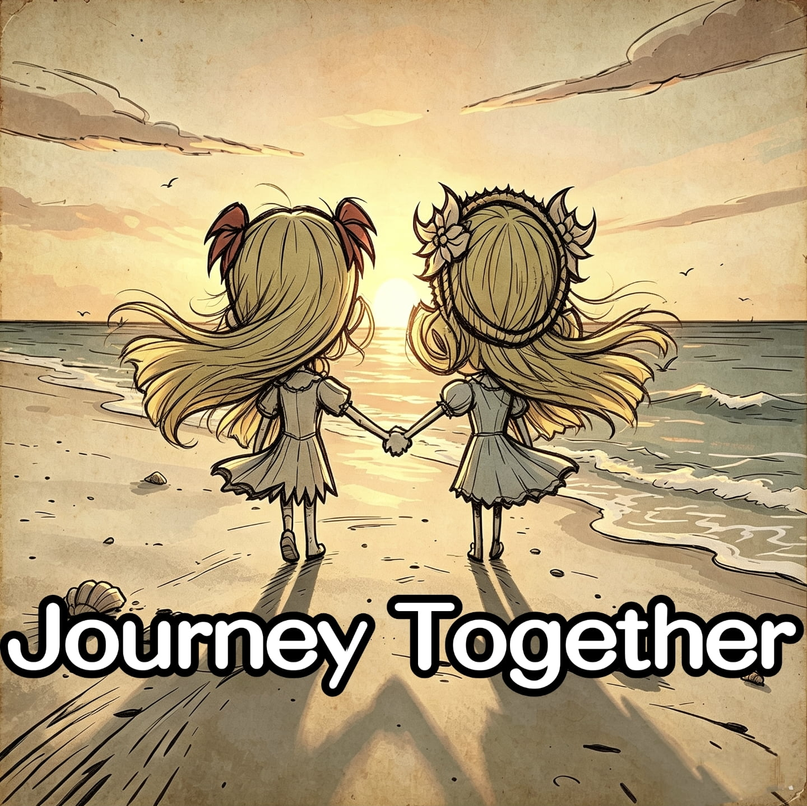

  

<h1 align="center">Journey Together · 一路同行</h1>

  <a href="https://steamcommunity.com/sharedfiles/filedetails/?id=3802676080">Steam Workshop</a> ·
  <a href="player-guide.md">Player guide</a> ·
  <a href="../../README.md">简体中文</a>

Look for Wendy near the Florid Postern when you first enter the Constant. Share a meal and, once she trusts you, ask her to come along. She can dodge a blow, pick up a weapon she dropped, and help plant trees back at camp. Open her panel when you have a quiet moment and you can play a game of Go together.

Journey Together adds a companion to **Don't Starve Together** who can survive and build a base on her own. Your choice of character matters. Wickerbottom remembers where you keep the bookshelves, and Wortox can spend souls to heal himself and injured players. Following, work orders and character abilities all run in the game itself.

## Meet your companion

1. Subscribe on the [Steam Workshop](https://steamcommunity.com/sharedfiles/filedetails/?id=3802676080) and enable Journey Together under **Server Mods** for your world.
2. The host and every player need the same version. On a dedicated server with caves, enable it on both shards.
3. **Alt + right-click** the companion to open her panel. Affinity usually starts at 20. At **25**, you can ask her to follow.

| To… | In game |
| --- | --- |
| Travel together | Press `Alt+R` for the command wheel, or say “Wendy, follow me” |
| Ask her to wait | Say “Wendy, stay here”. Use her current name if you rename her |
| Set up camp | Stand where you want the centre of the base and say “Wendy, this is home” |
| Ask for help with work | Once affinity is **above 50**, give her the right tool and say “Wendy, chop trees” |

Choose Simplified Chinese, Traditional Chinese, English or Russian in the mod settings. Chat keywords follow the companion's language. Keyboard shortcuts are configurable.

If you disconnect during a body exchange, you have 15 minutes by default to rejoin and continue. After that, the companion returns and you can reclaim your body on your next login. [Body exchange guide](player-guide.md#disconnecting-during-a-body-exchange)

## Guides and support

- For source installs, multiplayer, base life, character abilities, board games and troubleshooting, see the [player guide](player-guide.md).
- For optional voice input or model-assisted conversation, see [assistant setup in English](player-guide.md#optional-local-assistant) or the [full assistant manual in Chinese](../../tools/companion_bridge/README.md).
- To report a problem or contribute a translation or code change, see the [contributing guide](contributing.md), [developer reference in Chinese](../DEVELOPER.md) or [issue tracker](https://github.com/Im-Chuyu/Journey-Together/issues).
